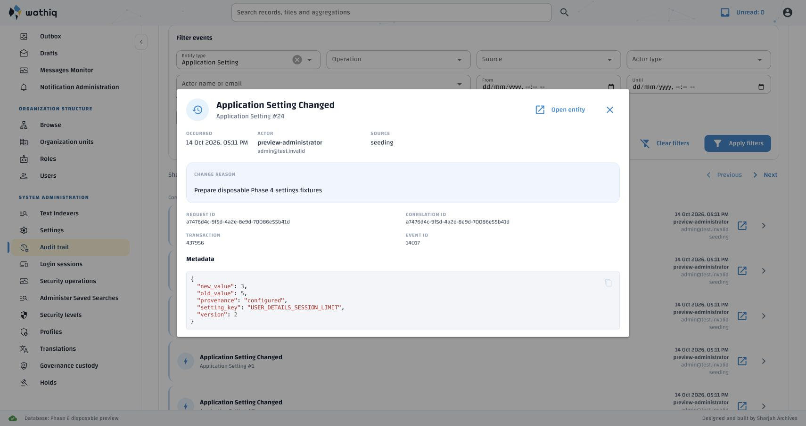
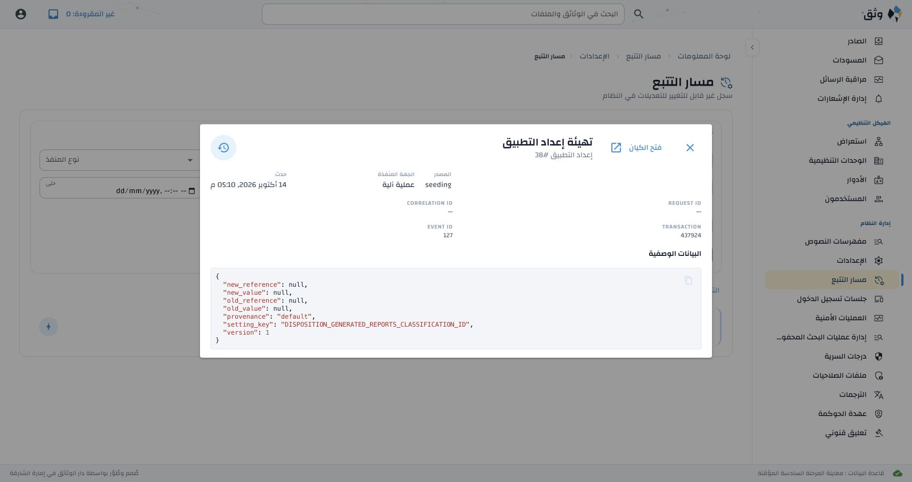

# Application Settings Audit Trail presentation and navigation

User-approved Phase 3 correction, 14 October 2026: Settings operations use the
same readable, translated labels as other audit operations, and their events
offer the existing current-entity action.

| Requirement | Implementation | Passing evidence |
| --- | --- | --- |
| Consistent labels for current and existing events | `event_labels.EVENT_MESSAGE_KEYS` maps `APPLICATION_SETTING_CHANGED`, `APPLICATION_SETTING_SEEDED` and `APPLICATION_SETTINGS_MIGRATION_COMPLETED` to contextual labels. Shared filters, timelines and details already use this resolver. `audit_labels` adds the localized entity type. | Six bilingual real-callback interaction cases cover all three operations; existing export-label regression passes; live English/Arabic filters, rows and details |
| Existing events are fixed without rewriting history | Labels resolve during rendering; technical operation codes, filter values and event metadata remain unchanged. Historical `metadata.setting_key` supplies the Settings target. | Interaction cases compare the original event dictionaries after rendering; live seeded reports-setting event routes successfully |
| Current-entity action opens the applicable Settings category | Shared timeline/detail buttons call `navigate_to_event_entity`; Settings events use guarded `select_application_settings(initial_setting_key=...)`. Settings chooses the category from its normal finite API response. | English session-limit event opens Dashboard and selection limits; Arabic reports-setting event opens Disposition; three target-category tests verify one Settings read |
| Existing authorization and draft-navigation rules remain | `app.settings.manage` gates Settings buttons and the handler; normal navigation guard controls leaving the page. No privilege, generic settings CRUD endpoint or extra lookup is added. | Authorized, unauthorized and declined-navigation cases in both languages; fake generic `api.get` is never invoked |

**32 Settings/audit interaction tests** and **one existing export-label test**
pass. The initial Arabic test looked up its accessible name outside the client
language context; correcting the expected localized name resolved that fixture
failure. No implementation fallback to English was added.

The English and canonical Arabic artifacts now contain **3,192** ordered active
keys, with four new labels:

- `audit.entity.application_setting`
- `audit.event.application_setting_changed`
- `audit.event.application_setting_seeded`
- `audit.event.application_settings_migration_completed`

All **3,188** prior Arabic entries retain their complete wording and provenance.
Coverage, ordering, placeholders, blanks, new-draft quality/provenance, root hashes,
active/stale references and the 29 approved terminology mappings pass. Four new
Arabic drafts were merged by key; no administrator export was promoted.

The four labels were synchronized and published on **demo** under the earlier
pending-translation authorization, through the existing definition/seed and
governed bulk review/publication functions. The actor's existing localization
privilege was checked. Every pre-existing translation row was identical before
and after this operation. Private report:
`/private/tmp/erms-settings-audit-labels-02w65k34/report.json` (0600 in a 0700 directory).
Other databases must seed/review/publish the four new drafts normally.

The live fixture used newly created database
`erms_messaging_test_acl_13ea31e611094fe99b9def867232eae9`, initialized from the
canonical schema and separate seeds. Three Settings entries produced exactly
three Settings GETs, without per-event Settings lookups or Settings PUTs.
Both direction checks used the existing native Audit Trail cards/buttons and
dialog treatment; no table, CSS fallback or cache was added. The preview was
stopped and its database dropped; final read-only catalogue inspection confirmed
cleanup. No test suite targeted a persistent database.

Reload/restart the WebUI to load the changed presentation and navigation code.
This correction needs no schema migration, environment/template change or API
restart. The four demo translations are already published. Stored events remain
immutable; no event-data migration is needed for existing labels or links.
