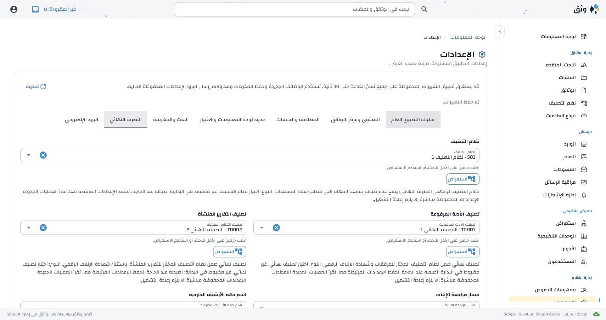
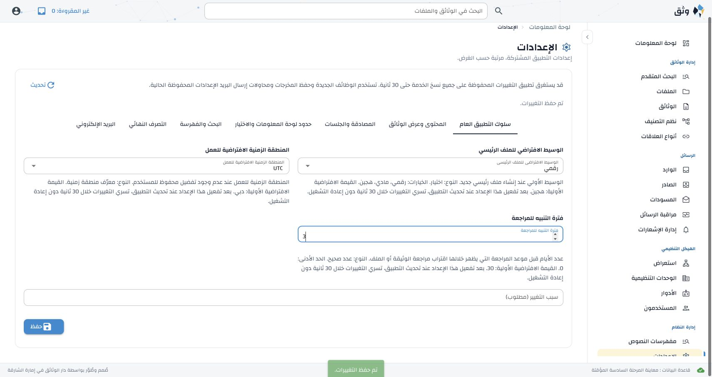
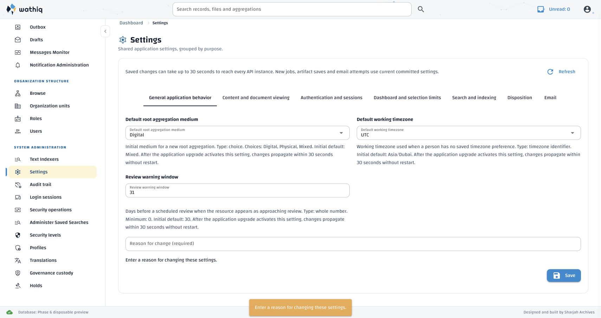

# Application Settings control corrections

User-approved Phase 3 correction session, 14 October 2026. The request requires
an IANA timezone dropdown, integer buttons with step one and minimum one, and
usable scheme-dependent classification search/Browse.

| Requirement | Implementation | Verification |
| --- | --- | --- |
| Default working timezone is an IANA dropdown | Native searchable NiceGUI Select over sorted `zoneinfo.available_timezones()`, matching Personal Preferences | `test_timezone_dropdown_and_exact_integer_steppers` in English/Arabic; browser selects Europe/London, saves it, and Arabic navigation reads it back |
| Every integer control steps by one with a floor of one | Standard NiceGUI Input configured `type=number`, `step=1` and native min/max; browser-owned arrows; string binding and integer submission validation | Same bilingual test covers every integer and its bounds, no custom append buttons, and exact values above 2**53; `test_integer_minimum_blocks_invalid_save_without_rewriting_existing_zero`; browser native stepping/minimum and bigint save |
| Successful saves show a toast | Existing translated `settings.page.saved` message passed to standard `ui.notify` with positive color, after a successful current-page save | `test_successful_save_has_translated_toast_but_conflict_does_not` in English/Arabic; both live browser saves show translated alerts |
| Save without a reason shows a warning toast | Standard warning `ui.notify` reuses `settings.error.reason_required`; inline error retained and previous success status cleared; returns before a save request | `test_missing_reason_warns_without_saving_or_losing_draft` covers English/Arabic, empty/whitespace-only reasons and an earlier successful save; live bilingual warnings retain drafts and issue no Settings PUT |
| Both destinations search after two characters within the selected scheme | Existing bounded RemoteSelect binding retained; destination controls/Browse disabled until a scheme is selected, with existing translated guidance | `test_scheme_first_browse_unlocks_both_two_character_destination_searches` in English/Arabic; both browser searches return terminal choices |
| Scheme selection and Browse are discoverable | Scheme selector is first and spans the two-column grid above both destinations; its Browse lists schemes without requiring a prior selection | Same test selects a scheme through Browse; browser scheme Browse and reports Browse both work; Arabic saves both destinations and reload retains them |
| RTL, freshness, stale requests and translation integrity | Native grid/column/append components; no CSS fallback, cache or new API request; existing selected-ID hydration and stale-response guards retained | Existing settings interaction regressions; live English/Arabic rendering and reload; Arabic 375px has one 261px column and document width 375px |

The first correction composed arrow buttons in the Input append slot. User
feedback identified their misalignment; browser measurements confirmed two
31.98px buttons occupying a 63.95px column inside a 40px field, overflowing by
12px above and below. That composition has been removed.

The final control is an ordinary NiceGUI Input with supported `type=number`
configuration. It uses the same native numeric field/stepper presentation as
NiceGUI Number, retaining Input's string binding because Number's Python event
conversion and blur sanitization use floats. No subclass, separate arrows,
custom component, JavaScript stepping or CSS fallback is added. The earlier
assumption that browser-native stepping necessarily rounded large values was
incorrect: Chromium browser verification preserved the exact sequence
9007199254740993 → 9007199254740994 → 9007199254740993 and an API save of the
original value. The maximum bound is also passed as a string, preserving its
exact PostgreSQL bigint value.
Existing stronger minima (password length 8) and maxima (SMTP port 65535,
segment size 64 MiB) remain. Nullable SMTP port can still be blank for automatic
port selection. These are **form-entry bounds**: no database values are rewritten,
and existing zero-valued review/retention settings remain readable and unchanged
unless edited. The API's descriptions/validation retain their approved legacy
database bounds, including zero where specified; this correction does not change
the persistent schema or the API contract.

Before the correction, the current preview already exposed the scheme selector
and both two-character searches worked after selecting a scheme. No missing
search implementation was observed. The correction makes the dependency explicit
and removes the clickable destination Browse action while its scheme is unset.
An older running WebUI must restart to load the corrected source.

Validation: **23 Settings interaction tests** and **18 relationship/bounded
collection tests** passed, in separate processes. Combining the suites initially
caused six existing relationship tests to run without a NiceGUI slot after the
User plugin reset; running that suite independently passed all 18. A first new
test appended `0` to `30` instead of replacing it; correcting the fixture to set
`0` verified that invalid saves are blocked.

Both maintained catalogues are byte-for-byte unchanged: **3,188** keys, no added,
changed or removed wording, no export promotion, no new review requirement.
Active/stale-key coverage, ordering, nonblank text, placeholders, quality flags,
administrator-export hashes and provenance preservation pass. Approved Arabic
terminology passes across 694 contextual uses of all 29 mappings. The older
machine-draft generator's wording assumptions are inappropriate for the curated
administrator export; its checks were not used to replace any translation.
The API environment template check still passes for all 36 settings; no
environment variable or template changed. `git diff --check` passes.

Browser databases were created from the canonical schema and separate seeds,
then dropped: `erms_messaging_test_acl_ae1bb5d0610a4aadb498c540b7572f8b`
and `erms_messaging_test_acl_b0821e10ed9741739b0b897aea80b6a3`.
Final read-only PostgreSQL catalogue inspection confirms both are absent.
No persistent database was tested, seeded or migrated.

The subsequent native-stepper/toast correction used two additional disposable
previews: `erms_messaging_test_acl_5887ffba2f9e4ee4a6e4e6146b1d2e0a` and
`erms_messaging_test_acl_e108ea2d1c3e4e4f9a712d459924ea1c`. English and Arabic
fields retain 40px height, have no additional button elements, and display
native arrows entirely inside the input. Success toasts reuse the existing
translated confirmation; no catalogue text or provenance changes. A saved
Arabic review-window value of 3 survives reload.
Both additional databases were dropped; final read-only PostgreSQL catalogue
inspection confirmed that they are absent. At 375px, the settled Arabic layout
has a 261px field and document width 375px, without horizontal overflow.

The missing-reason warning follow-up used disposable database
`erms_messaging_test_acl_358e6d7acd294317adad847eb37967d4`, created from the
canonical schema and separate seeds. Empty English and whitespace-only Arabic
reasons produced translated warning toasts and retained the edited values;
the API request log contains no Settings PUT. The database was dropped and
read-only catalogue inspection confirmed its absence. All 23 Settings tests,
catalogue/glossary/hash/provenance checks and template reconciliation pass.
No translation text, key, artifact, environment variable or schema changed.

Deploy by restarting the WebUI; no API restart, database migration or translation
publication is required for this correction.
