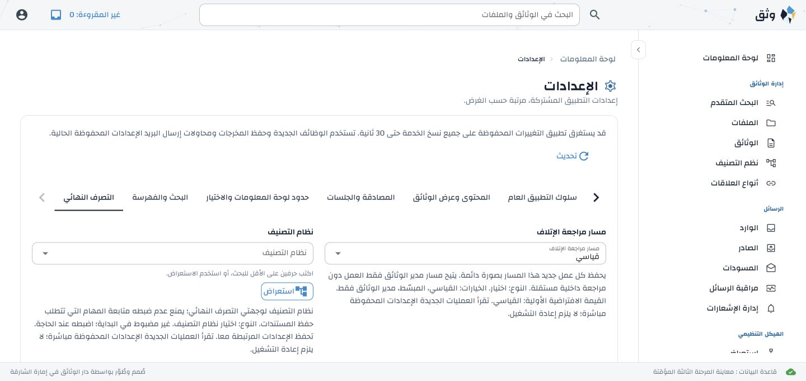

# Disposition Phase 3 implementation and verification

Phase 3 delivers Administration Settings for all 51 database settings and the
required destination warnings on Governance Custody. It uses the Phase 2
registry/API, existing authorization and bounded classification endpoints.

Measured session: 2026-10-14 07:32:00 to 2026-10-14 09:13:34 UTC
(1.69 active hours; no excluded idle interval was recorded). Final completion
bookkeeping follows this captured end boundary.

## Requirement evidence

| Approved contract | Implementation | Passing evidence |
| --- | --- | --- |
| ACFG 5.1–5.7, 7, 8, 10.5–10.6; ADMIN 1–4 | `frontend/webui/application_settings.py`, API client and guarded navigation: seven categories, all 51 controls with visible translated labels/explanations, explicit types/units/bounds/defaults/unset meanings/dependencies/effect timing. Category saves require a reason, use optimistic versions and complete related groups. Conflicts preserve drafts; successful saves refresh only their category and preserve other unsaved categories. | NiceGUI interaction tests for all 51 controls/explanations in both languages, reason/group save, conflict/draft retention, exact bigint precision; Phase 2 API validation/audit/authorization regressions. Browser English destination/reminder save/reload; Arabic reminder save with Arabic reason/reload and selected-tab restoration. |
| ACFG-11; ADMIN 2–4; i18n supporting contracts | Contextual translations, standard native tabs/grids/fields, write-only password replacement and explicit clear/retain behavior. A translated native append-slot clear button replaces the vendor English accessibility label on optional selectors. | English/Arabic browser layouts, password set-state with empty replacement input; interaction tests for secret replacement, cleared replacement after save, translated optional clearing and destination draft reset. Catalogue/placeholder/blank/glossary/provenance/hash checks. |
| ADMIN 2–3/6; DEST 17.2/18.12 and DEST-33/38 settings subset | Two-character server search, bounded 25 results, selected-ID hydration, scheme-constrained terminal choices. Browse displays 25 rows with a 26-row lookahead; each branch has its own offset. Branch clicks navigate; terminal selection performs a fresh individual read. Scheme changes clear both draft destinations and invalidate prior searches. Reuses the existing classification browser card/list treatment. | Real API 1,000-child branch/search checks; NiceGUI root paging, seven deep branches, stale terminal and old-scheme response checks. Browser 28 schemes, 28 branches, 1,000 terminal children and seven deep levels without a complete download. No new table is introduced. |
| ADMIN 5; ACFG-14/15 and DEST-38 configuration-warning subset | `application_settings.destination_configuration/destination_warnings`, `GovernanceCustodyRead`, existing custody route and UI: missing scheme/destination warnings, latest open exact-classification root (`date_opened DESC, id DESC`), root-only/open-only checks. Fresh committed query, no cache fallback. Public warnings contain only setting key and warning code. `app.settings.manage` governs the Settings link; other custody administrators receive contact guidance. | Four new disposable-DB tests: independent missing-setting clearance, changed destinations, closed roots/open children/wrong classifications excluded, latest opening/date tie and authority isolation. Browser warnings change from three unset settings to two missing roots, then disappear after separate open-root fixtures and Refresh. Restricted officer has no Settings navigation or edit link. |
| Performance/design supporting contracts | One finite settings read per entry/Refresh, concurrent unique selected-ID reads, no initial options query, current-page/identity guards, modal guards, stale selector revision protection, nondestructive refresh. Scoped observed RTL correction extends the existing native-component fallback only. | 76 frontend interaction/API client/navigation/heading/bounded-collection regressions; real browser repeated entry/reload, save freshness and request logs. Browser geometry described below. |

Implementation, named test selectors and phase-scoped runs are attached to all
applicable entries in `disposition-requirement-ledger.json`. Multi-phase entries
remain in progress; later task/workflow clauses are not claimed complete.

## Runs and disposable database lifecycle

- API/settings/governance/policy/localization suite: **68 passed**, two existing
  dependency deprecation warnings, 104.79 seconds. Database
  `erms_messaging_test_acl_9149cbf479d44ddcb5afd3cafc866b80` was created from
  `database/schema.sql`, separately seeded, and dropped with `WITH (FORCE)`.
- Frontend interaction/API client/navigation/heading/bounded-collection suite:
  **76 passed** in 10.60 seconds. It uses `--asyncio-mode=auto` and no database.
- Traceability and private-environment reconciliation: **27 passed** in 1.06
  seconds. API template reconciliation, compilation and whitespace checks pass.
- Initial API fixture failure (missing effective retention rule) was corrected;
  its database `erms_messaging_test_acl_715346b5e0354218b00191b393ac1b7d`
  was dropped. Initial preview initialization failure was corrected; database
  `erms_messaging_test_acl_5b57f58e7636405fada58e76c2d33123` was dropped.
- Browser preview databases were created specifically for this phase and cleaned
  up: `erms_messaging_test_acl_441ab3c9ce4447d8944ff1a58955c131`,
  `erms_messaging_test_acl_ff68647db30d470d94bcf710ba97d378`, and
  `erms_messaging_test_acl_d3744ff7022d4dbfa3736d2218b48ea4`, and
  `erms_messaging_test_acl_57e6d051ed6848c8a6f7934af94b67ce` (stable screenshot retake).
  `tools/preview_application_settings.py` owns its API/WebUI processes, unique
  cookie, temporary storage and ephemeral encryption key. Shutdown stops those
  processes and drops its database; separate catalogue inspection confirmed the
  cleanup when a prior terminal session handle was unavailable. Final PostgreSQL
  catalogue inspection confirmed that all seven Phase 3 databases are absent.

No test, seed, migration, translation publication or browser save targets a
persistent ERMS database. Arabic publication and fake credentials in the preview
are explicitly selected disposable fixtures only. No production email is sent.

## Browser, translation and performance evidence

English and Arabic saves persist after reload. Warning navigation opens the
Disposition category directly. The restricted INFO_GOV_OFFICER fixture retains
custody access but has neither Settings navigation nor an edit link. Saved SMTP
password plaintext is never returned or placed into the replacement control;
replacement/clear behavior is checked with disposable API and NiceGUI fixtures.

Native NiceGUI document direction and components were inspected first. Before
correction, Arabic already inherited RTL, but the legacy `.row` rule produced
`row-reverse` in native tabs/fields and physical floating labels used `left: 0`.
After the narrowly scoped existing fallback was extended, native rows use `row`,
Arabic labels have `right: 0` and English labels retain `left: 0`. The form has no
horizontal overflow at 1440px in either direction. At 375px in Arabic, after the
existing responsive drawer settles closed, its grid is one 261px column and the
document width is 375px. Temporary viewport overrides were reset. The native
append slot supplies translated clear controls without a global vendor-locale
change. See `webui-design-language.md` section 19.1.

The large/deep-tree browser run recorded 12 Browse requests, each limited to 26,
with root/parent and fixed scheme filters. One-character input made no search;
changing it to two characters made one bounded terminal-search request. Neither
Browse nor typeahead downloads a full hierarchy. Settings saves use their
mutation response, avoiding a redundant settings GET. Custody warnings arrive in
the existing report response, avoiding a separate settings request for readers
without settings authority. Repeated entry and refresh read current committed
values; three final repeated entries added exactly three settings GETs, with no
API/WebUI error markers. Abandoned metadata/search/modal responses cannot repaint
another page.

Form/reference snapshots are scoped to one page instance, principal and language.
Their key is setting key or `(resource, selected ID)`; there is no global option
cache. Entry/Refresh replaces them from the API; a successful save refreshes only
its category and its selected references. Failure retains the last rendered form
and unsaved drafts. Page/identity replacement makes pending results inert. Other
unsaved categories retain their original versions so concurrent changes remain
visible as conflicts. The API remains the sole setting authority.

The catalogue now has **3,188** active keys, with **47** new contextual keys.
English is sorted and Arabic follows that exact order. All **3,141** prior Arabic
items retain their entire text/provenance, including curated wording. Complete
active/stale-key, placeholder, blank, approved glossary (29 mappings, 694
contextual uses), root hash and new-draft quality/provenance/hash checks pass.
New Arabic wording remains generated drafts requiring explicit administrator
review/publication. No administrator export was promoted or replaced.

## Deployment and remaining scope

No new environment variable, template change, schema migration or operator
configuration is required by Phase 3. Existing Phase 2 migration 050 and encryption
key guidance still apply when deploying to a pre-settings database. Existing
private environment values were preserved. The API and WebUI must restart to
load this code.

Phase 4 supplies reviewed legacy migration/readiness and general/WebUI consumer
cutovers. Content/authentication and search/indexing cutovers remain Phases 5–6.
Actual disposition jobs, task warnings, artifacts, destruction and SMTP transport
remain with their assigned later phases. Settings explanations retain the
approved upgrade-activation timing for consumers awaiting those cutovers.
