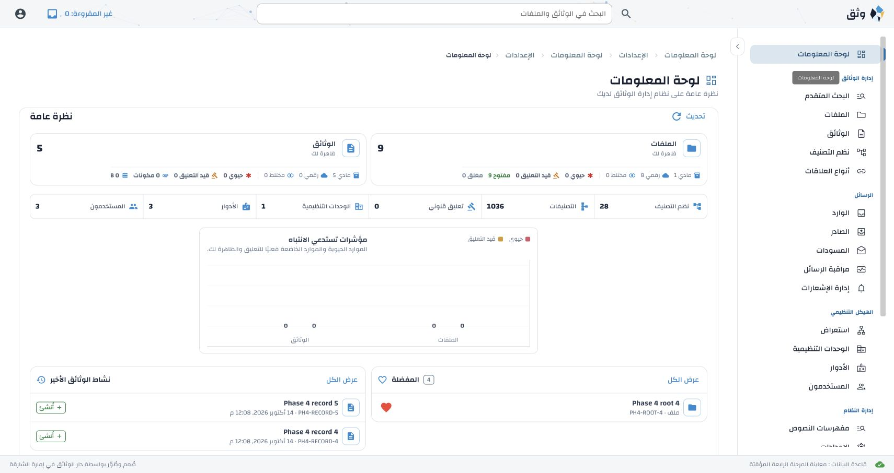

# Disposition Phase 4 implementation and verification

Phase 4 moves the nine general application and WebUI settings in Application
Configuration sections 5.1 and 5.4 to database-only runtime consumers. It adds
the reviewed offline migration and startup readiness gate, reusing the existing
registry, authorized Settings editor, optimistic updates, audit and cache.

## Requirement evidence

| Approved contract | Implementation | Passing evidence |
| --- | --- | --- |
| ACFG 5.1/5.4, 10.2/10.3/10.6; ACFG-02/04/08 | API timezone, root medium, review window, dashboard limits/lookback, recent-classification window and user-session pages use registry values. WebUI helpers require API configuration, with no environment/default authority. A finite authenticated nine-key response supports creation/detail pages; bootstrap, dashboard and favourites carry the same bounded subset in existing requests. | `test_runtime_timezone_medium_dashboard_and_public_subset_ignore_old_env`, `test_recent_selector_and_session_pages_use_runtime_limits_without_large_downloads`; WebUI configuration/API client/entity regressions. |
| ACFG 9–9.3; ACFG-03/16/17 | `tools/migrate_application_settings.py` explicitly targets one database and one legacy file. Preview is read-only; apply requires the reviewed plan, current authorized person and reason. Configured values, including deliberately configured defaults, are preserved. Invalid/conflicting values require explicit decisions. Source/target/version changes reject the plan; values, audit and per-key completion commit atomically. Completed reruns ignore later legacy edits. | Phase 4 migration tests cover preview/apply, private-file byte equality, conflicts, invalid inputs, authority, stale plans, audit rollback, second-database isolation, CLI readiness and real API startup before/after completion. CLI unit tests cover safe connection failure and source/plan path collision. |
| ACFG 6/7/10.9/12; ACFG-05/06/07/09/12/13 | Existing validated 30-second API cache and complete registry remain authoritative. Current process invalidates after changes. Migration reads committed values directly. Public configuration contains only the nine non-secret UI values; no deployment/SMTP fields. Migration checks effective `app.settings.manage`, without granting privileges. | Existing settings cache, atomic-save, secret protection, authorization, localization and policy regressions in the 125-test API run. |
| i18n and performance supporting contracts | Saved timezone preferences retain precedence; only fallback preferences follow shared-default changes. No persistent business-settings copy or new WebUI cache. Independent modal/detail reads run concurrently. Dashboard needs one summary request and no separate configuration read. Session and classification controls retain bounded server windows. | Seven English/Arabic NiceGUI bootstrap/fallback tests; bounded collection, navigation, abandoned refresh and API client regressions in the 227-test WebUI run; live evidence below. |
| ACFG 10.7; ACFG-10 | Nine obsolete environment entries removed from root/API/WebUI templates. API authoritative/generated copies agree. Local launcher checks readiness before affected services, without importing values. Deployment-owned settings and private environment files remain intact. | Template checker verifies 61 API settings; 29 traceability/local-environment/CLI tests pass. |

Configured positive limits remain maxima, with bounded transport windows rather
than unbounded downloads. Explicit API pagination overrides retain their existing
bounds. Large valid day values saturate date arithmetic safely without inventing
a registry upper bound. The old recent-classification WebUI helper is no longer
used by the redesigned workspace; its existing API endpoint now enforces the
configured recent-selection window without adding a new UI workflow.

## Verification runs

- API regression: **125 passed**, two existing dependency deprecation warnings,
  108.88 seconds. It includes 11 Phase 4 tests plus settings, localization,
  catalogue, policy, favourites, organizational ownership, medium,
  classification and privilege regressions.
- WebUI regression: **227 passed**, 21.47 seconds, using `--asyncio-mode=auto`.
  Targets include entities, API client, Settings interactions, collection refresh,
  Phase 4 configuration, bounded collections and navigation history.
- Traceability, local environment reconciliation and CLI safety: **29 passed**,
  1.04 seconds. An earlier run found stale supporting i18n source locators;
  deliberate source reconciliation corrected them before this passing run.
- Catalogue references and approved Arabic terminology pass: 29 glossary
  mappings across 694 contextual uses. Phase 4 adds no UI keys or translations.
  All 3,188 prior Arabic items retain complete wording and provenance. Only the
  artifact root specification hash changes to reflect the reconciled supporting
  specification. The 47 existing Phase 3 drafts still require administrator review.

All database-backed runs initialize a unique disposable database from the
self-contained canonical schema and separate seeds. The final API database
`erms_messaging_test_acl_a0cb012d539a49a5950a905e57d9c836` and isolation database
`erms_messaging_test_acl_8cf840c00a4f4c899f99070fcf140fae` were created and dropped.
Earlier corrected runs also dropped their databases:
`erms_messaging_test_acl_3d239550895c4e23828b7e2bd7984b5e`,
`erms_messaging_test_acl_81fddefa084b47e6b50a0a8a488f4568`,
`erms_messaging_test_acl_359d9a11f3d2495b887df462e0e16300`,
`erms_messaging_test_acl_0ea3f62873534094802f94d72df050dd`, and
`erms_messaging_test_acl_c7914a89325d485f9ebdd42e1e0c44fc`.
Initial failures were a nonexistent test target and incorrect audit actor fixture;
both were corrected. Sandboxed connection attempts created no database.

## Runtime scope and deployment

English live checks verified customized limits, UTC-to-Tokyo fallback display
without restart, and three-row session pages with a separate final page. The
fresh current-code sign-in made one bootstrap and one dashboard summary request.
Arabic verified the same initial limits, then saved favourite/recent/review
preview limits of 1/2/1; the next dashboard entry and repeated navigation showed
those exact windows. Saving a shared Tokyo default preserved the user's explicit
UTC preference, including localized timestamps. Body and main computed direction
were RTL, with document width equal to scroll width at 1710px. Existing components
and layout were retained; no new table or CSS fallback was introduced.

The final Arabic run recorded four summary requests for four dashboard renders,
two settings reads for two entries, two successful saves and no separate
configuration request. Three bootstrap requests covered initial sign-in and the
language preference update/rebuild. Existing refresh-abandonment and principal
guards are also exercised by the frontend regression suite. Neither API nor
WebUI logs contained error/traceback markers.

Preview databases `erms_messaging_test_acl_e801c98bffba4d5d9ad71632928bcdcd`,
`erms_messaging_test_acl_da4f6a3153f2493a9002943203e38cd8`, and
`erms_messaging_test_acl_8ef2fc209f864ab0974ec0d0eac95fe5` were created and dropped.
The preview runner owns temporary storage, fake identities, separate cookies,
ephemeral encryption keys and server processes. Final read-only PostgreSQL
catalogue inspection found no remaining disposable ACL-test databases. No
persistent database was tested, seeded, translated, migrated or changed.

The reused API cache has one complete non-secret snapshot per database/process,
keyed by registry setting key, with 30-second freshness and local mutation
invalidation. Failed refresh retains only a previously validated snapshot;
startup and direct migration reads fail closed. It contains no identity/language
rendering or credentials. WebUI configuration is transient per authenticated
page state, replaced by current bootstrap/page responses, and guarded against
abandoned page/identity responses. Failure retains rendered content; no browser
storage becomes a business-setting authority. Saved locale metadata is separate.

Operators upgrading an existing database must preview and apply the nine-key
migration **before starting the affected services**, following
[application-settings-upgrade.md](application-settings-upgrade.md). Fresh
installations without legacy entries use canonical defaults. The local launcher
requires review when its selected legacy file contains affected settings. The
private `.env` is never rewritten by this migration. Restart API/WebUI to load
the new code; later setting edits use the existing cache convergence contract.
No new environment variable, schema migration, persistent database change or
production email is introduced by Phase 4.

The older i18n section 6.1 environment ownership/schema-default prohibition was
reconciled to the newer approved ACFG section 5.1 database ownership and canonical
Asia/Dubai default. User-selected timezones still win. Other configuration groups
remain assigned to Phases 5–6; disposition jobs and destruction remain later work.

## Timing

First session started at 09:16:16 UTC and stopped at approximately 11:24 UTC on
14 October 2026 at the user's request. The second ran from 12:06:39 to 12:13:42
UTC. Active time totals **2.25 hours**; the approximately 0.71-hour offline gap is
excluded. The initial stop boundary is reconstructed from the resume note and is
explicitly approximate. Final completion bookkeeping follows the captured end.
