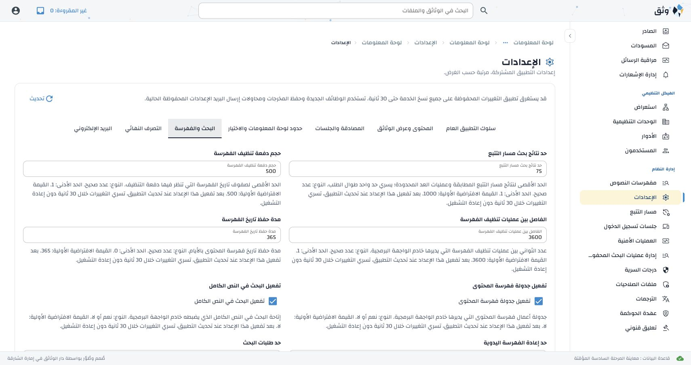

# Disposition Phase 6 implementation and verification

Phase 6 completes database ownership of the ten API search/indexing settings,
including the editable Audit Trail result cap. The reviewed migration now has
34 keys; earlier completion markers and configured values remain protected.
The separate WebUI full-text flag is removed. API, UI visibility, scheduling,
rate enforcement, history retention and maintenance use the same registry.

## Requirement evidence

| Approved contract | Implementation | Passing evidence |
| --- | --- | --- |
| ACFG 5.5/6/10.2–10.4; ACFG-02/05/06 | Cached search availability in structured/global search and health; API session context supplies scheduling. Middleware captures effective request rates using its existing authenticated connection. Credential history pages and indexing cleanup/reconcile use database defaults. | Seven Phase 6 integration cases plus full-text grammar/ranking/ACL/reindex, indexer lease/publication, credential and cleanup regressions. Defaults false, conflicting/invalid old environment ignored, runtime flag/rate changes, retention/interval/batch overrides and initial-load failure are verified. |
| ACFG Audit Trail requirements | `search_rows` captures one effective cap before count work and retains it for count lookahead, truncated total, last-page bound, offset rejection and `result_cap`. Valid large caps avoid bigint lookahead overflow. | Concurrent cap change during a count retains the captured cap; invalid zero/negative/noninteger/bool updates reject. Audit suite exercises default/custom cap, pagination/refinement, conservative actor predicates and indexes with 50,000 disposable events. |
| ACFG 9/10.7; ACFG-03/16/17 | Existing preview/apply extends to search keys; removed UI alias is reported but never imported. API legacy flag is the shared source. API and all affected standalone cleanup workers block unreviewed upgrades. Root/API examples and bootstrap assignments remove database keys. Local bootstrap uses append-only reconciliation. | Search extension/rerun preserves earlier values and customized cap; existing Phase 4 and Phase 5 migration/readiness regressions; index worker upgrade failure then completion; private bytes/empty assignments/0600 permissions/idempotence in local-bootstrap test. |
| ACFG 10.6; ACFG-08/11 | Finite UI configuration adds only the API feature flag to the nine existing values, piggybacked on bootstrap/dashboard/favourites. Header waits for API configuration, handlers remain bound, signed-out state clears visibility. No frontend environment authority/cache or per-widget request. Existing API registry category grouping remains explicit. | 223 frontend regressions, English/Arabic actual NiceGUI visibility transitions, current-page refresh and abandonment regression tests, and bilingual live checks below. |
| ACFG 10.7/11; ACFG-01/09/10 | `configuration-authority-inventory.json` records 117 settings with one owner, contract/default, service/restart, consumers and templates. Includes all 51 database keys, approved deployment keys and separately approved Messaging deployment controls. Indexer process/extraction settings retain deployment ownership. | Authority checker rejects unknown production readers/template assignments and database keys in environment templates; exact current artifact/closed inventory test, API template synchronization, complete registry/category and translation checks. |

## Canonical schema and upgrade

`051_database_indexing_policy.sql` replaces the existing scheduling function.
An API-provided session context follows its validated cached snapshot. When that
context is absent, direct database writes consult the saved setting rather than
assuming scheduling is enabled. Missing policy fails closed. Migration 051
changes one function and records its version, without altering content, settings
or privileges. The complete canonical schema repeats that definition and does
not invoke any migration. Tests compare the canonical function after applying
051 twice; the Phase 2 settings DDL parity check remains exact apart from the
explicit new schema-version bookkeeping row.

## Verification and database lifecycle

- Search/indexing/migration/API regression: **36 passed**, 35.81 seconds, two
  existing dependency deprecation warnings. Database
  `erms_messaging_test_acl_d649da21afa5454596298e0616210590` created/dropped.
- Final Phase 6 and settings/Phase 5/localization/policy integration:
  **63 passed**, 50.86 seconds. Database
  `erms_messaging_test_acl_d9254ec636234208bedec837a6e1f640` created/dropped.
- Audit Trail suite: **14 passed**, 118 deselected, 7.92 seconds. Both canonical
  disposable transfer databases were dropped:
  `erms_transfer_test_f146b4a67bcf42ee_source` and
  `erms_transfer_test_e3e6c36bdfb44610_destination`.
- Frontend: **223 passed**, 18.41 seconds. Source/interaction/API client checks
  include entity consumers, full-text UI, bilingual configuration and abandoned
  collection refresh. An initial reordered run exposed an existing uploader test
  depending on a NiceGUI slot; the established entities-before-interactions order
  passed without a production-code change.
- An initial collection error was an unused test import, corrected before the
  passing API runs. Its database
  `erms_messaging_test_acl_403937fa2fd040989fc035fb0c25446b` was dropped.

Every database run uses uniquely named disposable databases initialized from
`database/schema.sql` alone and separate seeds. No persistent database was tested,
seeded, migrated, translated or changed. No production email was sent.

## Browser, cache and translation evidence

English: initial authenticated bootstrap showed enabled header search. Saving
false and returning to Dashboard hid it after the fresh response. Arabic:
bootstrap remained disabled, saving true restored header search on Dashboard,
and returning to Search and indexing retained Audit Trail cap 75. The native
category and explanations remained translated, body direction was RTL and
1710px document width equalled scroll width. No layout/CSS/table is added.

The run recorded four dashboard summaries for four renders, three Settings GETs
for three entries, two successful saves and zero separate configuration GETs.
Three bootstraps covered sign-in and language preference/rebuild. API/WebUI logs
had no error markers. The owned preview processes stopped and database
`erms_messaging_test_acl_18df36c47655456aa970f7412cd02b0a` was dropped.

No new cache is introduced. The existing complete non-secret API cache is scoped
to logical database/process and has 30-second freshness from successful load,
local post-commit invalidation, serialized reload and only validated-snapshot
fallback. One-shot workers read fresh; watch passes re-evaluate cached defaults.
Migration/completion checks remain committed reads. UI values are transient
page/identity state replaced by guarded ordinary API responses; they are not
persisted as business authority. API enforcement is authoritative while visibility
is awaiting a fresh page response. Existing rate windows retain their established
scope; only their limit source changes.

Phase 6 adds no visible text/key or Arabic artifact change. All 3,188 maintained
items and complete provenance remain intact; existing Phase 3 generated drafts
still require administrator review/publication.

## Operator action and remaining work

Stop affected services, apply missing migrations 050 then 051, and review/apply
**a new 34-key preview** before starting upgraded services. See
[application-settings-upgrade.md](application-settings-upgrade.md). Initialize new
empty databases from the canonical schema alone. Private `.env` files are never
rewritten by migration or bootstrap reconciliation. No new environment variable
is added. Operators may deliberately remove obsolete entries after verification.
Restart API/WebUI/maintenance to load code; later settings edits need no restart.
Fresh scheduling/search defaults remain false; enable deliberately through Settings
after the documented readiness/quality checks.

`WEBUI_FULL_TEXT_SEARCH_ENABLED` has no database row or runtime authority.
Messaging deployment controls retain their separate approval. The unused
`CONTENT_DOWNLOAD_DB_BATCH_SIZE` has no current consumer/template, so no variable
was invented. `PATH` is host executable infrastructure; localized database display
names use their approved deployment pattern. Phase 7 begins actual disposition
persistence and protected transitions; Phase 6 does not implement those workflows.

Final authority/traceability/cache/local-file/CLI checks: **46 passed** in 2.15
seconds. API templates agree for all 36 remaining API environment readers.
Complete translation preservation, catalogue references, 694 uses of all 29
glossary mappings, source syntax, current route policy and whitespace pass.
Final read-only PostgreSQL catalogue inspection confirms all six Phase 6
disposable test/preview databases are absent.

Measured session: 14 October 2026, **13:22:58–13:51:03 UTC**, **0.47 active hours**,
no excluded idle interval. Final completion bookkeeping follows this boundary.
