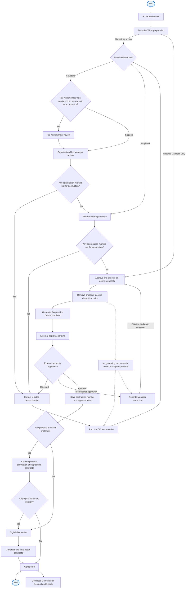

# Destruction workflow reference

Job details → History shows one entry per recorded action. A submission appears
as **Review round N submitted**; its details show the actor, time and comments
once. Expand **Recorded changes (N)** to inspect paginated changes, including
tasks completed/created, workflow changes and each carried proposal with its
affected aggregation. Review decisions, saves, membership changes, assignment,
evidence, termination and completion use the same grouping when recorded command
correlation is unambiguous. Separate actions remain separate; restricted events
keep their redacted envelopes inside an action. Every original audit record is preserved; the global Audit Trail and
revision histories retain individual events with clearer change labels.

Second and later review tasks include collapsed **View previous rounds** below
the latest submitted comments. Opening it shows previous submission comments
and decisions, with author, time and round. It loads on demand; full job history
remains in Job details.

The existing history API accepts `grouped=true` for server-paginated action
summaries; omitting it retains the raw-event contract. A summary's representative
event ID opens `jobs/{job_id}/history/{event_id}/events`, a separately authorized
25-row page (maximum 50) of its original events. No shared history cache, schema
migration, workflow transition or audit-data rewrite is involved.

The job workspace uses a compact stage tracker. This full branching diagram is
a documentation reference; actual routing follows the job’s saved review route.

**My tasks** has an always-visible **Refresh** button below its collapsible
filters and above the table, aligned left in English and right in Arabic to
match Eligibility and Jobs. It retrieves assignments using the current
filters, sorting and page size, returning to the first page without expanding
the filters or reloading the application.

The standalone **Disposition Eligibility** page opens as a browsing view without
selection instructions. The job's **Add aggregations** dialog retains its
job-specific selection guidance.
Selecting aggregations on the eligibility page enables Add only when they share
a disposition type and their owning units share an organizational ancestor.
An inline warning explains mixed types or disconnected organizational branches;
correcting the selection clears it. This happens before choosing or creating a
job. Records Unit and Audit Office can share a job owned by their nearest common
ancestor, such as the GM's Office.
The destination chooser shows the matching disposition type and, for destruction,
only jobs owned by that exact nearest common unit. Higher-parent jobs are not
shown. New-job creation prefills the disposition type and nearest common owning
unit and explains the suggestion. The existing job-scoped picker continues to
enforce its saved job's scope; a Records Unit job cannot admit Audit Office
material merely because a broader job could contain both.
For a new **Standard destruction** job, Save is disabled until the owning unit
has an effective File Administrator role and its own managing role, each with a
current assignment to an active person. The nearest configured File Administrator
role may be inherited; a parent's managing role does not count. A nearer empty
File Administrator role cannot fall back to a staffed ancestor role. Multiple
assignees are allowed. Future/expired assignments, inactive people, service
accounts and inactive roles or organizational branches do not count.

Inline warnings identify the needed File Administrator, Unit Manager or both,
and direct the user to the System Administrator. They use the same simple
wording whether a designation is missing or has no current assignee. Changing the owner rechecks readiness;
Save remains disabled while that check is pending or fails. The database also
checks on creation, including when the form's preview became stale. A stale
readiness rejection refreshes the role facts and disables Save if a role or
assignment is now missing. A failed
creation leaves no partial job/task or reserved job number. The gate covers
standalone creation as well as creation from a selection. Other review routes/types retain their rules. Existing-job exceptions are
documented below. Access, clearance and reviewer
eligibility are still checked again at submission and routing.

Existing installations must apply migration
`103_standard_destruction_owner_roles.sql` before deploying the updated UI/API.
New databases get the same functions and trigger directly from `schema.sql`.
The migration does not rewrite or invalidate existing jobs.

### Reviewer setup after a job has been created

The Jobs list marks affected Standard destruction jobs **Review setup needs
attention**. Open the job/task for the needed reviewer(s) and a direction to
contact the System Administrator. Checks run on page load and the existing
**Refresh** button. There is no background monitor or new job state. Forward
review actions are disabled when the remaining reviewer setup is unavailable;
authorized Save and return for correction remain available.

These exceptions are deliberate and must be preserved:

- **New job:** both required roles must be designated and currently staffed
  before Save, including an empty Standard destruction job.
- **Existing job before File Administrator routing:** if no File Administrator
  is designated anywhere on the owning unit's ancestor chain, the original skip
  to Unit Manager review remains. This absence alone must not show a warning.
  An ancestor designation still counts normally. A configured but inactive or
  unstaffed nearest role blocks; it is never treated as absent or bypassed.
- **An existing File Administrator task:** losing its setup does not cancel or
  reroute it automatically. The System Administrator must restore appropriate
  setup; existing reassignment and task-eligibility rules remain authoritative.
- **Unit Manager:** the job owner's own designated and staffed managing role is
  always needed while that review remains; no inheritance/skip is introduced.
- **Reviews already finished or skipped:** losing their setup does not reopen
  them. At Unit Manager review, only Unit Manager setup is checked; from Records
  Manager review onward, neither earlier setup produces these warnings.
- **Terminal jobs and other routes/types:** no new reviewer-setup warning.
  Current task authority, claims, resource access and clearance always remain.
  File Administrators do not gain a Reject action; Save also remains subject to
  their own current task authorization.

For either technical cause, use these simple messages with the unit name:
“A File Administrator needs to be assigned for {unit}. Contact the System
Administrator for help.” / “A Unit Manager needs to be assigned for {unit}.
Contact the System Administrator for help.” When both are missing, combine the
reviewer names in one sentence. At creation explain that the Standard job cannot
be saved until resolved. On an existing job explain that the review cannot
continue and that authorized work can still be saved. After the administrator's
fix, Refresh clears the warning and enables progression; the command independently
checks live facts, so stale pages cannot bypass the rules.

Deploy migration `104_remaining_review_readiness.sql` after 103, together with
the matching API/WebUI. It changes private validation/read functions only;
no job/task/history data or route is rewritten, and the routing function is
unchanged. Fresh databases use standalone `schema.sql` and separately register
the matching baseline. No environment setting or new worker is required.
English and Arabic messages are included; new Arabic drafts need review before
publication. See [reviewer setup verification](verification/review-setup.md).
The full normative exception table is in Destruction Process §5.1.1.

In a job or task workspace, the Aggregations tab's **Search aggregations**
field searches only memberships of that job. Press Enter to match aggregation
number or title, owning organization unit name, or classification code or title.
Matching is case-insensitive and accepts partial text. It does not search the
job number or the other table columns. The field displays this scope as a hint
in English and Arabic.

The tab automatically shows the aggregations retained in the job, including
units already processed while the job awaits completion. Completed and terminated
jobs retain their aggregation lists. Removed aggregations are excluded, including
earlier removal episodes of a subsequently re-added aggregation. There is no
Membership dropdown or Show removed option; removal decisions remain in History.
**Add aggregations** appears beside this tab's heading, in both job and task
workspaces, when the current user and stage permit additions.

Individual and bulk removal keep the workspace on **Aggregations**, preserving
the search, sorting and page size. The current page is retained
when valid; an emptied last page moves to the preceding valid page. Refreshing
after a bulk-removal conflict preserves the same view.

The effective retention-rule source is a short clickable label, such as
**Classification · 1431** or **Local override**. Open it to see the full defining
source, both periods in years and the disposition action. A nonzero **Review
proposals** count opens that aggregation's existing proposals dialog. Zero is
plain text. All disclosures retain current authorization and server pagination.

Proposals are saved immediately when **Add proposal**, **Update proposal** or
**Withdraw** succeeds. Selecting several relationships saves their individual
proposals atomically. Cancel only discards unconfirmed editor input. Saved
proposals remain unapplied until authorized final approval; a proposed hold, for
example, does not become a real hold yet. The member counts refresh from the
server after each successful operation, without losing the current tab or comments.

**Save changes** and **Review changes** remain in the shared sticky footer for
unsaved Review comments. Adding/updating/withdrawing a proposal does not save those
comments. Failed proposal writes keep the editor open; failed comment saves keep
the comments. Exact retries reuse the command ID, and stale versions require
resolution rather than overwriting someone else's work. Confirmed proposal
operations each retain their individual attributed history event.

Every proposal reason, including removal-from-job, is explicitly **optional**.
Review comments are optional on Save, Submit, Complete review and Approve. They
are **required when rejecting or returning for correction**, and the field's
label/helper explains this before the user acts. Subsequent reviewers retain
prior reasons and do not need to repeat them. These changes do not alter task
ownership, claim checks, visibility/redaction, removal/correction routing or the
Records Manager's complete-set approval and current execution authority.

Review proposals use six columns: **Target**, **Proposed change**, **Status**,
**Proposed by**, **Reason**, and **Actions**. Proposed by combines the original
author and role; the review round appears above the table. Descriptions name
the proposed security level, relationship type and related item, retention
periods/action, or selected holds. The first three hold labels and a remaining
count keep large selections compact; Details retains the complete list.

Workflow stage and audit metadata remain in Details and revision history.
**Proposed at** is the original creation time; **Last revised at** identifies
the latest actual revision. **Not revised** means no revision was recorded.
Carrying an unchanged proposal into another review round preserves that state
and its original author/time. No proposal or audit history is rewritten.

The proposal dialog has **Details** and **Revision history** tabs. Details puts
the target and state at the top, compares recorded current and proposed values,
and shows the reason directly. Relationship endpoints have separate **From** and
**To** labels. Expand **Proposal information** for submission/revision metadata
and background values. Comparison panels stack on smaller screens, and Close
stays reachable while the body scrolls.

Revision history loads on demand in server pages. Expand a dated action to see
its reason and readable **Before/After** values. **Recorded information** retains
the remaining permitted audit metadata; technical details retain their existing
privilege gate. This keeps revision inspection in the same dialog. Returning
to the history tab refreshes its page; closed/abandoned dialogs ignore delayed
responses.

## Reading review rounds on Job details

After a return, the single tracker highlights correction work and says
“Preparing review round 2” (or the next round). The return notice shows who
returned it, when, from which stage, and the reason. Expanding “View previous
rounds” shows recorded submissions and decisions, not a second tracker.
Unreached stages are omitted. Use “Load earlier rounds” for older history.
The next immutable round is created only when submitted or approved through
the existing workflow. Previous rounds and their decisions remain unchanged.

## Recovering a reopened member

Reopening an aggregation preserves its job membership and blocks progress. An
authorized IGU can use **Accelerate disposition eligibility** on the aggregation
to close it and restore its existing job's pending status when its current
retention action and organizational scope remain compatible. The reopening
flag clears atomically. Removal and re-addition are unnecessary. Ordinary
reclosure alone does not restore the member.

Existing blockers and closure restrictions remain. Recovery does not advance
the job or resume destruction, and approval validity follows the existing approved-facts comparison. Exact
restoration may retain approval; changed approved facts use the existing
correction/return flow. Saved preparation proposals remain in place. Explicit removal remains
available for incompatible members. See the
[approved amendment and upgrade guide](disposition-in-job-acceleration.md).

## Correction comments and Simplified review additions

The current correction task shows the actual latest return comments, reviewer,
stage, round and time above the Officer's own editable comments. The original
text is read-only and retains line breaks. Earlier comments and decisions remain
in history. This reuses the authorized preceding-round projection inside the
existing review-work response, without another browser request.

During **Simplified** Records Manager review, the Manager holding the current
claimed task may use **Add aggregations** in its Aggregations tab or Job details.
The usual eligibility, whole-unit, ownership, protection, access, assigned-Officer
and one-active-job checks apply. Addition uses the current task role, preserves
saved work and the review round, and does not execute proposals or grant immediate
removal rights. Save pending review comments before opening the selection dialog.
Adding aggregations refreshes the job; final approval covers all current members and proposals. Original submitted
units must still be unchanged. The original submission snapshot is retained.
Standard review still requires correction/resubmission for additional units;
Records Manager Only preparation/correction remains unchanged.

Deploy migration `094_simplified_review_additions.sql` to an existing database,
then restart API/WebUI. A new database uses the canonical schema and baseline.
No configuration or privilege change is required. Catalogue synchronization
adds the Add aggregations message and one unpublished Arabic draft for review. See the
[verification and requirement mapping](verification/simplified-review-and-correction.md).

## Adding aggregations from a job

**Add aggregations** in Job details or Current task opens a selection dialog
inside the job. Its heading identifies the job; a destruction job also shows
its owning unit and descendant-unit scope. It lists only compatible, closed
aggregations without admission blockers or another active job, accessible to
both you and the assigned Preparer. For destruction, ownership must fall within
that subtree. Search by number/title and due-date filters narrow the results.
The general Disposition eligibility page remains available separately.

The centered dialog fits its contents, up to 1,100px wide and 75% of desktop
screen height. Its heading and buttons stay visible while the body scrolls.
Phones use nearly the full available screen, with margins.

Relationships do not prevent addition. The warning identifies candidates whose
links may need resolving before final disposition without exposing related
resources. Adding candidates does not waive later approval or destruction checks.

Select up to 100 aggregations and click **Add selected (N)**. They are saved
immediately; another Save is unnecessary. Full success returns to the job's
updated Aggregations tab, showing the first page of active members without an
old search hiding the additions. If some additions fail, valid additions remain saved
and the dialog displays the result summary and **View failures** details, with
refreshed candidates and cleared selection. Close the dialog to return to the
updated job. Refresh/filter changes clear selection; paging preserves selected
versions. A connection problem offers a safe retry of the same addition; a
definitive conflict requires refreshing and selecting again.

Existing guards for unsaved review comments remain. Opening/cancelling the
picker does not save comments or submit the task. No database migration, new
privilege, application setting or environment change is needed. Deploy/restart
API and WebUI together; the existing eligibility read accepts optional `job_id`
and bounded `query`, and the existing membership command is unchanged. See
[verification and requirement mapping](verification/job-scoped-selection.md).

## Emailing the destruction request

During **External approval pending**, **Current Task** offers **Send by email**
beside **Preview request** and **Download request**, with the configured
recipient and latest sending attempt. The Records Manager or assigned Records
Officer sends deliberately; approving proposals and generating the form do not
send mail. Sending leaves the task open for the authority's received decision.

The action shares retry/busy state and the latest-attempt summary with
**Evidence and documents**, which retains full **Email attempts** history.
Existing server authorization controls visibility and sending. No new API,
privilege or setting is introduced; existing English and Arabic keys are reused.
See [request email verification](verification/request-task-email.md).

## Emailing the digital destruction certificate

In **Current Task**, the final certificate section offers **Preview certificate**,
download and **Send by email** together, shows the configured recipient and
latest recorded attempt, and explains that sending is optional and remains possible after completion.
**Preview certificate** opens the exact saved certificate in the standard
document viewer when the user currently has component-view permission. It does
not download, regenerate, send, or complete anything, and is also available
from the completed job workspace. **Complete this task** completes the final
task and job without sending mail.
The same send action and full **Email attempts** history remain in **Evidence
and documents**. Both buttons share one pending retry identity; switching tabs
after an uncertain response does not create a second submission. An acknowledged
later send is a new attempt. SMTP acceptance is not confirmed delivery.

The workspace includes the authorized document's latest attempt. Refreshes use
the existing paginated email-history endpoint with optional `document_id` and
`limit=1`. Hidden or abandoned pages do not poll; visible pending attempts stop
polling at a terminal result. Existing role/document checks remain authoritative.
No migration, environment setting, privilege or automatic email was introduced.
See [verification and catalogue details](verification/certificate-task-email.md).

## Collecting material for physical destruction

The preparation report now groups physical and mixed aggregations by their
effective current collection location. Each row has a running serial number,
aggregation number/title, classification code, medium and current location.
A differing assigned location appears underneath. Missing current locations
are listed last under **Locations to verify**; an assigned location never
implies that the material is currently there. Inherited locations still apply.

The organization is prominent, with the same Disposition organization override,
localized root-unit fallback and values-language setting as the destruction
request. A common owning unit appears once; different owners appear per row.
The compact header contains the human job number, generation time and report
version. One totals line counts each aggregation/record once. Detailed
descendant counts and integrity checksums remain in the saved source snapshot.
Physical/mixed descendants remain included even beneath digital parents.

New reports use the checked-in v2 template. Restart the API after deployment to
refresh its immutable default-asset cache. Existing issued PDFs and v1 assets
remain available; choose **More → Create updated report** on an eligible active
physical-destruction task to save a fresh report using current facts. An
administrator-uploaded template continues to take precedence over repository
defaults. No migration, environment setting, privilege or new UI message key is
required. See [template verification](verification/physical-preparation-template.md).

### Required preparer and Manager preparation (3 November 2026)

Every new disposition job requires a specific eligible **Preparer**, including
when created from selected aggregations. The form defaults to the creator when
eligible, validates before submission, and the API/database reject missing
assignment. This prevents creating an unusable empty job followed by three
failed additions such as DT-2026-3. Existing empty unassigned jobs remain intact
and can be explicitly assigned before adding their aggregations.

Records Managers and Officers may prepare Standard/Simplified destruction jobs;
Manager preparation does not skip the route's internal reviews. Records Manager
Only still requires a Manager. A Manager may add initial aggregations for an
assigned Officer, with the Officer retaining their preparation task. This does
not permit editing that Officer's proposals, completing their task, or
removing their memberships. Existing protection, owner, current access and
clearance checks apply to both the actor and preparer. Ordinary failures still
use the existing per-item feedback; no special unassigned-job dialog is needed.

Upgrade existing databases with `095_required_job_preparer.sql`; fresh databases
use `schema.sql` and its matching baseline. Migration 095 preserves existing
jobs, assignments, tasks and event history. Restart API/WebUI after deployment.
New Arabic UI drafts remain unpublished until reviewed.

### Document version display

The **Evidence and documents** table combines the document's evidence-version
number and currency into one **Version** column: **Version 2 · Current** or
**Version 1 · Earlier**. There is no separate Version status column. The text
is localized; sorting remains numeric and server-side. Preparation reports use
their generated report version. Template revision remains a separate column,
and earlier documents remain available under the existing access rules.

## Proposal persistence and explanation upgrade

Apply `database/migrations/096_immediate_proposals_optional_reasons.sql` to existing
databases and deploy the matching API/WebUI. Fresh databases use `schema.sql`
and the matching baseline. The migration changes validation/functions only; it
does not rewrite saved proposals, comments, decisions or event history.

Nine new English/Arabic message definitions describe immediate persistence and
which explanations are optional. Local startup, or the explicit Arabic seeder
with `--missing-only`, adds missing drafts while preserving existing translations;
publish them only after translation review. Verification and requirement mapping:
[Immediate proposals](verification/immediate-proposals.md).

## Bulk proposal and aggregation actions

Select eligible rows in Review proposals to **Withdraw selected proposals**. In
Aggregations, select roots to **Remove selected from job** during an authorized
preparation/correction task, or **Propose removal of selected aggregations**
during review. Proposed removal saves a separate proposal per root and leaves
membership unchanged until approval. Existing removal proposals cannot be
added again. Individual row actions remain available.

The header checkbox selects only the current page. Selections survive paging
and sorting within the mounted job, but filters/round changes clear them. Up to
100 rows may be selected. Confirm once; reasons are optional for proposals and
required once for direct removal. Unsaved review comments stay in their editor.
A stale/unavailable item prevents the whole batch; Refresh selection clears it
and rereads current versions. After a connection error, retry the same action
to recover its outcome safely. No partial bulk removals or withdrawals occur.

Apply `097_bulk_disposition_audit_link.sql` to existing databases; it only adds
the existing command UUID to new proposal audit events. Old events remain
unchanged. Fresh databases use the matching canonical schema. Deploy/restart
the API and WebUI together. No environment settings, privileges or workflow
states change. New Arabic drafts require review before publication.

Requirement mapping, test results and live rendering evidence:
[Bulk disposition verification](verification/bulk-disposition.md).
