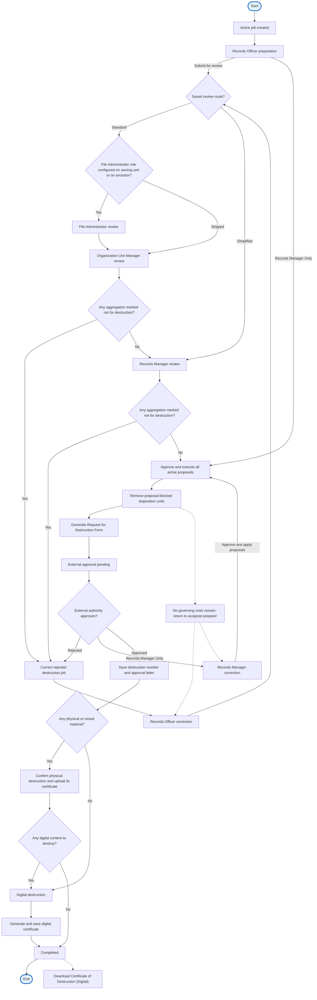

# Destruction workflow reference

The job workspace uses a compact stage tracker. This full branching diagram is
a documentation reference; actual routing follows the job’s saved review route.

## Reading review rounds on Job details

After a return, the single tracker highlights correction work and says
“Preparing review round 2” (or the next round). The return notice shows who
returned it, when, from which stage, and the reason. Expanding “View previous
rounds” shows recorded submissions and decisions, not a second tracker.
Unreached stages are omitted. Use “Load earlier rounds” for older history.
The next immutable round is created only when submitted or approved through
the existing workflow. Previous rounds and their decisions remain unchanged.
