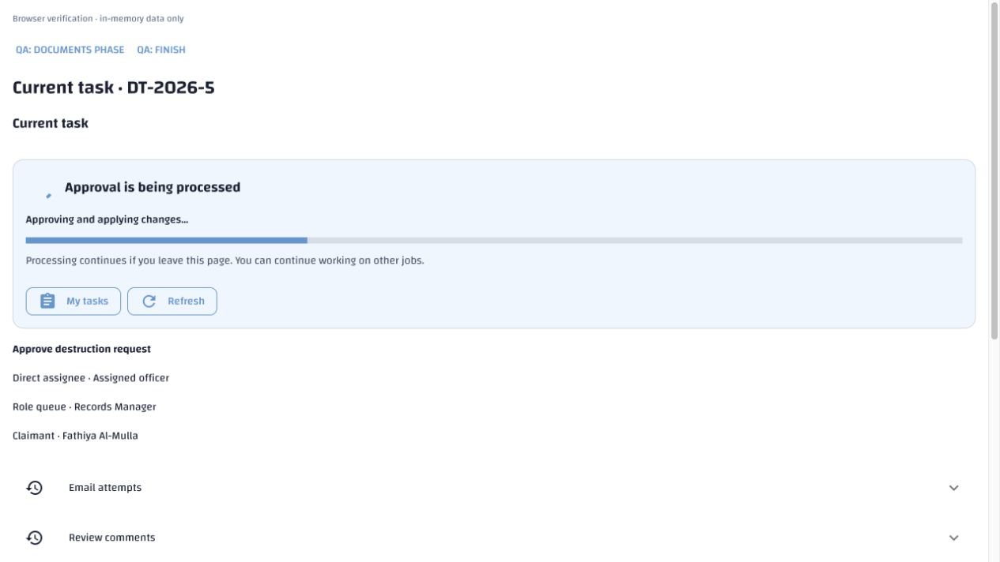
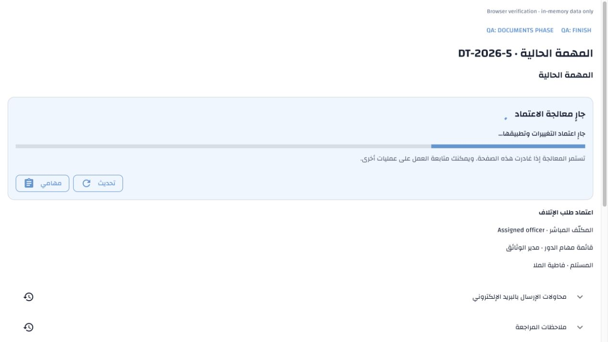
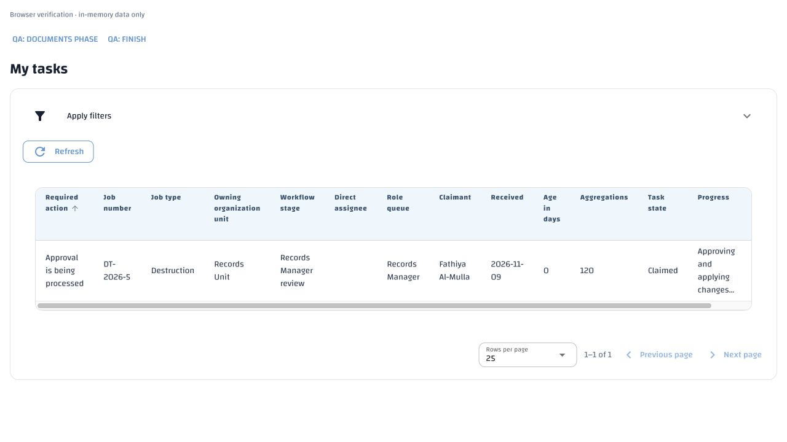
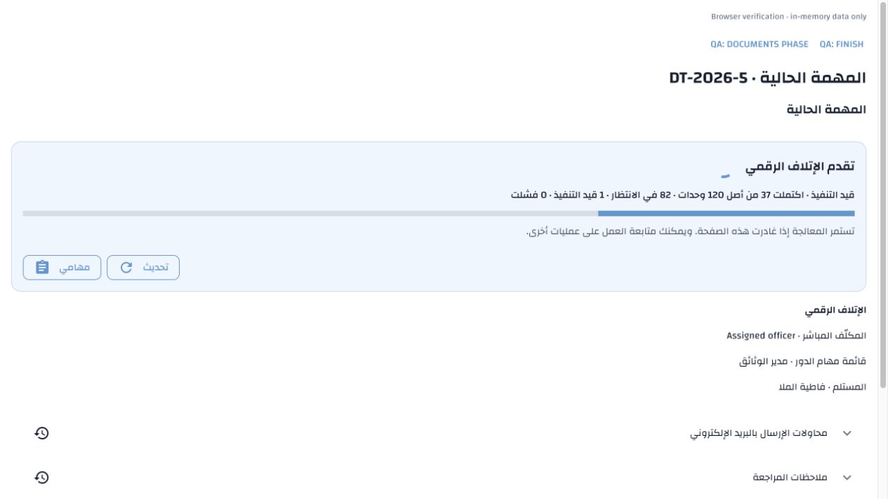

# Background disposition operations — 9 November 2026

The later [digital task guidance follow-up](digital-task-guidance.md) removes
My Tasks buttons from progress cards and hides digital progress before an
execution request. Navigation remains available through the application shell.
It also supplies stage-specific digital Claim task guidance. The earlier
background-execution results below remain valid for execution and recovery.

Approval acceptance is now a short HTTP 202 command. The existing disposition
worker owns complete-set application and required documents. The approval task
remains open until saved evidence and next-task routing commit; closing the page
or restarting an API/worker cannot discard the accepted operation. Applied effects
and their checkpoint commit atomically. Document-only recovery uses existing
per-round identities and never replays proposal effects.

The current implementation covers destruction approval only. Disposition §17.10
requires future approved transfer/local-archives bulk work to reuse this durable
operation lifecycle, handler registry, bounded worker and progress pattern.
Existing digital destruction keeps its irreversible per-unit checkpoints.
No future workflow, privilege, configurable workflow engine, service or environment
setting is introduced.

## Requirement → implementation → evidence

| Approved requirement | Implementation | Verification |
| --- | --- | --- |
| Disposition §17.10; Destruction §10: short acceptance, durable identity, exact retries and current authority | `operations.py`, HTTP routes, migration 105, canonical schema | Background API suite: real HTTP acceptance cannot call renderer, current version/authority changes roll back all application, conflicting requests rejected |
| Destruction §10: atomic application and deferred task completion | Existing approval helper with protected background command identity; application/result checkpoint in one transaction; documents then atomic routing | Standard, Simplified and Records Manager Only routes, surviving and empty jobs, original task retained until report/request ready |
| Destruction §10: interruption, document-only recovery and competing workers | Session advisory lock, immutable execution/completion identities, per-round document identities, exact retry receipt | Interrupt before/after committed application, two workers, report failure/retry, lost retry response, no duplicate effects/documents; unrelated job creation continues during delayed rendering |
| Existing invalidated-approval exception | Existing current-facts check and authorized return-for-review action; release failed operation only with successful existing renewal | Inherited retention facts changed after application: documents fail safely, return-for-review succeeds, applied effects retained |
| Destruction §§10/15.2/23: navigation, fresh progress and safe read failure | Shared native progress card, mounted-view polling, bounded My Tasks page refresh, current authorized status read | English/Arabic component tests plus actual browser rendering, My Tasks navigation/reopen and application → documents → ready transition |
| Governed notification outcomes and authorized links | Existing producer registry/receipts; durable notification retry; authorized job link on notification details | Configured real notification deduplicates, role removal hides link, temporary notification failure retries without repeating work |

## Gaps closed in the resumed final review

- **Stale task sorting:** the sort query previously excluded successful attempts
  before selecting the latest row. A recovered job could therefore still sort
  using an older failure. `workflow.tasks` now selects the latest attempt first
  and uses digital progress, or no approval progress, after success. The regression
  creates an actual failed approval, a successful new attempt and another queued
  job, then verifies both sort directions and the displayed current status.
- **Conflicting digital controls:** release/reassignment could remove the worker's
  current claimant; changing the Preparer could invalidate job authorization.
  `workspace.read` and `queries.job` now withhold these controls during queued or
  running digital work. Tests verify both states, then a durable failure restores
  the existing authorized retry, release/reassignment and Preparer controls.
  Server authority rechecks and deliberate termination/recovery are unchanged.
- **Lost document-retry response:** the server already deduplicated command IDs,
  but the retry button created a new ID on every click. The mounted form now retains
  its ID through a transport error. English/Arabic tests simulate accepted-but-lost
  response recovery, verifying the repeated request is identical and the form
  remains usable. A refreshed definitive failure permits a new explicit attempt.

These refinements are normative in Destruction §§6.2, 10 and 15.2 and the shared
Disposition §17.10 contract. They add no workflow state, privilege, environment
setting or translation key, and need no additional database migration.

The three server regression cases reproduced both gaps before correction (one
sorting case and queued/running control cases). After correction, the complete
background-operation and digital-destruction files passed **46 tests** in
`erms_messaging_test_acl_cb75f3da77e9450cbf414c43d164574d`, which was dropped.
The reproduction database `erms_messaging_test_acl_30c018350a03428ebdf4502b58cf29be`
was also dropped after its expected three failures. **275 English/Arabic UI
tests passed**, including the added lost-response retry cases and existing task,
progress and navigation checks. These final checks supplement, rather than add
arithmetically to, the earlier overlapping runs below.

## Automated verification

- **17 background API tests passed** on a fresh canonical disposable database;
  **17 passed** on the HEAD-schema + migration-105 upgrade path. The final fresh
  run also verifies an identical document-retry command cannot start another
  attempt after a later renderer failure, and resets pending outcome delivery.
- **87 approval/external API regressions passed**, including the two previously
  failing real HTTP cases. These use real document staging/storage. The document
  phase uses READ COMMITTED so staged uploads committed by its separate storage
  connection are visible; atomic application and final routing remain SERIALIZABLE.
- **318 relevant UI tests passed** for review/task screens, nonmodal approval,
  navigation/abandonment, digital progress, exact retry and bilingual rendering.
- **86 catalogue, Arabic terminology, canonical-schema and schema-verifier checks
  passed**. Catalogue reference discovery, configuration authority, API template
  synchronization and whitespace checks pass independently.
- Two additional fresh ICU `ar` disposable databases compared **HEAD + migration
  105** against the current canonical schema. Their complete normalized schema
  dumps match, including function bodies, column order, constraint names, indexes
  and grants. The comparison harness initially needed locale quoting and dict-row
  corrections; all created databases were dropped, including those failed runs.
- An earlier wider regression run passed 161 cases but exposed SERIALIZABLE
  upload visibility in 9 cases. The corrected background and approval/external
  suites above pass; the earlier failing result is not counted as success.

Final test databases were `erms_messaging_test_acl_37d5958fdc6349f381dfb2f0ae3f3e8f`,
`erms_messaging_test_acl_db1f2fe3e9584120adafe1754d42eaed`, and
`erms_messaging_test_acl_0291dd0885104e1ba0cb23978138ce2d`.
The parity pair was `erms_bg_upgrade_666dad416bab496799c75135506f6d30` and
`erms_bg_canonical_b3ca2d5a60584930ac6ef83facbef948`.
Creation and cleanup succeeded for all of these. No database-backed test ran
against `demo` or another persistent database.

The requirement ledger reconciles the two changed specification inventories,
new §17.10, related performance locators and this amendment's evidence. Its
repository-wide baseline checker still reports pre-existing drift in unrelated
configuration/reference snapshots and historical schema-symbol anchors. Those
older claims are not silently rebaselined or declared verified by this change.

## Browser evidence

Actual ReviewForm and My Tasks components were rendered with the application's
stylesheet, fonts and maintained catalogues using in-memory fixtures. The browser
checks performed no persistent approval or destruction. The card uses NiceGUI
spinner/card/row/linear-progress controls. NiceGUI's `show_value=False` avoids a
raw fractional label; its forwarded supported `reverse` prop supplies Arabic
bar direction because the constructor has no direction parameter. No CSS override
was added. Existing Wathiq table headers, borders and pagination are retained.

Confirmation closed after acceptance. The page remained usable, showed applying
then documents, and allowed My Tasks/reopen during pending work. Ready polling
opened the existing document-verification result. Arabic showed the same controls
and direction. Digital progress displayed actual 37/120 completed, 82 queued,
1 running, 0 failed with a corresponding native bar. Repeated navigation and
late/abandoned replies are also covered by component tests. No progress cache or
catalogue parsing on message-render paths was introduced.

## Localization and local deployment

The English manifest and Arabic artifact now have **4066 active keys**. This
amendment adds 13 disposition status/error/action keys and 4 human-readable event
labels. All 4049 preceding Arabic entries and provenance were preserved; no
administrator export was replaced. New entries have their own generation
metadata and require human review.

The explicit Arabic utility ran against authorized `demo` with `--missing-only`:
17 stored, 4049 protected, 0 corrected, 0 failed and 0 awaiting generation.
All 4110 pre-existing Arabic rows, including retired definitions, have the same
before/after hash:
`e6e1e9c6de723a53609eea8447d9d0f15373bfa9a1306748f56db55f05835d44`.
The new drafts remain unpublished. Normal colleague startup continues to fill
missing drafts while preserving existing translations/publications.

Migration `105_background_disposition_operations` was applied to `demo`. Before
and after counts were identical: 5 jobs, 29 tasks, 20 proposals, 6 rounds,
19 memberships, 19 documents and 120858 audit events. Migration rewrote no
historical rows. The idempotent producer seed then registered
`disposition.operation_outcome` without altering existing producer configuration.

For existing installations, apply migration 105 and the separately maintained
`disposition-notification-producers.sql` seed, then deploy/restart the matching
API, WebUI and existing disposition worker together. New installations use the
self-contained canonical schema, separate required reference seed and baseline.
The local recorded stack was restarted through its lifecycle helper; final status
confirmed every recorded service running and **Health: ready**. The temporary
in-memory preview server and its three browser tabs were closed.
No `.env` value/template changed; configuration inventory only updates the
worker's DATABASE_URL consumer line number.

**Operator action:** `demo`'s new `disposition.operation_outcome` producer is
unconfigured. Configure and activate it in Notification Administration to receive
out-of-page completion/failure messages. Its context is `job_id` and
`operation_id`; its governed audience is the initiating currently authorized
Manager. Business processing and on-page status work without activation.
Existing destruction/completion producer settings remain untouched. No request
or certificate is automatically emailed by this processing change.
