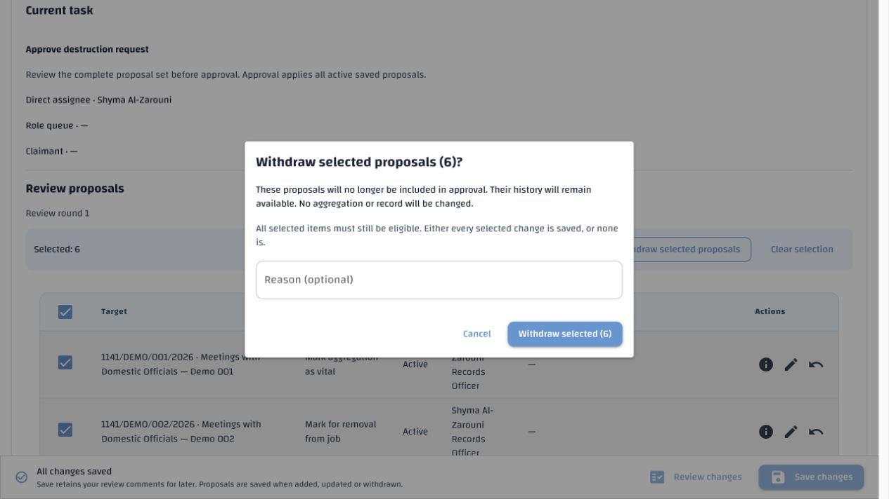
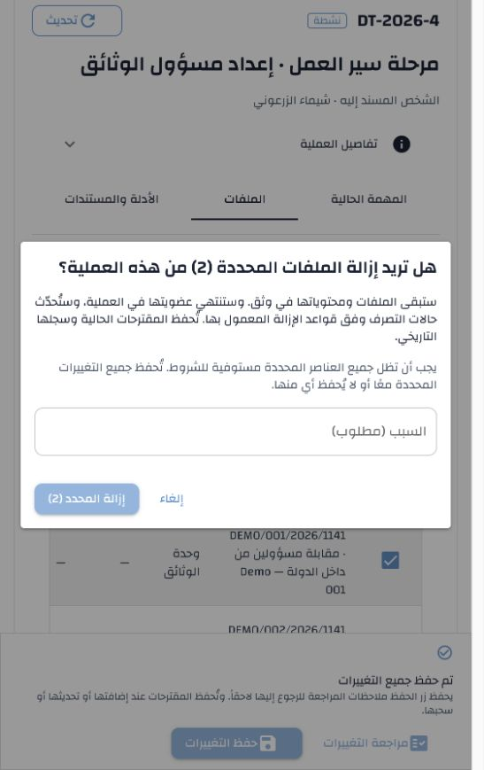

# Bulk disposition actions — verification

Approved and verified 4 November 2026. Contract:
[Destruction process §6.5.1](../../specs/destruction-process.md#651-bulk-proposal-and-membership-actions-approved-4-november-2026),
DEST-50 and [common disposition §18.1](../../specs/disposition.md#181-bulk-membership-removal-amendment-4-november-2026).

## Requirement → implementation → evidence

| Approved requirement | Implementation | Verification |
|---|---|---|
| Withdraw explicit active proposals together | `ReviewForm.bulk_proposals`, existing `review-work` route with `bulk=true`, existing SQL save transaction | Bulk creation/withdrawal, stale-peer rollback, exact retry, per-item history and unchanged memberships in `test_disposition_bulk.py` (API) |
| Direct removal only where already permitted | New `POST /jobs/{job_id}/memberships/remove`; one `membership_remove` command receipt; existing per-member SQL transition/authorization gates | Root/member versions, foreign IDs, duplicates, required reason, forbidden stage, late failure rollback, status restoration, no record deletion and two concurrent requests with one winner |
| Propose removal during review | Same review-work command; one `remove_from_job` proposal per selected root, optional shared reason; exclude existing active removals | API creation/no-side-effect checks and real member-table UI payload/exclusion checks |
| Current access, task, claim, role and scope | Existing `review_context`, `proposal_visible`, membership-stage and resource gates; fresh SQL preflight for bulk withdrawal | Hidden related endpoint rejects complete batch, visible peer remains active; single eligible peer succeeds; another claimant and revoked role rejected; existing individual withdrawal behavior remains unchanged |
| All-or-nothing and safe retry | Existing command kernel/savepoint and payload-bound UUID; no HTTP loop or per-removal savepoints | Late second-removal failure restores first; stale second withdrawal restores first; original committed result returned on retry; no duplicate events |
| Individual immutable events linked by batch | Existing membership audit; migration 097 adds command UUID to future proposal events | Same UUID on both proposal events, original proposer retained, migration applied twice over occupied data without changing old events; resulting function matches canonical definition |
| Bounded selection and current-page select-all | `BulkSelection`, existing styled `PageTable`, at most 100 explicit row/version snapshots | Real NiceGUI tests in English/Arabic: page-only select-all, inaccessible exclusion, server paging, cap, frozen selected versions, filter clearing, real member action paths and existing navigation regressions |
| Preserve Save and unsaved comments | Proposal mutation does not submit `review_notes`; refresh does not upgrade comment version behind unsaved text | Immediate persistence, connection retry identity, original comment version and text retained; existing shared-footer/pending-proposal regressions |
| Confirmation, feedback, abandonment | One dialog, explicit count/consequences; direct reason required, proposal reasons optional; definitive failure differs from uncertain transport outcome | Both languages and all three actions; required button state, failure/refresh and retry states; disposed/inactive source cannot start mutation |
| Retain individual actions and final approval | Existing row handlers and complete-set approval paths remain; no bulk approval/destruction/email/task completion | Existing membership, review, task, screen, pending-proposal, shared-footer and job-creation regression suites |

Selection is local to the mounted job and language/identity context. It is not
an operational-result cache. Filters, review-round scope changes, successful
proposal actions and disposal clear it; paging/sorting preserve the exact
selected versions. There is no collection prefetch or new environment setting,
privilege, table, workflow stage or lifecycle state.

## Automated runs

- Main API regression run: **129 passed**, with three obsolete creation-test
  assumptions failing because the already-approved mandatory Preparer was
  omitted. Those test fixtures were corrected to the current approved contract;
  no production creation behavior was changed.
- Focused API/migration/concurrency and corrected-fixture run: **26 passed**.
- Final bulk security, existing review-edge and job-creation run: **57 passed**.
  These runs overlap; counts are not a unique combined-test total.
- Final UI run: **320 passed**, covering bulk controls, existing task/screens,
  shared footer and pending proposals, in English and Arabic.
- Canonical SQL and locale-verifier unit checks: **53 passed**. Three older
  comparisons were updated to compare the final approved migration definition,
  rather than the superseded 093/094 bodies. The new audit function is included.
- Catalogue reference/stale-key, terminology, exact active-key coverage/order,
  blanks, placeholders, prior Arabic wording/provenance and artifact hashes
  passed. Python compilation, operation-policy generation, API environment
  template consistency, configuration-authority inventory and `git diff --check`
  passed. A pre-existing CONTENT_STORAGE_BACKEND consumer line locator was
  reconciled; no setting or template value changed.

All database-backed tests used fresh canonical-schema disposable databases:

| Run | Database | Cleanup |
|---|---|---|
| Initial bulk tests | `erms_messaging_test_acl_e8548d1f82ac44da879aeb81c3d714e8` | Dropped |
| Main regression | `erms_messaging_test_acl_ed15d1af21774dccb30cb03addbb5863` | Dropped |
| Focused latest/migration/concurrency | `erms_messaging_test_acl_50e564986f794e3c9d0c5bd2bb1ecfe0` | Dropped |
| Security and existing review/creation | `erms_messaging_test_acl_cd7ab47fde454728b80ca039ea0b639f` | Dropped |

No test suite targeted `demo`. The authorized local update applied only migration
097 and the explicit missing-only Arabic seed: **25 stored, 3,991 protected,
0 corrected, 0 failed, 0 awaiting generation**. New translations remain
unpublished drafts. Existing jobs/proposals and historical events were not
rewritten by the migration.

The recorded local stack was restarted through its ownership-aware controller
and returned **Health: ready**. Its running OpenAPI contract exposes the bulk
membership-removal route and review-work bulk flag. All four disposable
databases were independently confirmed absent; the 25 new `demo` translations
were confirmed unpublished. The temporary browser tab and verification server
were closed/stopped after the live checks.

The older full disposition-baseline checker still reports pre-existing drift
in configuration/security/reference snapshots and older schema anchors. This
change records its own three requirement entries and passing evidence; it does
not claim to reconcile or reapprove unrelated historical release evidence.

## Translation changes

Both canonical artifacts now have **4,016** active keys. Added 24 keys under
`disposition.ui.bulk_*` plus
`disposition.ui.disposition_bulk_selection_changed`; no existing keys, Arabic
text or per-item provenance were replaced. No administrator export was promoted.
The Arabic drafts require human review/publication through the existing process.

## Deployment and API contract

Apply `database/migrations/097_bulk_disposition_audit_link.sql` to an existing
096 installation. Fresh installations use `database/schema.sql` and the matching
baseline registry. Migration 097 changes only the new-event audit function and
registers its version. Deploy/restart API and WebUI together.

Bulk direct removal accepts a command UUID, acting role and 1–100 unique
`{membership_id, expected_version, root_version}` items. `If-Match` is the job
version; the existing change-reason header is required once. The result contains
one item per removed membership and the current job version. The existing
review-work endpoint accepts `bulk: true` for a homogeneous list of withdrawals
or root-removal creations only, with no comment-save fields. Job/task and
proposal/target versions remain mandatory. Existing request shapes default to
`bulk: false`, retaining their behavior and exact retry payloads.

## Live appearance and interaction

The temporary verification page ran the actual `job_screen`, `ReviewForm`,
`PageTable`, new selection/dialog controls and Wathiq's existing CSS with
in-memory sample data. API authorization and persistence were verified
separately against the disposable databases.

Observed: the light-blue table styling matches existing Wathiq tables; native
row/header checkboxes align; partially redacted proposals remain disabled;
withdrawal refreshes immediately; Arabic direct removal requires a reason;
selection survives a server-page change; cancellation preserves selection; and
successful removal refreshes the membership listing. Both LTR desktop and RTL
narrow layouts retain usable controls and confirmation content. No custom
layout/RTL CSS was added to the application.

