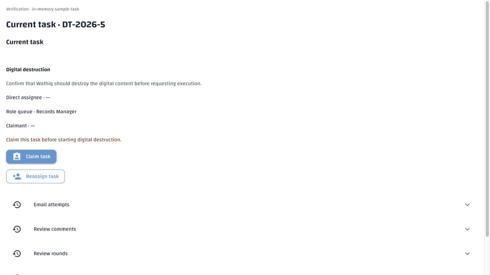
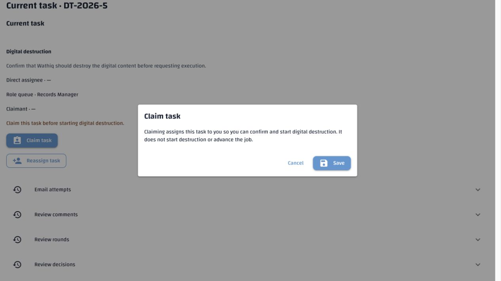
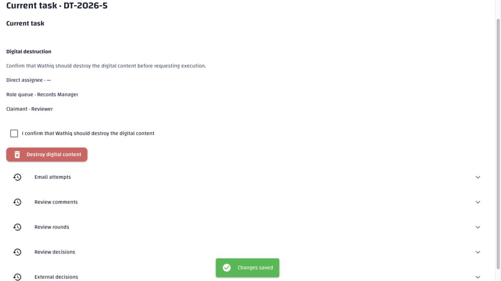
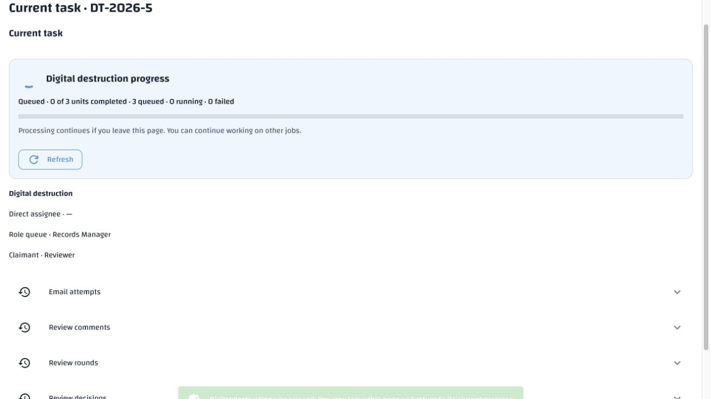
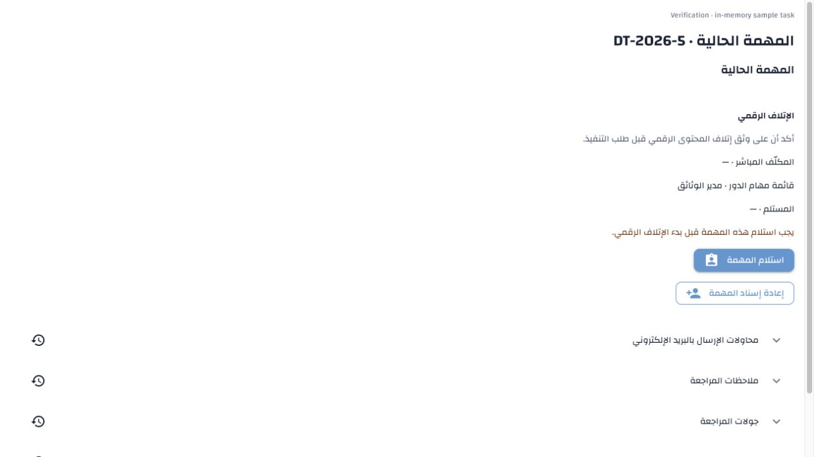
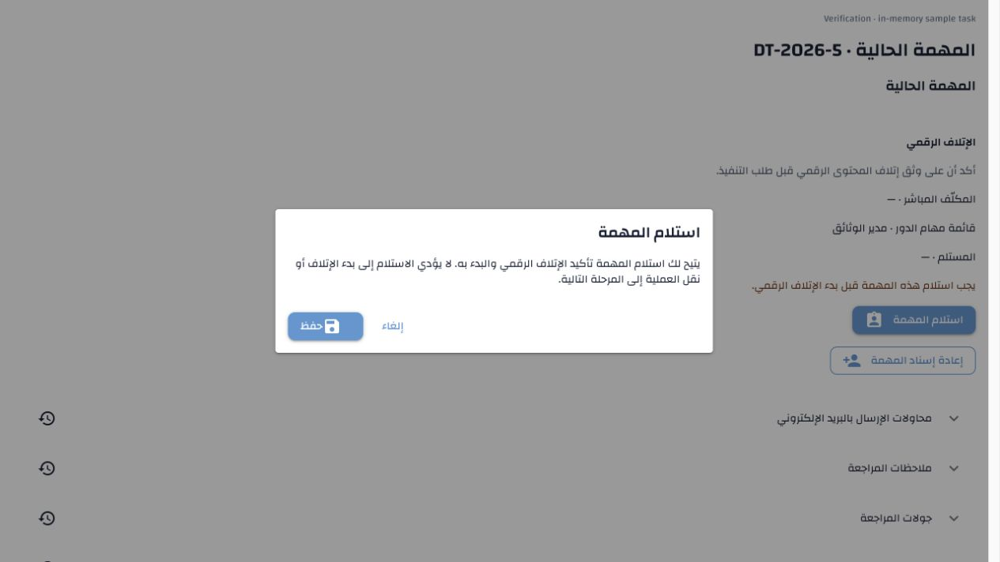
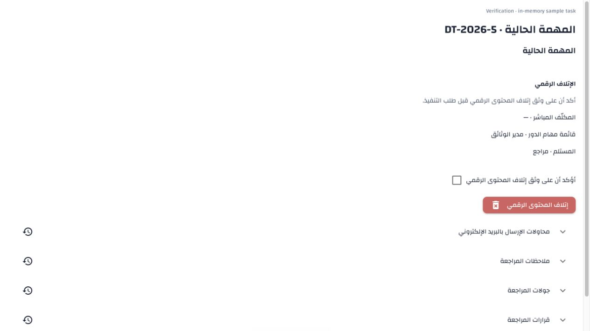
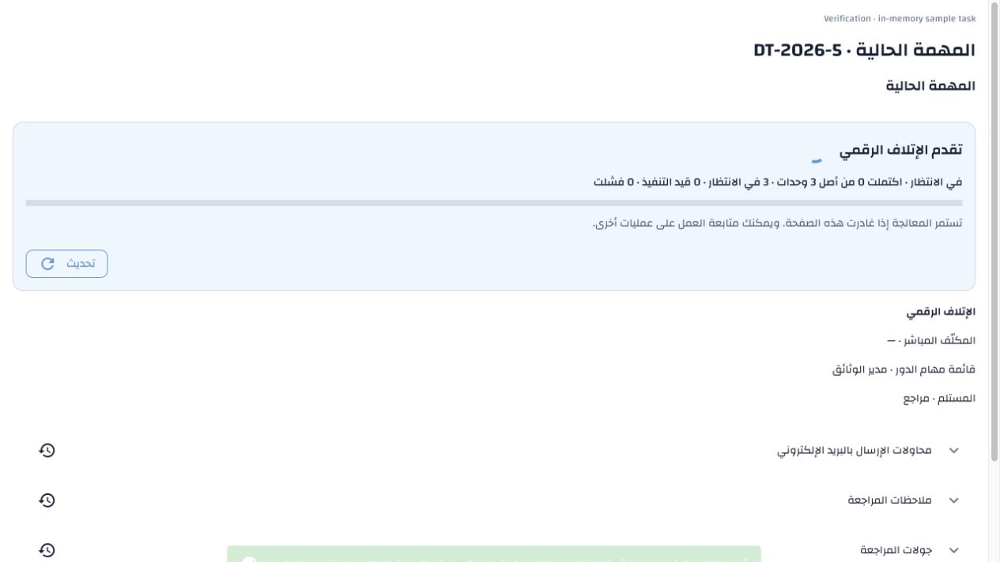

# Digital task guidance and progress — 9 November 2026

The digital destruction task shows progress only after an execution request
exists. Before that request, its progress card and progress Refresh action are
hidden. The existing claim and explicit execution confirmation remain available
under current task authority. Digital and approval progress cards do not repeat
My Tasks navigation; users choose where to go from the application navigation.

An unclaimed digital task now says **Claim this task before starting digital
destruction.** Its Claim task dialog explains digital execution responsibility
and makes clear that claiming does not itself start destruction or advance the
job. Review-stage claim guidance retains its proposal/review explanation.

## Requirement → implementation → verification

| Approved requirement | Implementation | Evidence |
| --- | --- | --- |
| Destruction §§10/15.2 and Disposition §17.10: no duplicate My Tasks button in progress | Shared `background.panel` no longer creates navigation controls | Bilingual approval polling/abandonment tests and all requested digital progress states lack an inbox button even with the navigation callback available |
| Destruction §15.2: no progress card before execution request | Native card visibility follows the current server execution projection | Unclaimed and claimed-ready cases hide the card; queued, running, failed and succeeded cases show it; browser claiming alone leaves progress absent |
| Destruction §§6.3/15.2: digital claim guidance describes the current action | Contextual inline and dialog messages selected for the digital task type | English/Arabic inline/dialog assertions; existing review-stage dialog remains covered by its original tests |
| Existing execution confirmation, exact retries and durable progress | Existing execution command/payload, polling and recovery retained | Explicit checkbox remains unchecked, Start disabled until confirmation, command exact-retry checks, fresh progress and abandoned-response checks |

## Verification

**333 tests passed**, covering the digital destruction, approval progress and
My Tasks/review component suites in English and Arabic, plus locale/translation
and Arabic terminology/grammar checks. No database-backed test run was needed
for this presentation change. No real task was claimed or destruction requested
for browser verification.

Browser verification mounted the actual `ReviewForm` with Wathiq styles and the
checked-in catalogues, using an in-memory API. In both languages the flow was:

1. Unclaimed task: corrected instruction, no visible progress card or My Tasks button.
2. Claim dialog: digital explanation, no proposal/review instruction.
3. Saved claim: separate unchecked execution confirmation and disabled Start; still no progress card.
4. Confirm and request execution: queued progress card appears with counts and Refresh; no My Tasks button.

Native NiceGUI card visibility handles the initial hidden state; no custom CSS
or Quasar override was needed. Existing polling stops for abandoned forms and
does not take ownership of background processing. Screenshots are below. The
temporary preview and browser tabs are removed after verification.

## Translation preservation

Added two contextual keys to `messages.en.json` and merged Arabic drafts into
the canonical `messages.ar.generated.json`, preserving all 4,067 earlier items
and their provenance:

- `disposition.ui.claim_before_digital_destruction`
- `disposition.ui.claim_digital_explanation`

The active catalogue now has 4,069 keys. Exact active-key coverage/order,
placeholder/blank checks, source references/stale-key check, terminology and
artifact hash pass. The prior-item hash excluding these two new keys is
`77f6b9534e2d105e015d6a6fe2f80a1d6220bc9c368d1f86339d693cc4f46247`.
No administrator export was replaced or promoted.

The explicit missing-only seed filled the two new Arabic drafts in demo across
two passes, corrected zero existing translations and left both unpublished for
review. All 4,128 prior Arabic database rows are unchanged, hash
`bf0b7d4dc0a343d59425f2d5060fcbbac9319eddbe64489864b6ae7dd9b5f80d`.
No schema migration or environment setting is needed. Configuration-authority,
API-template and whitespace checks pass.

