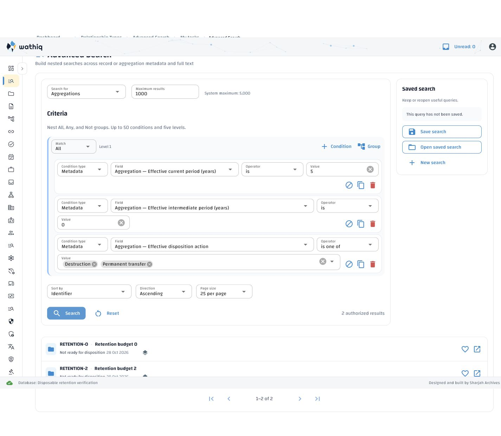
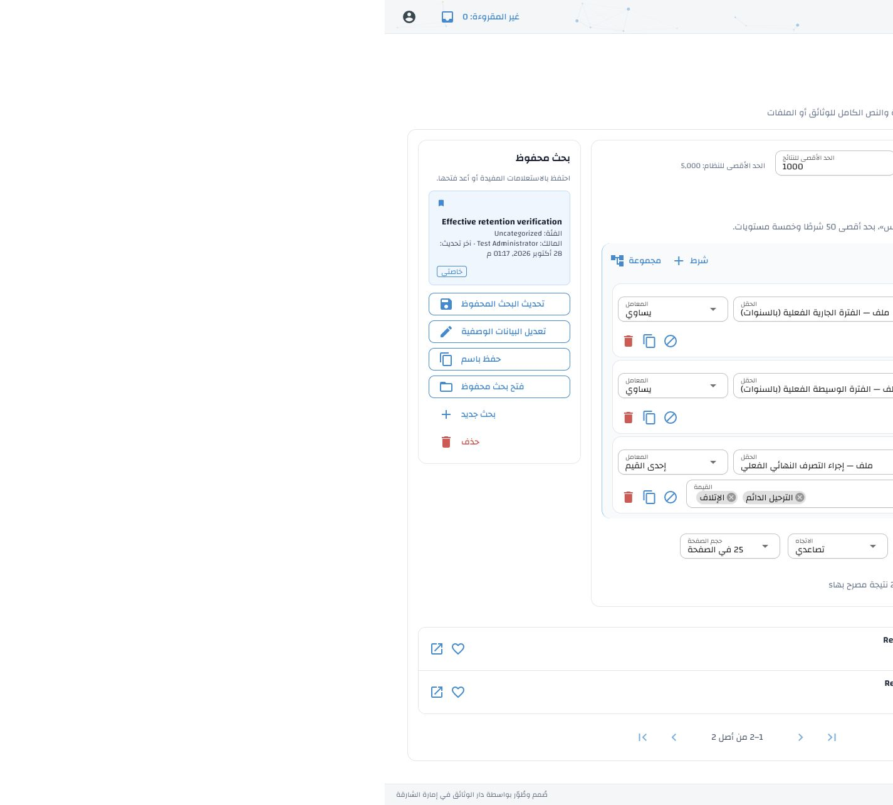

# Effective-retention search verification

Date: 28 October 2026. Contract:
[approved extension](../../specs/advanced-search-effective-retention-extension.md).
One implementation phase covers AS-ER-01 through AS-ER-05; all are verified in
[the requirement reconciliation](../advanced-search-implementation-traceability.md#effective-retention-extension--28-october-2026).

## Implementation

Aggregation searches accept the three `effective_retention.*` fields through
ordinary comparison leaves. A lateral call to the existing effective-rule
resolver is added only when a retention predicate is present. All predicates
use that same rule source, with the existing authorized resource view and
visibility conditions. Count and page queries both filter before pagination.
The projection remains `resource.*`; rule instructions, justification and
other resolver columns are not added to search results.

Periods accept nonnegative whole years and existing numeric operators. Action
values and operators are controlled. Records, sort keys, invalid values and
operators, and existing complexity-limit violations are rejected. The visual
builder includes numeric inputs/ranges and a localized action multiselect.
Saved-search schema version 1, current authorization, deterministic ordering,
and stored result caps are preserved. No cache, environment setting, database
migration, or full-text reindex was introduced.

## Automated verification

Final API run: **45 passed**. The runner created
`erms_messaging_test_acl_1d8976ab14ce49bd860a485eb50f3d3b`, initialized the canonical
schema plus separate reference/baseline/seeds, and printed its successful drop
message after the run. No test suite used the persistent demo database.

```bash
backend/services/api/.venv/bin/python tools/run_disposable_acl_tests.py \
  backend/services/api/tests/test_advanced_search_effective_retention.py \
  backend/services/api/tests/test_advanced_search_component_metadata.py \
  backend/services/api/tests/test_saved_searches.py \
  backend/services/api/tests/test_disposition_terminal_search.py \
  backend/services/api/tests/test_full_text_search_phase3.py -s
```

Coverage includes direct/inherited classification rules, root overrides and
removal, classification-rule changes, child reparenting, resolver parity, all
numeric/action operators, zero/open/closed cases, nested Boolean/full-text
queries, invalid input and injection, bounds, target/sort rejection, ACL-filtered
counts, deterministic pagination, saved reopening/freshness and execution caps.

Final frontend run: **76 passed**, covering these files:

- `frontend/webui/interaction/tests/test_advanced_search_retention.py`
- `frontend/webui/tests/test_advanced_search_builder.py`
- `frontend/webui/tests/test_saved_search_localization.py`
- `frontend/webui/tests/test_saved_search_errors.py`
- `frontend/webui/tests/test_search_session_isolation.py`
- `frontend/webui/tests/test_full_text_search_phase3_ui.py`
- `frontend/webui/tests/test_full_text_search_phase4_ui.py`

The renderer interaction tests construct the actual NiceGUI controls in English
and Arabic and exercise numeric sanitization used on blur, including zero and
range bounds. They cover the regression where setting `min` through a string
property caused a numeric/string comparison error. Numeric limits now use
constructor arguments. A fresh browser preview also exercised both year inputs
on blur and executed the query with no error/traceback in its server log.

## Query plans

`EXPLAIN (ANALYZE, BUFFERS, FORMAT JSON)` used 100 governing roots with nine
children each: **1,000 aggregations**. The fixture set the executing user context
and used `authorized_aggregations_for_search` plus the same visibility condition
as the API. The count and full-row 25-item page each contained all three filters.

| Query | Planning | Execution |
| --- | --- | --- |
| Count | 26.158 ms | 210.915 ms |
| Page, ordered by ID, limit 25 | 0.689 ms | 6.113 ms |

The source contains one resolver join regardless of the number of retention
leaves; searches without those leaves contain none. These are local fixture
measurements, not a production latency guarantee. No new index was justified.

## Live browser verification

An isolated API at port 18000 and WebUI at port 18080 used disposable databases
created from the canonical schema. The final corrected-control preview used
`erms_messaging_test_acl_bd3b4c18b7bc45a7baa715670a5e0f7d`; both preview processes
were stopped and the database was dropped successfully. Earlier preview and
regression databases were also dropped. The browser viewport override was reset.

Verified English LTR and Arabic RTL labels, three combined criteria, action
multiselect chips, numeric ranges and zero, fractional-value rejection, saved
restoration, and expected result cards. The fixture search for five current
years, zero intermediate years and either destruction or permanent transfer
returned RETENTION-0 and RETENTION-2. Changing RETENTION-2 to six current years
removed it on the next browser execution.

Repeated Dashboard/Search navigation retained all three criteria. Holding a
lock in the disposable database kept a search pending while navigation moved
to Dashboard; after releasing the lock, the old results did not appear there.
Returning restored the criteria. Arabic document direction was `rtl`, with no
horizontal document overflow at the verified desktop viewport.





The existing Arabic result-count presentation appends an English plural suffix
for multiple results. This predates these filters and was left outside this
extension; the five new messages introduce no such suffix or placeholder.

## Arabic artifacts and local activation

Added three field-label keys and two validation keys to `messages.en.json` and
`messages.ar.generated.json`:

- `advanced_search.field.effective_current_period_years`
- `advanced_search.field.effective_intermediate_period_years`
- `advanced_search.field.effective_disposition_action`
- `advanced_search.validation.retention_years`
- `advanced_search.validation.retention_action`

All **3,892 existing Arabic items, text and per-item provenance were preserved
exactly**. No administrator export was replaced or promoted. The five new
entries carry generation metadata and `needs_human_review`; catalogue,
specification and terminology hashes were refreshed. All 3,897 active keys
have matching sorted language coverage, nonblank text and placeholder parity.
The repository catalogue/stale-key checker and the approved terminology checker
passed (879 contextual glossary uses).

The managed local stack was restarted to load the change. Its existing
`--missing-only` seed workflow stored five Arabic drafts in the authorized local
`demo` database, protected 3,892 existing values, and reported zero corrections,
failures or missing generations. New Arabic drafts remain **unpublished for
administrator review**; publication in the disposable preview was solely for
visual verification. Operators deploying elsewhere should restart API/WebUI and
run the documented missing-only Arabic seed workflow, then review/publish the
five new drafts. Configuration-authority and API-template consistency checks
also passed; no environment templates or private values were changed by this
implementation.
