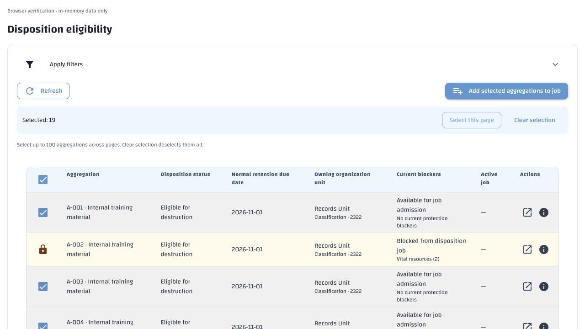
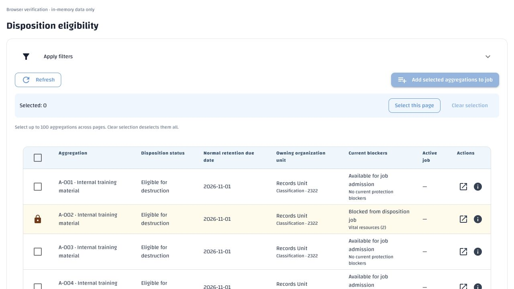
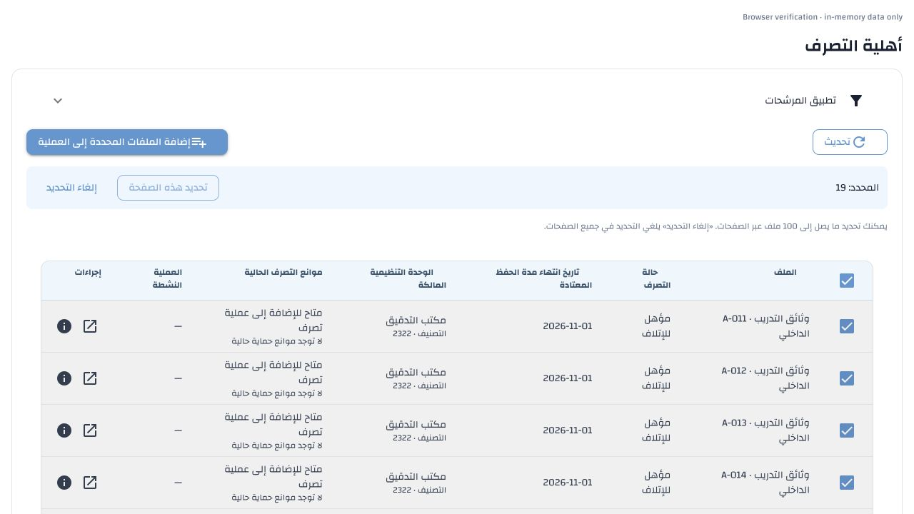
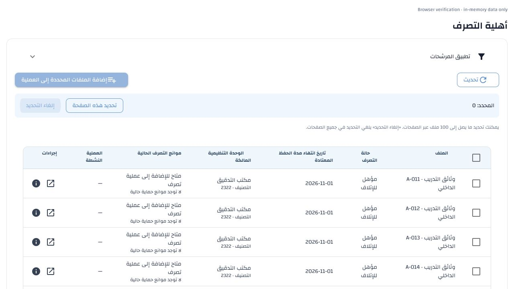

# Eligibility page selection — 5 November 2026

The Disposition Eligibility table now provides **Select this page**, a total
selected count, and **Clear selection**. Select this page and the header checkbox
operate on currently available rows on the displayed server page. Clear selection
removes selections on every page. Pagination, sorting and page-size changes
preserve explicit selections; Refresh, changed filters, successful membership
addition and view disposal clear them.

The existing 100-aggregation addition limit remains. A whole-page selection that
would exceed it leaves the existing selection unchanged and explains the limit.
Locked, inaccessible and otherwise unavailable rows remain unselected. Selected
versions are retained rather than silently updated on a reread; membership
admission still authoritatively checks current versions, access, clearance and
eligibility for every selected aggregation.

Selections with unknown cross-page owning-unit relationships use the existing
bounded suggested-owner read for the explicit selected IDs. Add waits for that
check. No complete result set or organization hierarchy is downloaded. A reply
cannot repopulate cleared selections or update an abandoned page. The completed
check resolves labels and errors inside the owning NiceGUI client so an Arabic
page cannot revert to English in its count or header label.

The selection state and its checked-scope signature belong only to the mounted
page and its user/language. They are cleared together; no shared result cache or
saved navigation selection was added. Existing API contracts and database schema
are unchanged. The independent job-scoped Add aggregations picker is unchanged.

## Requirement → implementation → verification

- [Disposition specification revision 1.24, §10.2](../../specs/disposition.md)
  defines page selection, cross-page retention/clearing, limits and validation.
- `frontend/webui/disposition/screens.py::eligibility_screen` implements the
  controls, selected snapshots and bounded scope check using standard NiceGUI
  components and the existing Wathiq table/header slots.
- `frontend/webui/tests/test_disposition_eligibility_paging.py`: **18 tests passed**
  in English and Arabic. They cover available/locked/redacted/open rows,
  retention across pages/sorts/page sizes, header scope, original versions,
  complete add payload, clearing on filters/refresh/add, late replies,
  failure and abandonment, 100-item limits, and locale isolation after a
  background check loses its inherited catalogue.
- **215 relevant UI tests passed** across that file and the existing screen,
  eligibility-selection, addition-feedback and simplified-addition tests.
- Catalogue coverage/order, approved Arabic terminology, configuration authority,
  API environment-template consistency and whitespace checks passed.

## Live browser evidence

The actual screen and application stylesheet were rendered with in-memory data,
matching the established light-blue headers, borders, spacing, action icons and
pagination. No persistent aggregation or job was changed for browser testing.

In English, page 1 selected nine available rows while skipping its locked row.
Page 2 added ten, making 19 total. The page-2 header deselected only its ten;
returning to page 1 retained its checked rows. Clear selection set the total to
zero and returning to page 2 confirmed that it was also unchecked.

The same native controls were checked in Arabic/RTL. An individual checkbox
updated the count and made the header indeterminate. The background owning-unit
check kept the count and accessible header label Arabic. Clear selection removed
both pages' selections, including the off-page rows.

## Translation and deployment boundary

Three new contextual keys were added, bringing active English/Arabic coverage to
4046 keys: `disposition.ui.eligibility_select_page`,
`disposition.ui.eligibility_selection_hint`, and
`disposition.ui.eligibility_selection_checking`. All 4043 existing Arabic entries
and provenance remain identical to their previous checked-in versions. No admin
export was promoted; new entries have their own generation metadata. Existing
bulk count, clear-selection, page-header and limit messages are reused.

The explicit Arabic seed utility ran with `--missing-only` against the authorized
local `demo` database. It stored three generated, unpublished drafts, protected
4043 active entries, corrected none and reported zero validation failures or
missing generated values. The full 4104 pre-existing Arabic rows, including
retired definitions, had identical hashes before and after:
`19f75b67325decc14bf4190c0c4a3048123fb3cab816c23e0b45fbff0f04b23b`.
The new Arabic drafts require administrator review/publication through the normal
workflow. No existing translation or publication was overwritten.

No database-backed tests or migrations were needed. No environment setting was
added or changed. The recorded local stack is restarted to load the updated
WebUI; colleagues' normal startup imports only missing Arabic drafts.

The recorded local stack was restarted after verification. Its status command
confirmed all recorded services running and **Health: ready**. The temporary
preview server and browser tab were closed.
