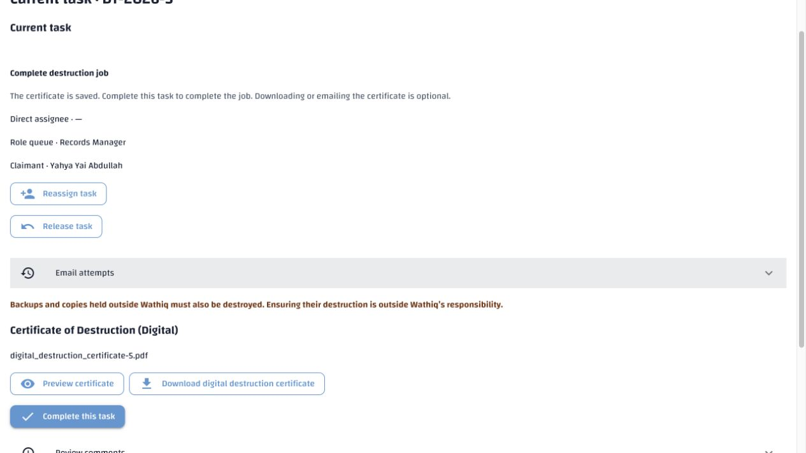
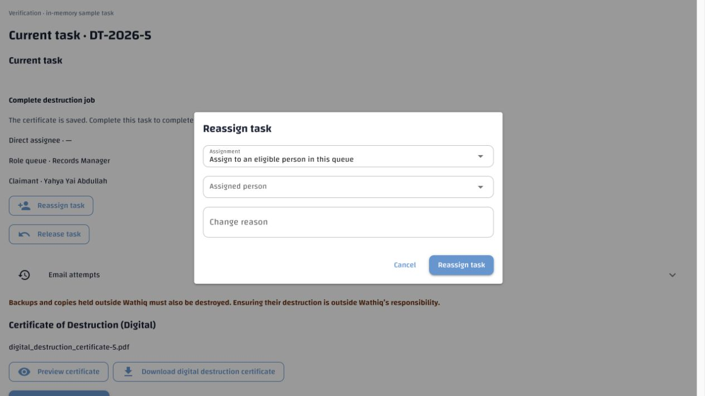
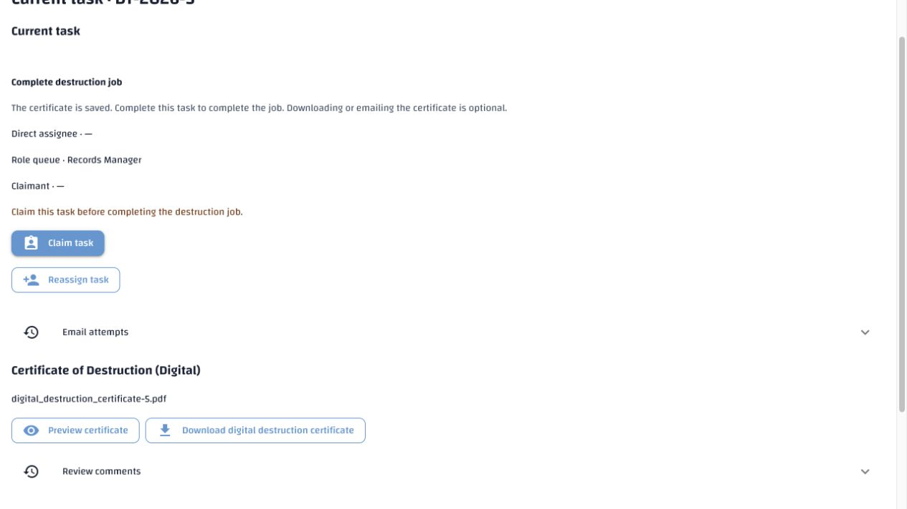
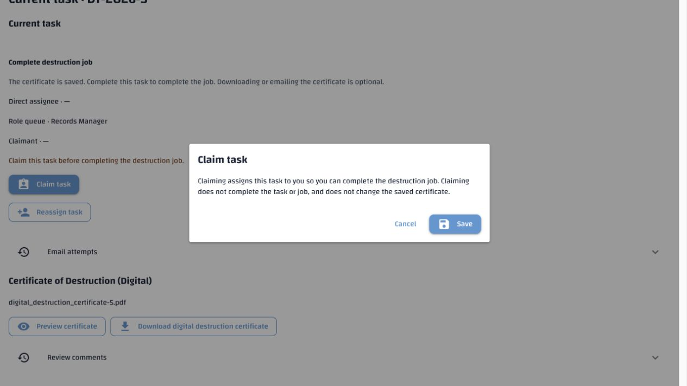
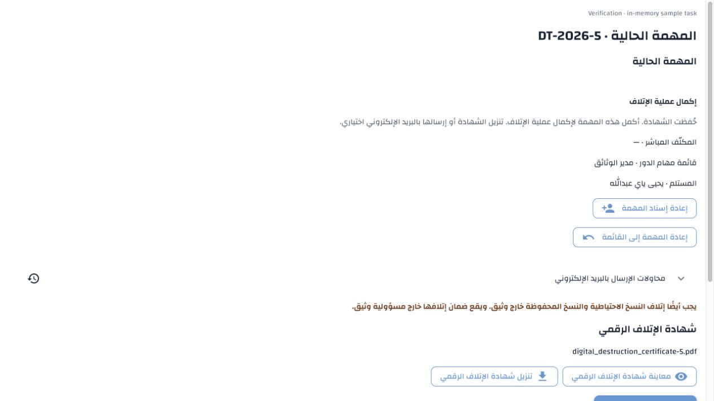
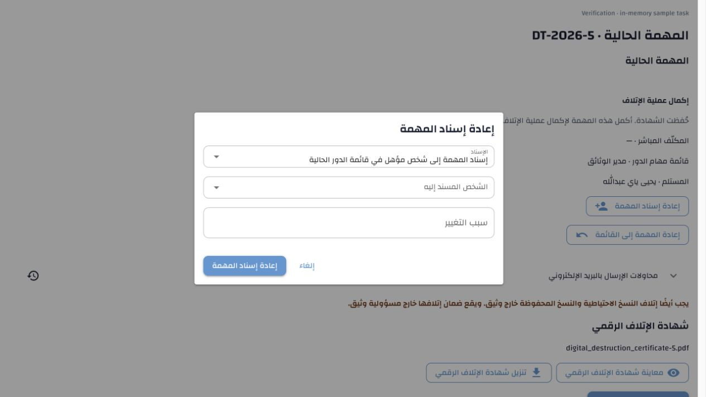
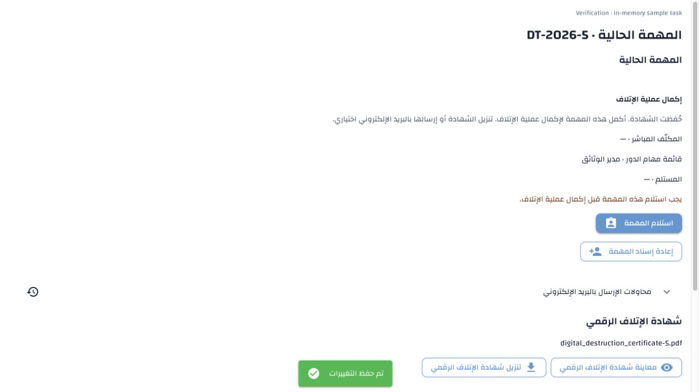
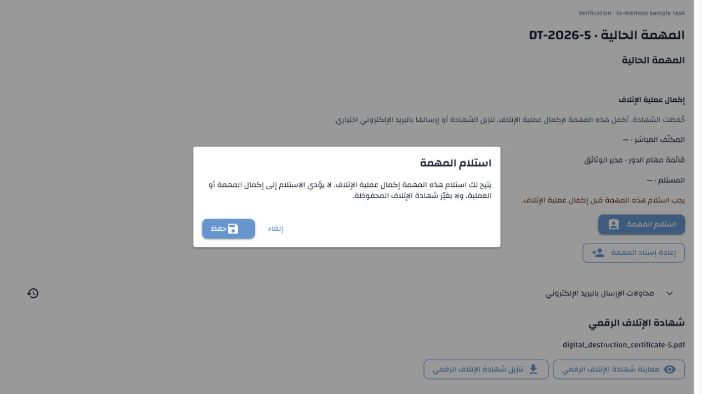

# Final certificate task handover — 9 November 2026

The final **Complete destruction job** task now uses the existing Records
Manager queue lifecycle. Saving the certificate creates it already claimed by
the Manager who requested digital destruction. That Manager can reassign it to
another currently eligible Manager or release it to the queue. An unclaimed
task must be claimed before **Complete this task** becomes available. The last
task still completes the job atomically; preview, download and email remain
optional and retain their existing permissions.

## Requirement → implementation → verification

| Approved contract | Implementation | Evidence |
| --- | --- | --- |
| Destruction §§6.3/16 and DEST-14: initial Manager claim and final-task handover | `finish_destruction_job`, `task_eligible` and the narrowly scoped initial-claim guard in canonical schema/migration 106; existing task commands and bounded selectors reused | Real destruction/certificate creation yields a claimed queue task; reassignment and exact retry move the personal inbox; release leaves it open even with one member; only the claimant can complete |
| DEST-21/22: current eligibility, personal inbox and atomic claims | Existing role membership/profile and task authority checks plus saved-certificate record/component access; workspace completion action requires the current working claimant | Ineligible membership, clearance and Officer-only candidates excluded; direct unauthorized completion rejected; eligibility loss releases the claim; two concurrent claimants produce one winner; authorized Manager-queue change works |
| Destruction §16: evidence and execution attribution preserved | Queue changes alter task ownership only; final-task actor is separate from destruction executor | Certificate document/component rows, retained proof and destruction runs compare unchanged across handover, release and final completion; original executor remains recorded |
| Destruction §16: existing unfinished direct tasks upgraded safely | Migration 106 preserves task ID/creation time, keeps an eligible former assignee as claimant, otherwise leaves the Manager queue open; appends a migration event | Unfinished, completed and ineligible-assignee upgrade cases; completed task unchanged; migration rerun adds no task changes/events; demo before/after snapshots below |
| Destruction §§6.3/16: useful final-stage claim guidance | Shared native `ReviewForm` chooses two contextual certificate claim messages | English/Arabic own, unclaimed and other-claimant controls; correct inline/dialog explanation; no review-work request for this stage; browser release/claim transitions verified |

## Automated verification

**492 tests passed** across these completed runs:

- 65 API workflow/completion/final-queue regressions against a fresh disposable
  database initialized from the latest canonical schema.
- 9 final-queue cases against a separate disposable database initialized from
  HEAD and upgraded through migrations 105 and 106, including all three legacy
  task states described above.
- 319 native WebUI completion/task/destruction/approval tests in English and
  Arabic, including abandoned progress reads and existing preview behavior.
- 99 canonical-schema tooling, locale, translation-inspector and Arabic
  terminology/grammar checks.

The two API test databases were created and dropped successfully:

- `erms_messaging_test_acl_b521201ef9794c5698caa28d5323cbe5`
- `erms_messaging_test_acl_05fdbe8b34dd4eab89c05fc86e10dcef`

An initial fixture setup attempt was corrected to elevate the evidence parent
before its certificate security level. Its disposable database,
`erms_messaging_test_acl_7a4d081992cd41409287bd932e1e8f2e`, was also dropped.
No test suite used demo.

Independent exact normalized schema comparison passed for fresh canonical
schema versus HEAD plus migrations 105/106, including function bodies,
constraints and grants. Both comparison databases were created and dropped:

- `erms_final_queue_upgrade_b40fc1b2f7a24f6bb6dc9dca29fe0882`
- `erms_final_queue_canonical_b5c3a6d79e6145c0bb23899d8519b18b`

## Demo deployment and preservation

The recorded local stack was stopped with its official helper, a private full
demo backup was saved under `.runtime/backups/`, and migration 106 was applied.
The helper restarted the stack successfully with all recorded services healthy.

For **DT-2026-5**, task **32** changed from direct assignment to Records Manager
queue **4**, still claimed by **Yahya Yai Abdullah** (user 6). Read-only workspace
verification exposes Reassign, Release and Complete. Its task ID and creation
time are unchanged; the version increments once. No real task was released,
reassigned, claimed or completed for browser testing.

All other tasks, the affected job row, and all 41 pre-existing job/task history
rows compare unchanged. The migration adds its own attributed event. Saved
digital-certificate document/component rows, permanent disposition proof and
destruction-run rows retain their before/after hash:

`ffc1cb274dbbffca4ed090d279271121d86c4cf2104cf1e78594817d54004f01`.

## Translation and documentation checks

Two contextual keys were added to the English manifest and merged into the
canonical Arabic artifact:

- `disposition.ui.claim_before_certificate_completion`
- `disposition.ui.claim_certificate_explanation`

The active catalogue has **4,071 keys**. All previous 4,069 Arabic items and
their provenance are unchanged, hash excluding the two additions:
`6195d774348c5f056375714bdb3eaa8b63be3e4057fb2714829b3c5fa5660570`.
No administrator export was replaced or promoted. Exact active-key coverage,
ordering, placeholder/nonblank/markup validation, source/stale references and
artifact hashes pass; the new text uses the existing task/job terminology.

The explicit `--missing-only` seed verified both new Arabic drafts in demo.
They retain generated-source provenance through import and remain unpublished
for human review. The final seed was idempotent: zero stored/corrected/failed
and zero awaiting generation. All 4,130 pre-existing Arabic database rows are
unchanged, hash excluding the two additions:
`774050b5b3ef88672f2509b3ed6701f2330a84155b595b20adf3903ced45b589`.

Destruction specification revision 1.26 and the workflow guide document the
queue lifecycle and upgrade exception. Scoped requirement-ledger evidence is
updated without replacing previous results. The repository-wide baseline
checker still reports pre-existing drift in other specification/reference
snapshots; this change does not declare those unrelated requirements verified.
Configuration-authority, API-template consistency and whitespace checks pass.
No environment setting, privilege or notification activation was added.

## Browser verification

The actual native `ReviewForm` was mounted with Wathiq styles/catalogues and an
in-memory API in a temporary loopback preview. Both English/LTR and Arabic/RTL
show Reassign and Release for the claimant. Release removes Complete and shows
the specific Claim guidance; the Claim dialog explains its limited effect;
claiming restores Complete. The existing reassignment dialog renders in both
languages. No new table, cache, layout workaround or broad collection read was
introduced. Preview tabs/server were removed after verification.

