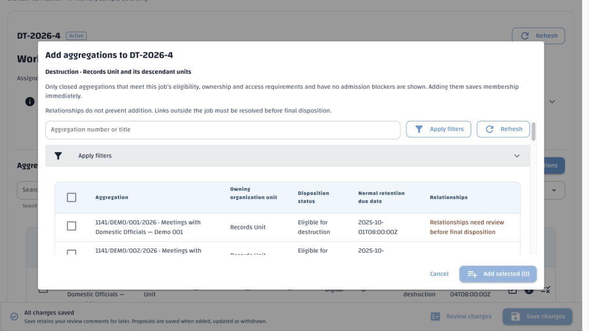
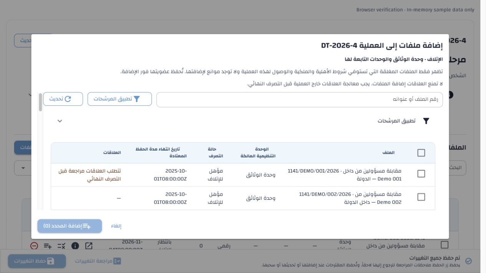
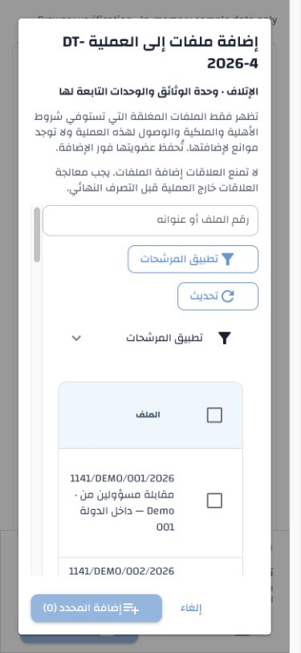

# Job-scoped aggregation selection — 4 November 2026

Approved scope: [Disposition §18.2 / DISP-44](../../specs/disposition.md#182-job-scoped-aggregation-selection-4-november-2026)
and [Destruction §5.2](../../specs/destruction-process.md#52-addition-and-initial-stage).

## Requirement → implementation → verification

| Requirement | Implementation | Evidence |
| --- | --- | --- |
| Select inside the current job, with explicit job/type/owning-subtree context | `selection.add_aggregations_dialog`, `job_screen.add_members` | Real NiceGUI controls and job integration tests; browser captures below |
| Fixed compatibility scope before counts/pagination | Existing eligibility endpoint with optional `job_id`; `queries.eligibility` intersects existing filters with admission criteria | API tests exclude other actions, unrelated owners, open/protected/already-admitted roots; descendant/grandchild owners included; incompatible caller filters cannot broaden scope |
| Current actor and assigned Preparer access/clearance and addition authority | Existing job projection and authorization functions; same assigned-person eligibility as admission | Actor/preparer clearance tested independently; current claim required for Simplified review; delegated Manager creation/admission regressions |
| Admit relationship-linked roots, warning only about final disposition | Page-local boolean projection of existing `relationship_scope`; no related identities returned | Linked candidate remains selectable; warning contains no endpoint/link IDs; existing relationship/admission regressions |
| True server paging, search and due filters | Existing `PageTable`; query limited to 200 characters; at most 100 explicit selected snapshots | Count/offset/search/date API tests; current-page selection across two server pages, filter/refresh clearing, unchanged selected versions |
| Immediate addition, preserving per-item results | Existing memberships command, without a second chooser/Save | Late-hold test retains valid addition and rejects invalid peer; partial-result UI remains open with paginated failures and fresh candidates |
| Safe retry and cancellation | Exact UUID/payload/job version retained on uncertain transport; definitive failure requires refresh | Retry equality and new command after refresh tested; cancellation without mutation; closed/inactive views ignore late responses and cannot add |
| Return to refreshed Aggregations tab | Explicit workspace refresh callback preserves job/task identity; reset to first unfiltered active-member page | Job integration test verifies task/job/tab and filters; live successful addition updates job count from 35 to 36 |
| Preserve existing work and other flows | Existing dirty-comment guard; standalone eligibility/creation/chooser retained | Simplified-addition, shared-footer, pending-proposal, general eligibility and addition-feedback regression tests |
| English/Arabic, responsive layout and established table styling | Existing Wathiq `PageTable`, bounded dialog card and native flex/overflow | Both-language tests and live desktop/phone checks; no new global CSS or RTL overrides |

## Passing automated checks

- **26 API checks:** new candidate tests and existing job-creation tests.
- **115 API checks:** existing membership/admission and review-edge regressions.
- **139 UI/localization checks:** picker, Simplified additions, bulk selection,
  existing screens, addition feedback, shared footer, pending proposals and Arabic
  grammar/terminology verifier unit tests.
- **16 final picker checks** passed after the last filter-state, keyboard-search
  and tooltip refinements. These overlap the combined run above.
- Catalogue reference/stale-key checks passed. All 4,029 active English/Arabic
  keys have identical order/coverage, nonblank values and matching placeholders.
  All 4,017 pre-existing Arabic entries and per-item provenance are unchanged;
  the 12 new drafts passed generated-text terminology/quality validation and
  artifact-hash checks. The generic draft generator's whole-file bootstrap
  validator is not used to replace administrator-curated export wording.
- Configuration-authority validation, API environment-template consistency,
  Python compilation and `git diff --check` passed. No environment setting changed.

Every database suite ran only in a newly created canonical-schema disposable
database. Initial fixture runs exposed closed-metadata/recalculation assumptions;
fixtures were corrected to use the existing reopen/reclose/evaluation lifecycle,
unique security names and a genuinely unclaimed multi-user review queue.
Production admission rules were not changed to accommodate tests.

| Run | Disposable database | Cleanup |
| --- | --- | --- |
| Initial scope checks | `erms_messaging_test_acl_a76ba099e47a4c54ad1dc88384337d51` | Dropped |
| Corrected fixtures | `erms_messaging_test_acl_507e89d84b4a4851a98134f564aa76d1` | Dropped |
| Passing candidate/creation checks | `erms_messaging_test_acl_a08d58722a834d27b2ae634a7d7fb5f3` | Dropped |
| Passing existing regressions | `erms_messaging_test_acl_b7fa6aeef0ca4a029a3f9663c3d4165a` | Dropped |

All four were independently confirmed absent. No test suite targeted `demo`.

## Browser observations

The temporary page mounted the actual `job_screen`, picker, selection control
and Wathiq stylesheet over in-memory sample data. API authorization/persistence
were verified separately against disposable databases. The standalone job table
provided the comparison for the same light-blue header, borders and typography.

The initial 4 November implementation used native `full-width` and a fixed
viewport height. The user approved a compact refinement on **5 November 2026**:
1,100px maximum width, content-based height capped at 75% of desktop viewport
height, with nearly the full height available on phones.

The observed 560px Quasar default cap cannot express the requested width with
the prior card width class alone, while `full-width` forces viewport-wide sizing.
The existing native card `.style()` API now supplies a bounded 1,100px width.
Responsive height utilities override the default dialog maximum; no fixed
height is imposed. A native `ui.column` with flex/overflow scrolls only the
body. Its inner column retains its intrinsic height so the flex layout cannot
collapse the table to its header. QTable retains its own horizontal scrolling.
No raw CSS selector, JavaScript resize observer or RTL override was needed.

Final measurements in **both LTR and RTL**: at 1280×720, the populated dialog is
1,100×540 (75% height), with heading and actions outside the scrolling body.
At 1280×1000, one English result shrinks the dialog to 596px high, below its
750px cap. At 390×844, the phone dialog is approximately 327×796 with no dialog
overflow; filters fit within the body and primary/Cancel buttons remain visible.
The body scrolls through the table and pagination while the footer stays put.
English desktop selection enabled **Add selected (1)**;
Arabic scope, guidance and relationship warning used the maintained draft text.
Cancellation retained the job; successful sample addition returned to its
updated Aggregations tab. Reopening fetched fresh data. Viewport overrides,
temporary browser tab and verification server were removed after checking.

The sizing refinement passed **22** picker/Simplified-addition regression checks
in English and Arabic, plus catalogue references/stale-key, configuration-authority
and whitespace checks. It changes no UI text, catalogue entries, API, authorization
or persistence behavior. No database-backed suite was needed for this layout-only
refinement. Browser checks confirmed selection, search, addition/refresh and
cancellation. The local stack was restarted through its recorded controller.

## Local deployment and translations

No migration, new database entity, privilege, application setting or environment
variable is required. The existing eligibility read accepts optional positive
`job_id` and bounded `query`; its general mode is unchanged. Scoped responses
also provide current job/version/type/owner and the existing addition-role
projection. The membership mutation and per-item outcomes are unchanged.
There is no new operational-result or authorization cache. Selection is bounded,
dialog-local and isolated by mounted identity/language; close/navigation discards it.

The authorized `demo` update synchronized definitions and explicitly seeded
Arabic with `--missing-only`: **12 stored, 4,017 protected, 0 corrected, 0 failed,
0 awaiting generation**. The new translations remain unpublished drafts for
administrator review. No administrator export was promoted and no existing
translation wording was replaced. Colleagues receive the new definitions/drafts
through the existing local-stack catalogue synchronization workflow.

The recorded local stack was restarted through its ownership-aware controller.
The running API exposes the scoped eligibility contract and the WebUI responds
successfully. API and WebUI should be deployed/restarted together.
