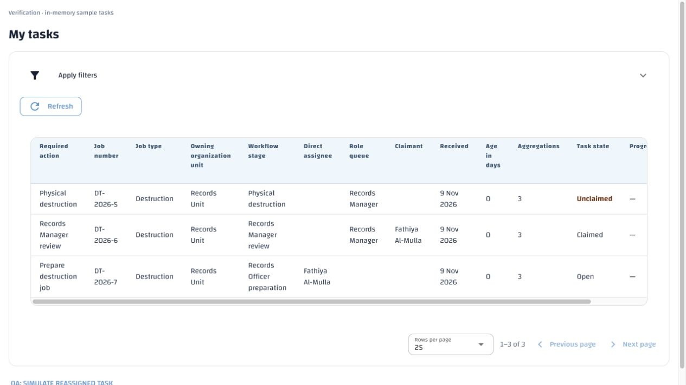
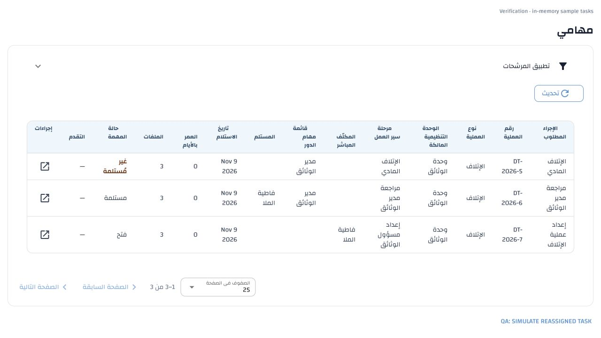
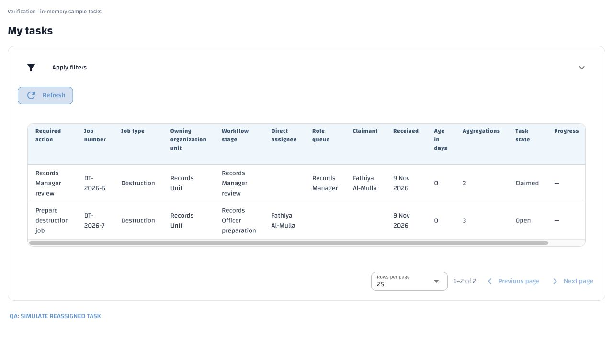
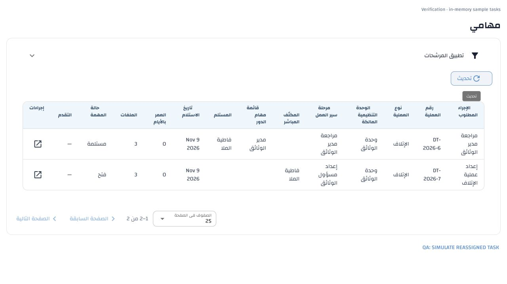

# Personal disposition task inbox — 9 November 2026

My Tasks now contains only the signed-in person's currently authorized direct
assignments, their own claimed tasks, and genuinely available unclaimed queue
work. Once someone else owns a task, it is excluded for every role. Records
Managers and Records Officers retain their existing job-based management route.

## Requirement → implementation → evidence

| Approved requirement | Implementation | Verification |
| --- | --- | --- |
| Destruction §§6.1–6.3, DEST-21; Disposition §17.5, DISP-39: personal inbox | `workflow.tasks` applies ownership together with current eligibility in the shared count/page predicate | Direct assignment, manual claim, reassignment, release and server total/offset regressions; File Administrator, Unit Manager and Records Manager queues |
| A queue row must actually be claimable | Exclude open sibling rows when another task for the same job/stage is claimed, matching the existing atomic claim gate | Separate Manager-role queues disappear after a claim and return after release; duplicate claim still rejected |
| Retain current access and clearance | Existing `task_eligible` remains mandatory; no authorization function or privilege is broadened | Inactive user/role, expired membership, privilege/profile and clearance-loss checks |
| Manage other people's work from Jobs, independently of My Tasks | Existing authorized workspace/task-management projection and Current task link remain unchanged | Manager and Officer can still inspect/reassign from job details; cannot edit another claimant's review; actual physical-task reassignment regression |
| Simple unclaimed distinction | Existing Task state cell displays **Unclaimed** in dark amber, semibold text for open role queues | English/Arabic component tests and actual native Wathiq table browser rendering; no new column, badge, state or filter |
| Freshness and navigation | Existing uncached bounded inbox request and retained Refresh behavior | English/Arabic refresh success/failure/abandonment, real request offsets, job/task navigation checks; browser Refresh removes simulated reassigned row and corrects count |

## Verification

- **66 API/catalogue tests passed**, covering the complete workflow and physical
  destruction test files plus canonical Arabic coverage and terminology checks.
- **6 additional authorization cases passed** with explicit empty-inbox assertions
  after eligibility loss.
- **247 English/Arabic task UI tests passed**. **46 translation/locale and Arabic
  terminology/grammar checks passed**.
- The representative history regression retains 200 jobs with cancelled earlier
  assignments, checks the current-stage index and accurate disjoint server pages.
- Configuration authority, API template consistency, catalogue order/hash,
  placeholder/blank checks and whitespace checks pass.

All API tests use newly created disposable databases. The final runs used
`erms_messaging_test_acl_8a2923e536ed4214a5e6ee1681bab49a` and
`erms_messaging_test_acl_364aa255b19b471db86acb311ea6f859`; cleanup is recorded in
the scoped requirement ledger. The earlier fixture-development run used
`erms_messaging_test_acl_db0c4229f59141309af855d68448ce54` and was dropped after
identifying that future disposition types do not yet create preparation tasks;
that fixture was narrowed to the implemented destruction workflow. No future
workflow was added to make a test pass. No test ran against demo.

## Local demo check and translation preservation

A separate **read-only** demo transaction verifies DT-2026-5 task 30 remains
claimed by Yahya (user 6): Fathiya (user 4) receives zero inbox rows for that job;
Yahya receives task 30; Fathiya's authorized job workspace still offers reassignment.
No claim, assignment, history or job data was changed for this check.

One contextual key, `disposition.ui.unclaimed`, was added with Arabic draft
**غير مُستلمة**. The canonical artifact now covers 4,067 active keys. All prior
4,066 Arabic items and their provenance are unchanged (canonical item hash,
excluding the new key: `807f6d6880c8454149bbc00a1666bf787ca771d36588d2467436c063f0b4de53`).
The explicit missing-only utility stored that one draft in demo, corrected no
existing translations and left it unpublished for review. All 4,127 prior Arabic
database rows are unchanged, hash
`d9566cb73fc5b325d1c88546c7aefb623c9e1872ba01df2f13cd752dcc554dd9`.

No schema migration, environment setting, cache or new management control is
required. The local stack is reloaded for review. Existing notification producer
configuration and Arabic publication remain unchanged.

## Browser evidence

The actual `tasks_screen` and existing Wathiq styles were mounted with in-memory
sample data, using the checked-in English/Arabic catalogues. This verifies table
presentation without manufacturing claims in demo. Both languages show the same
columns and ordinary status text. Unclaimed is dark amber and semibold; other
state values retain their normal colour and weight. Existing light-blue headers, borders, spacing,
pagination and direction remain intact. Refresh updates rows/counts with filters
collapsed. Temporary preview and browser tabs are removed after verification.

## Unclaimed colour follow-up

At the user's request, the existing Unclaimed text is now dark amber and
semibold, with no badge or additional column. The display label itself remains
the non-colour cue. NiceGUI's native dynamic column `style` configuration scopes
the emphasis to open role-queue rows; no custom slot or global CSS is introduced.
A native column utility class was investigated first: browser inspection showed
that Wathiq's shared table-cell selector overrode its colour. Native per-column
style resolves that observed cascade without changing shared table styles.

Both English and Arabic browser views confirm `rgb(120, 53, 15)` and weight 600
for Unclaimed; ordinary Claimed/Open cells retain `rgb(51, 65, 85)` and weight 400.
The existing 247 bilingual task UI tests pass again. No catalogue wording or
translation artifact changed in this follow-up, and no database test or business
mutation was needed for the colour change.
