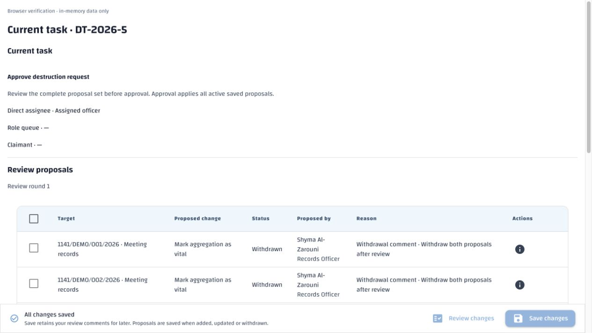
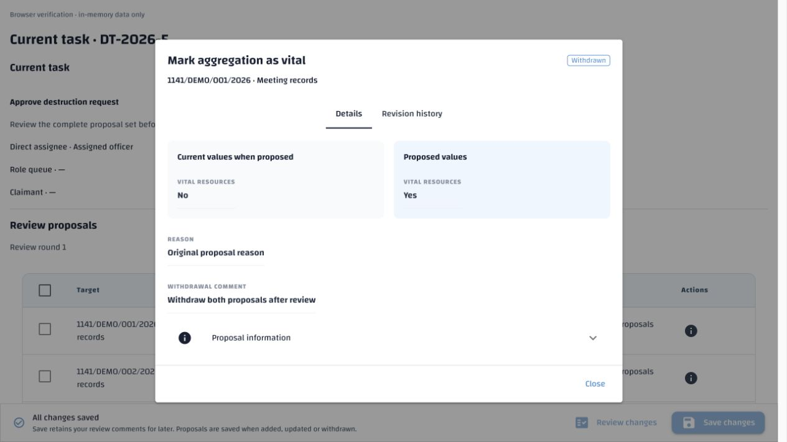
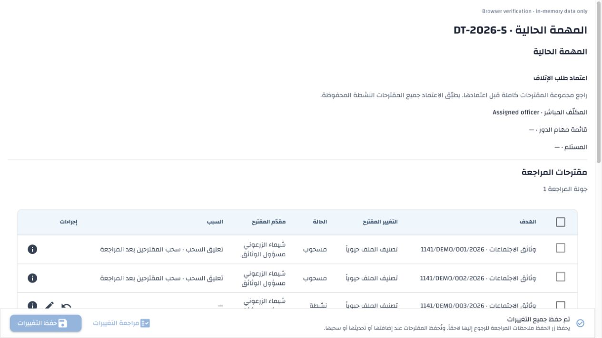
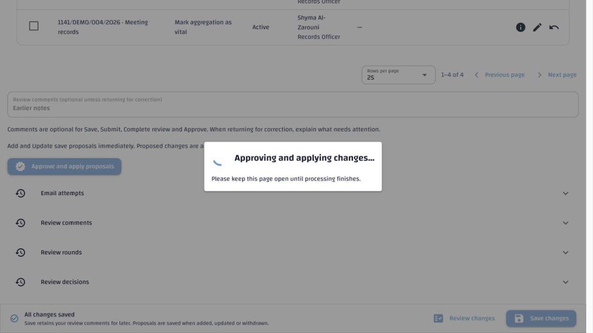
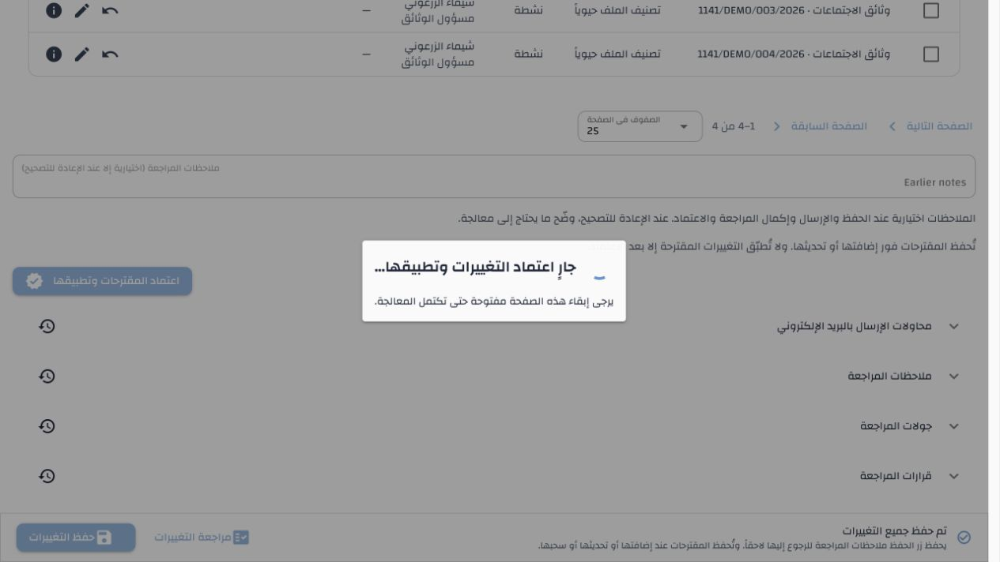

# Review withdrawal comments and approval progress — 9 November 2026

**Superseded progress design:** The later approved background-processing change
replaces this note's blocking progress dialog. Its withdrawal-comment findings
remain valid. See [background disposition verification](background-disposition.md)
for the current implementation and evidence.

The bulk-withdrawal comment was already saved to every selected proposal. A
read-only check of the latest two-proposal withdrawal in `demo` found both rows
had the same withdrawal comment; only one had an original proposal reason. The
proposal table displayed the original reason, making the other row look blank.
No historical data repair or database migration is needed.

Every readable withdrawn row now shows its **Withdrawal comment**. Details keep
that comment and the original proposal reason in separately labelled fields.
Existing partial/full redaction remains in force. The comments editor, immediate
proposal persistence and per-item audit records are unchanged.

After confirmation, a standard persistent NiceGUI dialog shows a spinner,
**Approving and applying changes…**, and asks the user to keep the page open.
It blocks ordinary page interactions while approval, application, required
server-side document work and the existing result-view callback finish. Escape
and outside clicks cannot dismiss it. The existing busy guard prevents duplicate
submission. There is no percentage because this request exposes one complete
result rather than item-level progress. It does not prevent forcibly closing a
browser tab or losing the connection; existing command identities/recovery still
apply.

Progress closes on success, errors, cancellation of an in-flight handler, or
view disposal. Confirmation cancellation starts no approval/progress. An
approval already committed with pending documents follows existing document
recovery rather than applying the proposals again. No new API, worker, cache,
privilege, workflow state or approval transaction was added.

## Requirement → implementation → verification

- Destruction specification revision **1.22**, §§6.5.1 and 10, defines the display
  and progress corrections. `docs/disposition-workflow.md` documents their use.
- `frontend/webui/disposition/review.py` displays the withdrawal comment and
  hosts native persistent progress, with cleanup in the action's `finally`.
  `proposal_details.py` retains both explanations separately.
- **297 relevant UI cases passed**: the combined run of approval progress,
  proposal presentation, proposal details, bulk controls and task forms passed
  295 cases; an added result-view-disposal variant passed in the final 12-case
  progress run, adding two bilingual cases. Coverage includes shared comments,
  original/empty reasons, redaction, exact retries, unsaved comments, cancellation,
  duplicate clicks, delayed result views, host disposal, API failures, committed
  document failure recovery and abandoned views.
- **15 API/database cases passed** in
  `backend/services/api/tests/test_disposition_bulk.py`. The strengthened test
  checks shared English, Arabic and absent comments against every stored row and
  the readable proposal projection. It retains original reasons and verifies
  whole-batch rollback, exact retry results and two item history events.
- The final run created
  `erms_messaging_test_acl_c12afce68f654021bb651cec6889ce19` from the canonical
  schema and dropped it afterward. The initial test run also dropped its own
  disposable database after an incorrect test assertion expected a comment in
  the compact mutation receipt; the corrected test checks database storage and
  the actual proposal projection. No test suite used `demo`.
- Active-key coverage/order, approved Arabic terminology, configuration
  authority, API environment-template consistency and whitespace checks pass.
  The separate historical baseline-ledger checker still reports pre-existing
  drift in other source snapshots/references, SQL symbol anchors and unowned
  acceptance IDs. This amendment reconciles its destruction-section locators
  and records scoped evidence; it does not claim that unrelated baseline drift
  was repaired.

## Live browser evidence

The actual ReviewForm, proposal Details, standard table and application
stylesheet were rendered with in-memory API fixtures. No persistent job,
proposal, approval or document was changed. Both withdrawn rows display the
same comment, including the row whose original reason is blank. Details show
both explanations. English/LTR and Arabic/RTL use the same established table
headers, borders, spacing, actions and pagination.

Both languages show the persistent spinner during a delayed approval. Escape
and outside clicks left progress open. After the test response, progress closed,
the result callback ran and controls became available again. Unit checks also
cover replacement of the old form by the result view and failed responses.

## Translation and deployment

Added three contextual keys to both maintained artifacts:
`disposition.ui.withdrawal_comment`, `disposition.ui.approval_processing` and
`disposition.ui.approval_processing_hint`, bringing coverage to **4049** keys.
All **4046** previously checked-in Arabic entries and their provenance are
preserved. New entries have individual generation metadata; no administrator
export was replaced or promoted.

The explicit Arabic seed utility ran with `--missing-only` against the
user-authorized `demo` database, storing three generated, unpublished drafts.
It corrected none and reported zero validation failures or missing generated
values. All **4107** pre-existing Arabic database rows, including retired keys,
had the same before/after hash:
`cf5d06da446e08ed7ce17faefd475e2d31a076e788e6708d9f622cdc90c263c1`.
New Arabic drafts require administrator review and publication. Existing
translations/publications were not changed.

The recorded local stack was restarted successfully to load the UI changes;
its services are running. No environment setting changed. Colleagues can deploy
normally without a migration or data repair. Their normal startup imports only
missing Arabic drafts. Temporary preview tabs and the in-memory preview server
are closed after verification.
