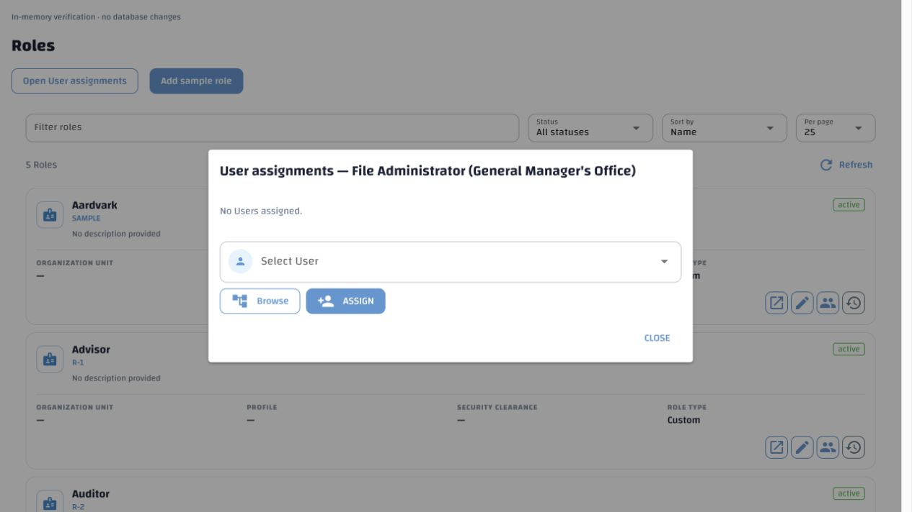
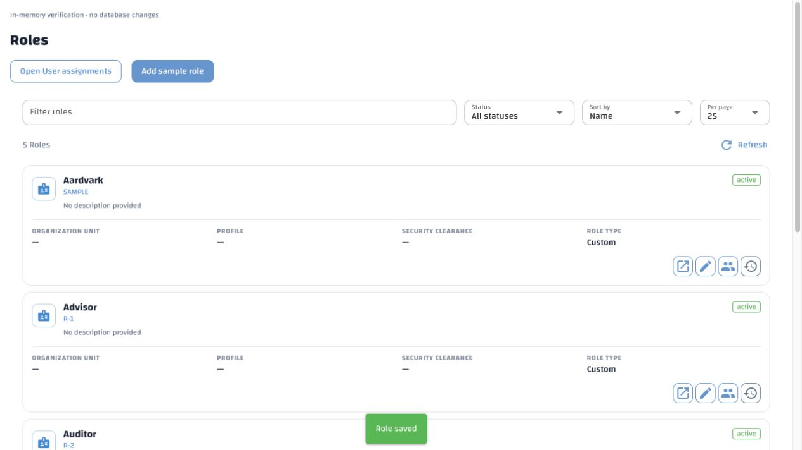
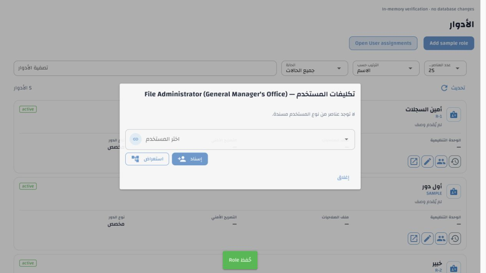
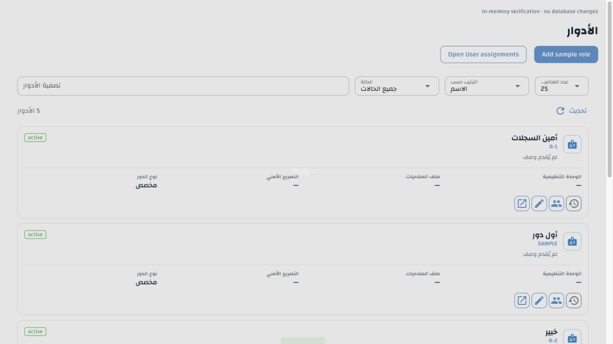

# Shared text rendering and role order after Save — 5 November 2026

The assignments heading displayed `General Manager&#x27;s Office` because the
shared catalogue renderer HTML-encoded interpolation values before passing them
to literal NiceGUI text properties. The earlier reviewer-warning-only decoding
workaround did not cover assignments, confirmations, notifications, tooltips or
other interpolated labels.

`i18n_catalogue.py` now supplies literal text and retains the independent
bidirectional isolates. NiceGUI/Vue escape it when writing DOM text. HTML/Vue
slot templates retain explicit `html.escape` at their output boundary; native
NiceGUI property strings quote dynamic text with Python `repr`. No entity is
decoded from user-authored source text. One-pass interpolation also preserves
brace-like names verbatim instead of treating them as further placeholders.
The warning-specific `html.unescape` workaround has been removed.

The audit covered catalogue output in `app.py`, disposition screens/review,
classification workspace, application settings, navigation, and HTML/template
sinks throughout the WebUI. No catalogue renderer call was found flowing
directly to a raw HTML or Markdown sink; templates already escape translated
text explicitly. Rich message bodies use their separate existing sanitization
workflow. Property quoting was corrected across the shared application,
classification, settings and disposition controls, including accessible labels.
This implements the existing escaping and bidi requirements in
[internationalization §§7.2 and 15](../../specs/internationalization-and-user-preferences.md)
and [WebUI design-language guidance](../webui-design-language.md).

The Roles page's initial server order was correct. After creating or editing a
role, however, the common editor appended/replaced the row and sorted the page
by internal ID. It now reloads the existing bounded server page, preserving
sort, query, filters, limit and offset, updating the total, and retaining server
localization. Localized-name-only saves use the same reload. Existing detail
callbacks and search-first workflows retain their behavior. A Save completed
after navigation does not replace a different collection page. No collection
cache or new request on ordinary message rendering was introduced.

## Verification

- 146 focused tests passed, including literal punctuation, entity-like and
  markup-like names, nested interpolation, braces, bidi isolates, inspector
  framing, and create/update/translation saves with name/code/status sorting,
  filters and paging in both languages.
- The broad WebUI run passed 1,423 checks. Two unrelated source-assertion tests
  fail identically against unchanged HEAD: the entity editor test searches for
  an obsolete condition, and the legal-holds layout test expects an absent
  footer class. These were reproduced without changing application files.
- Four background collection-refresh interaction tests passed with
  `--asyncio-mode=auto` (the combined first run lacked that fixture mode).
- Catalogue completeness, approved Arabic terminology, configuration authority,
  API environment-template consistency and whitespace checks passed.
- Live browser verification mounted the actual Roles list, editor Save,
  collection loader and User assignments dialog with an in-memory API. Creating
  a role immediately preserved Name order in English and Arabic. Repeated
  navigation selected the correct language/direction. No persistent role,
  organization, user, or database data was altered for testing. Database
  collation is unchanged.

English assignments title:

English list immediately after saving a new role:

Arabic assignments title and list:

No English/Arabic catalogue entries or translation wording/provenance changed;
no administrator export was promoted and no new drafts require review. No
migration, database repair or environment setting is required. The WebUI must
be restarted to load the shared rendering change.

The recorded local stack was restarted successfully; API and WebUI reported
ready. The temporary preview server and browser tab were closed after verification.
