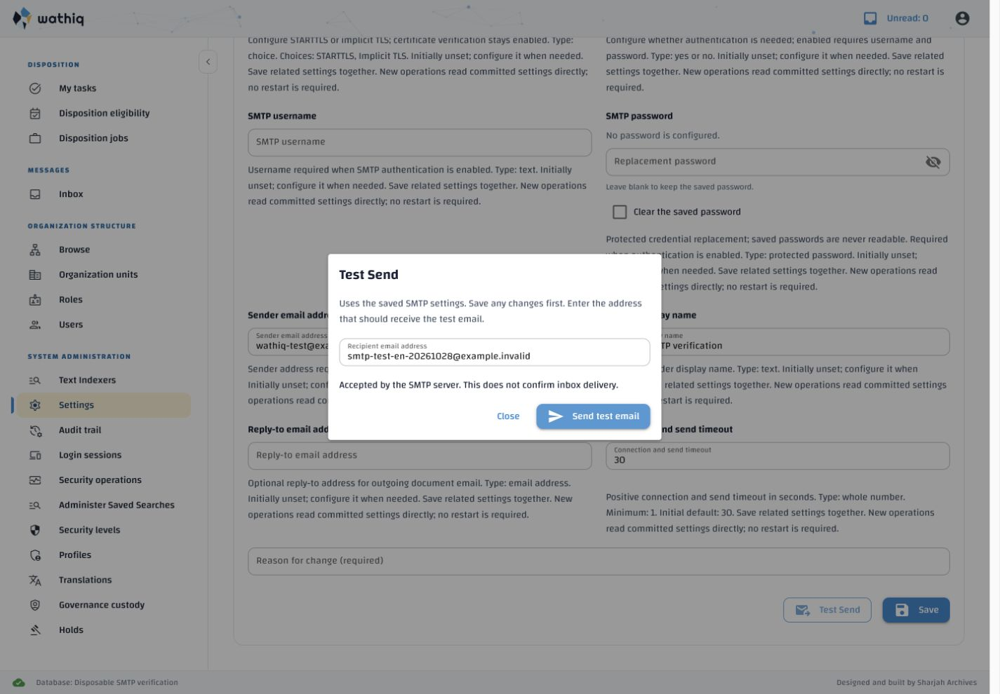
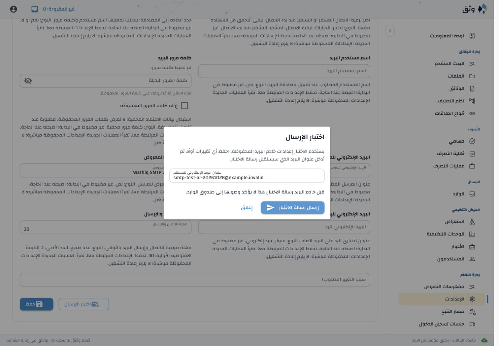

# Email settings Test Send verification

Verified 28 October 2026 against Administration Settings §4.1. The feature is
implemented and loaded in the managed local stack.

## Requirement traceability

| Approved behavior | Implementation | Evidence |
| --- | --- | --- |
| Existing settings-management privilege | API router dependency and operation-policy registry | `test_settings_privilege_is_required_before_send`; policy inventory tests |
| Temporary recipient dialog; saved SMTP configuration only | WebUI `settings_page`, API `test_send_email`, fresh `capture_email_settings` | Recipient-only request, malformed/header-injection/extra-field rejection, saved-config freshness and unsaved-form preservation tests |
| Protected credentials; existing TLS transport, sender/reply-to and timeout | Server-side password resolution and existing `disposition.email.smtp_send` | Both TLS modes, verified TLS contexts, server-only credentials, envelope sender/reply-to and fixed bilingual message tests |
| Truthful outcomes, no automatic retry or settings/history mutation | `SmtpTestResult` and localized result feedback | Acceptance, connection/TLS/authentication/DATA failures, uncertain DATA, lost API response, no retry/settings/history mutation tests |
| Duplicate and abandoned-dialog/page protection | In-flight guards, NiceGUI value-change callback and page/form identity checks | Interaction tests for duplicate submissions, closing a pending dialog and inactive pages |
| English and Arabic/RTL | Contextual `settings.email_test.*` keys and standard NiceGUI dialog direction | Both-language interaction tests and live screenshots below |

## Automated checks

- API/settings/disposition communications/policy tests: **83 passed, 1
  deselected** in a uniquely named disposable database initialized from the
  canonical schema. Command:
  `backend/services/api/.venv/bin/python tools/run_disposable_acl_tests.py backend/services/api/tests/test_smtp_test_send.py backend/services/api/tests/test_application_settings.py backend/services/api/tests/test_disposition_communications.py backend/services/api/tests/test_policy_inventory.py -k 'not test_certificate_shared_sender_after_completion_requires_actual_manager'`.
- WebUI interaction, settings audit and API client tests: **97 passed**.
  Command:
  `frontend/webui/.venv/bin/python -m pytest -q -o asyncio_mode=auto frontend/webui/interaction/tests/test_application_settings.py frontend/webui/interaction/tests/test_application_settings_audit.py frontend/webui/tests/test_api_client.py`.
- Catalogue reference/stale-key validation, approved Arabic terminology,
  exact active-key coverage/order, nonblank text, placeholders, markup,
  provenance preservation and artifact hashes passed.
- Configuration authority, API environment-template consistency and
  `git diff --check` passed. No environment settings or database migrations added.

The deselected test,
`test_certificate_shared_sender_after_completion_requires_actual_manager`,
fails before email sending because its disposition job remains `active` when
the test expects `completed`. The same failure was reproduced in a separate
disposable database with the unchanged HEAD email-settings capture function.
It is an existing disposition-workflow failure outside this amendment.

## Live verification and cleanup

A separate API and WebUI used a new disposable database with saved SMTP
configuration pointing exclusively at local MailDev (`localhost:1025`, implicit
TLS, authentication disabled). The process trusted MailDev's local certificate
through `SSL_CERT_FILE`; certificate and hostname verification remained enabled.
Persistent SMTP configuration was not changed for testing.

The English and Arabic dialogs each sent one fixed bilingual test message to a
synthetic `example.invalid` address. MailDev captured both without attachments:
`g50zq8x4.eml` (English) and `nvy0bh22.eml` (Arabic), under gitignored
`.runtime/maildev/mail/`. Both dialogs reported SMTP acceptance without claiming
inbox delivery. After navigating away and returning to Email settings, Test Send
opened a fresh dialog with an empty recipient and retained the saved SMTP values.
No preview server exceptions were observed.

The preview API/WebUI were stopped, the preview and test databases were dropped,
and database absence was verified. The browser tab was closed and its temporary
viewport override reset. The reused MailDev service remains running. The managed
local stack was restarted through its ownership-aware launcher and is ready.

## Translation and deployment handoff

`messages.en.json` and canonical `messages.ar.generated.json` gained **11**
`settings.email_test.*` keys, bringing exact active-key coverage to **3,908**.
All **3,897** existing Arabic translations and per-item provenance were preserved
unchanged; no administrator export was promoted or replaced. New entries include
generation provenance and require human review.

The explicit local `--missing-only` seed stored 11 generated drafts, protected
all 3,897 prior entries, and reported zero corrections, failures or missing
generation. A subsequent run protected all 3,908 entries and stored none.
Read-only verification confirmed all 11 new local Arabic entries remain
unpublished drafts. Screenshots used publication only inside the disposable
verification database. Review and publish the new drafts through Translation
Administration for Arabic runtime wording.

Deploy the API/WebUI code and catalogue together, synchronize definitions, and
run the established explicit Arabic draft seed/import workflow. Restart the API
and WebUI processes to load the code/catalogue. Existing SMTP values apply
immediately to later test attempts; no new configuration is required.
