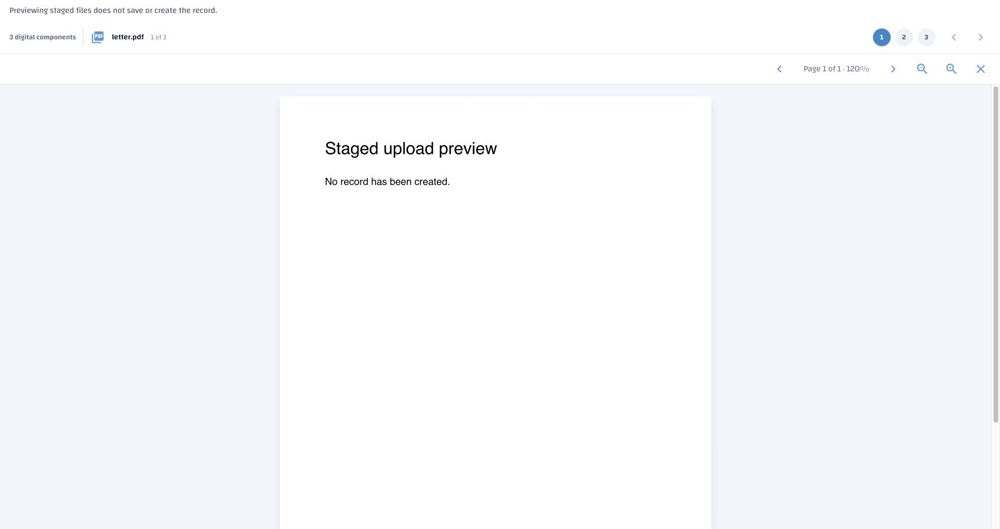
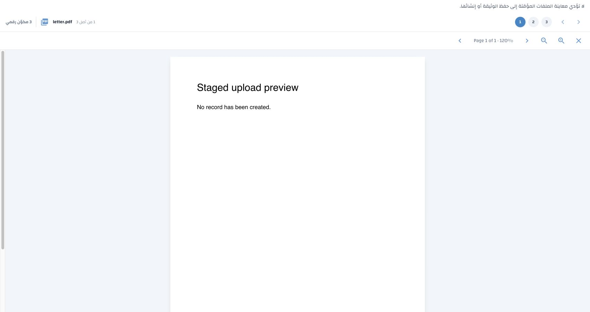

# Staged digital component preview verification

Verified 3 November 2026 against the approved amendment in
[Digital component preview navigation, section 4](../../specs/digital-component-preview-navigation.md#4-preview-staged-components-before-record-creation).

## Requirement traceability

| Requirement | Implementation | Verification |
|---|---|---|
| Preview completed, supported staged uploads with the existing viewer | Draft editor passes its mounted component metadata into `preview_record_components`; cards reuse the translated Preview tooltip and accessible name | UI tests exercise real cards and the shared viewer in English and Arabic; live PDF rendering screenshots below |
| Preserve record creation and staged originals | Read-only rendition route and `PostgreSQLContentStorage.read_draft`; no commit, promotion or saved-record content-view events | API tests compare metadata, expiry and bytes; check zero permanent records/components/events; explicitly commit after converted preview and compare saved bytes |
| Enforce draft owner, current `record.create`, open/unexpired draft and component membership | `_open_draft` on every GET/HEAD; component lookup scoped to both IDs, row locked while reading | API tests cover another owner, revoked privilege, cross-draft IDs, expired/deleted/committed drafts, deleted and incomplete components |
| Reuse format handling and conversion constraints | Shared `_rendition_response`, existing PDF conversion service, isolated temporary conversion cleanup | Native PDF/image/audio/video, conversion and failure checks; existing timeout, unsupported-format, native MIME/audit and saved processing-copy lifetime regressions |
| Safe HTTP behavior and segmented storage | Private no-store, sandbox/nosniff headers; existing HEAD/range logic; ordered staged segments | Full/range/HEAD checks and a range spanning multiple stored segments |
| Preserve saved viewer permissions | Saved rendition wrapper and original capability APIs retained; staged viewer omits Print/Download | Saved content authorization/PDF/print regressions and UI capability-control tests |
| Bound rendering and avoid stale async work | Reuse editor metadata, 50 switcher entries/page, selected-file byte requests, closed/source-active guards | UI tests with 121 components; delayed responses after closing source or viewer do not render |

## Automated results

- API suite: **30 passed**, covering staged preview, saved PDF/print, content
  authorization and operation-policy inventory.
- Additional segmented-storage and saved rendition/conversion regressions:
  **5 passed**.
- UI preview and entity regression suite: **161 passed, 1 deselected**.
  The deselected existing test,
  `test_entity_translation_editor_loads_selected_language_automatically`, fails
  against unchanged `HEAD` too: its source-string assertion expects an older
  `if not creating and spec.key in multilingual_fields:` expression. This task
  does not change that editor or its test.
- Catalogue reference/stale-key, approved terminology, exact active-key coverage,
  ordering, placeholders, blanks and artifact hash checks passed. Both artifacts
  have **3,991** keys. The sole added key is `components.staged.preview_hint`;
  all **3,990** previous Arabic entries and provenance remain byte-for-value
  unchanged. The English plural suffix is no longer inserted into the Arabic
  component-count message; existing curated translation text was preserved.
- Python compilation and `git diff --check` passed.

Database tests used canonical-schema disposable databases only:

| Run | Disposable database | Cleanup |
|---|---|---|
| Initial tests, before correcting test assertions | `erms_messaging_test_acl_6adebd2e80484019bee9533b1e6d6543` | Dropped |
| Main passing API run | `erms_messaging_test_acl_59e0d2df6199498c9b80eb8d88ca3cd0` | Dropped |
| Additional regression run | `erms_messaging_test_acl_e7bf73e8a36f4332966b157836ba1674` | Dropped |

No test suite targeted `demo`. The authorized missing-only Arabic seed was run
separately against `demo`: **1 stored, 3,990 protected, 0 corrected, 0 failed,
0 awaiting generation**. The new translation remains an unpublished draft for
review. There is no schema or environment-variable change.

The generated operation-policy inventory includes the new draft rendition GET.
To regenerate it, its existing disposition-history detail GET also needed the
same relationship-scoped classification as its parent history route. No route
authorization behavior was changed by that inventory correction.

## Live rendering and interaction

A temporary local verification page used the actual component-card renderer,
shared viewer and shipped PDF.js canvas with sample in-memory files. API
authorization/storage were verified separately by the disposable-database tests.

Observed in Chrome: PDF canvas rendering; ordered component switching; supported
PDF/image/text Preview actions and no ZIP Preview; no staged Print/Download;
closing Preview preserves a changed unsaved title. Final Arabic rendering shows
the translated hint, accessible actions, switcher and RTL layout. The existing
PDF.js page-status string remains English, as in saved-record preview. The
temporary server was stopped and its browser tab closed after verification.

Reproduce the focused checks using the two `test_staged_component_preview.py`
files under API and WebUI tests. Always use `tools/run_disposable_acl_tests.py`
for database-backed runs; do not point pytest at an existing installation.
