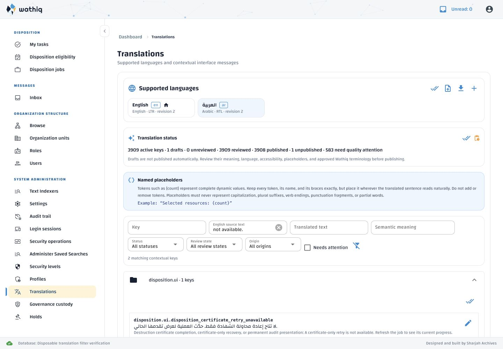
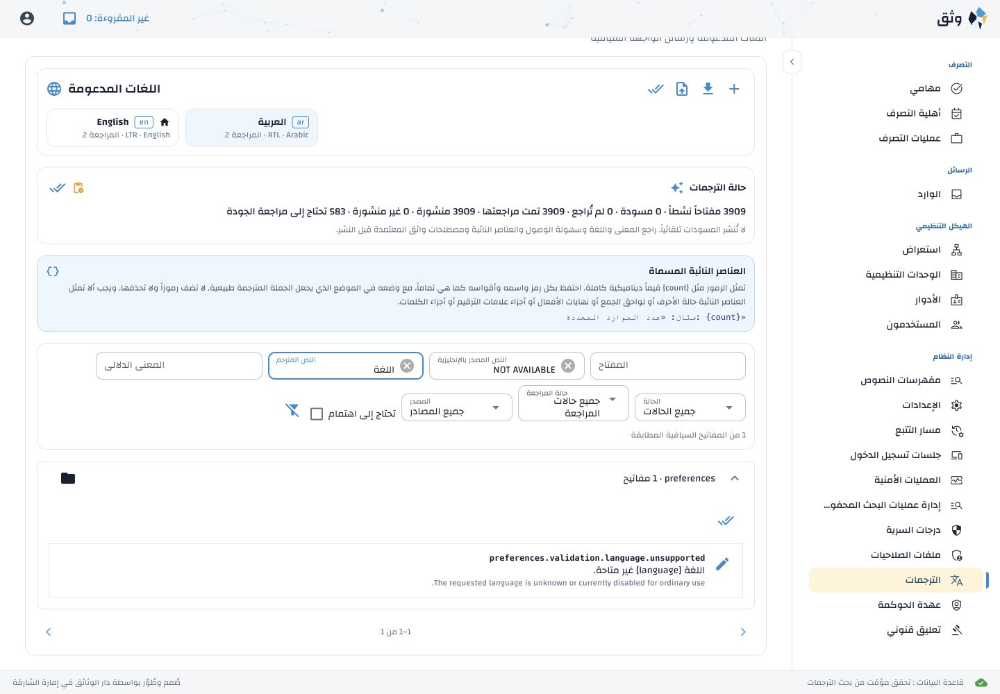

# Translation Administration: English source text filter

Verified 28 October 2026. User-requested extension to Internationalization
§7.4, §13 and acceptance item 19.9, recorded in specification revision 0.25.

| Requirement | Implementation | Verification |
| --- | --- | --- |
| Independently search English source text | `admin_messages(source_text=...)` filters `definition.default_text` with parameterized case-insensitive partial matching | English/Arabic selected languages; translation overrides do not replace the source; missing translation rows remain searchable |
| Combine with existing filters and paging | Shared SQL predicates apply before count, context-group paging and row retrieval | Combined key/source/translation/meaning/status/origin tests; mismatches return zero; filtered totals and distinct context pages agree; blank source is unconstrained |
| Clear, debounce and reveal matches | Standard NiceGUI input beside Translated text, 350 ms debounce, existing page-reset and expansion behavior | Production-screen interaction tests and live LTR/RTL verification |
| Preserve filters after editing; display fresh data | Existing editor refresh reuses current controls | Disposable Arabic draft save retained the source query and displayed updated translation text |
| Safe asynchronous navigation and language | Sequence checks, page/deleted-container guards and owning-client render context | Delayed-response tests after a newer filter/navigation; Arabic Clear all summary remains Arabic |

## Checks

- **29 API/catalogue tests passed** using a fresh canonical-schema disposable
  database:
  `backend/services/api/.venv/bin/python tools/run_disposable_acl_tests.py backend/services/api/tests/test_localization_catalogue.py`.
- **4 production-screen interaction tests passed**, including English/Arabic,
  pagination reset, combined filters, clear-all and delayed requests:
  `frontend/webui/.venv/bin/python -m pytest -q -o asyncio_mode=auto frontend/webui/interaction/tests/test_translation_source_filter.py`.
- **76 unit tests passed** across translation inspector, bulk administration
  and API client; **3 additional translation administration regressions passed**
  from `frontend/webui/tests/test_entities.py -k translation_administration`.
  Run plain unit tests separately from the NiceGUI user-plugin interaction suite.
- Catalogue references/stale keys, exact language coverage and order, blanks,
  placeholders, markup, approved Arabic terminology, provenance preservation,
  artifact hashes, configuration authority, API environment-template consistency
  and whitespace checks passed. No schema, privilege, environment variable or
  new cache was introduced.

## Live evidence and localization

A separate API/WebUI and disposable database demonstrated English source
search while Arabic was selected, a filtered translation edit/save, combined
English/Arabic filters, matching totals, clear-all and navigation in both UI
directions. The final Arabic clear-all refresh retained Arabic summary wording.
The preview published translations only in its disposable database for visual
verification. No persistent translation was edited or published by browser tests.

English and canonical Arabic artifacts gained one key:
`localization.filter.source_text` — **English source text** /
**النص المصدر بالإنجليزية**. Active-key coverage is **3,909**. All 3,908 prior
translation texts and administrator/generation provenance were preserved.
Sixteen earlier machine-generated drafts gained their missing explicit
`origin=generated` and `status=draft` fields, satisfying the existing artifact
validation contract without changing wording or review flags. No administrator
export was promoted or replaced.

The managed local stack was restarted through its lifecycle launcher. Its
explicit `--missing-only` seed stored the one new Arabic draft, protected 3,908
existing entries and reported zero corrections, failures or missing generation.
The new label remains unpublished for human review through Translation
Administration; deployments should synchronize definitions, import/seed missing
drafts and restart API/WebUI processes together. No new settings are required.

All disposable test/preview databases and preview processes were removed;
the temporary browser tab was closed and viewport override reset. The managed
local stack remains ready, and reused external services remain running.
