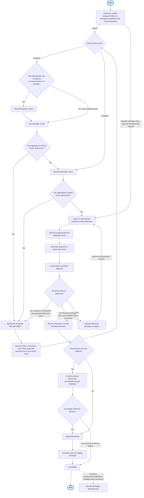

# Destruction Process — Disposition Extension Specification

**Status:** Approved
**Approved:** 12 October 2026
**Prepared:** 7 October 2026
**Project:** ERMS / Wathiq
**Revision:** 1.3
**Amendment approved:** 22 October 2026

## Revision history

| Revision | Date | Summary |
| --- | --- | --- |
| 1.3 | 22 October 2026 | Clarify eligible-but-blocked accelerated units and normal versus preserve-state holds during closure |
| 1.2 | 21 October 2026 | Apply common immediate exceptional-acceleration notifications independently of periodic destruction-eligibility reminders |
| 1.1 | 13 October 2026 | Added Records Manager Only routing and explicit Save without submission for every review participant |
| 1.0 | 12 October 2026 | Approved specification, including the agreed workflow, configuration, evidence, recovery, and verification requirements |
| 0.1 | 6 October 2026 | Initial destruction-process extension covering reminders, job ownership, internal review and approval, the external request, approval evidence, physical and digital destruction, and destruction certificates |
| 0.2 | 6 October 2026 | Clarified relationship admission versus final-destruction blockers, review UI, and checks before physical and digital destruction |
| 0.3 | 7 October 2026 | Added staged review proposals for vital status, disposition-blocking security, legal holds, aggregation relationships, and local retention overrides; deferred their execution until Records Manager approval; and required proposal-caused blockers to be removed before generating the external request |
| 0.4 | 7 October 2026 | Defined the disposition task inbox, role-queue claiming, common destruction-job workspace, task-specific forms, review-proposal presentation, asynchronous progress, and completion notifications |
| 0.5 | 7 October 2026 | Defined the destruction-specific logical data model for review proposals and effects, external approval, physical confirmation, asynchronous destruction, manifests, reminders, configuration, and protected operations; shared workflow tables remain defined by the common disposition specification |
| 0.6 | 7 October 2026 | Designated each organizational unit's File Administrator role through `org_units.file_administrator_role_id`, with same-unit, active, non-system role validation and role-queue routing |
| 0.7 | 7 October 2026 | Allowed a destruction job to inherit its effective File Administrator role from the nearest ancestor organizational unit when its owning unit has no valid File Administrator, without adding an inheritance-control setting |
| 0.8 | 7 October 2026 | Made File Administrator review conditional: skip it when neither the owning unit nor any ancestor has configured the role, but block routing when the nearest configured role cannot be used; clarified that inherited routing never grants access to descendant content |
| 0.9 | 7 October 2026 | Resolved Unit Manager identification through the authoritative `org_units.managing_role_id` defined by the Hierarchical Oversight Default ACLs security extension |
| 0.10 | 8 October 2026 | Documented why an unconfigured File Administrator review is skipped, while a configured but unusable role blocks submission |
| 0.11 | 8 October 2026 | Included Information Governance Managers alongside Information Governance Officers as destruction-eligibility reminder recipients |
| 0.12 | 8 October 2026 | Clarified that the notification contains no aggregation metadata, while the eligibility listing displays metadata and blocking information subject to access rights |
| 0.13 | 8 October 2026 | Allowed an active, empty job's owning unit to change only before its first submission to File Administrator or Unit Manager review |
| 0.14 | 8 October 2026 | Added proposals to remove existing named aggregation relationships, with deferred execution, relationship identity, authorization, and verification requirements |
| 0.15 | 8 October 2026 | Made individual governance-proposal reasons optional and required an overall job reason on each Records Officer submission |
| 0.16 | 8 October 2026 | Allowed a successor assigned Records Officer to revise their predecessor's proposals during preparation or correction, preserving original attribution and every revision |
| 0.17 | 8 October 2026 | Added attributed free-text instructions, observations, and recommendations for Records Officers and all review participants, visible to subsequent reviewers and preserved in history |
| 0.18 | 8 October 2026 | Named the shared free-text field Review notes |
| 0.19 | 9 October 2026 | Allowed destruction jobs to combine aggregations owned by the job's owning unit and its descendants, without transferring ownership or granting access; clarified consolidated review responsibility |
| 0.20 | 9 October 2026 | Explicitly defined direct assignee, role queue, and claimant in the task inbox |
| 0.21 | 9 October 2026 | Allowed all four workflow participants to revise or withdraw one another's proposals during their own open tasks, with complete attribution and history; Records Manager approval applies every remaining active proposal |
| 0.22 | 9 October 2026 | Added external rejection with correction notes, return to the assigned Records Officer, renewed internal review, and a newly generated destruction request |
| 0.23 | 9 October 2026 | Required external rejection-letter upload and creation of a linked governed evidence record in the latest open aggregation under the evidence classification to be specified |
| 0.24 | 9 October 2026 | Made active job creation and Records Officer preparation the explicit diagram entry, separating correction and resubmission from creation |
| 0.25 | 12 October 2026 | Explicitly attributed proposal execution to the approving Records Manager with actor_type = 'user', preserving all proposal attribution and change history |
| 0.26 | 12 October 2026 | Clarified that review-stage link removal is a proposal with an optional individual reason, and execution authority is checked against the approving Records Manager |
| 0.27 | 12 October 2026 | Distinguished immediate Records Officer removal of job membership during preparation or correction from proposed relationship removal requiring Records Manager approval |
| 0.28 | 12 October 2026 | Added organization-wide Standard or Simplified destruction review routing through the reusable Administration Settings page, with the route saved on each new job |
| 0.29 | 12 October 2026 | Made previously uploaded evidence previewable in later tasks and restricted corrective re-uploads to Records Officers and Records Managers, preserving every version and change in job history |
| 0.30 | 12 October 2026 | Set uploaded-evidence destination to classification 1651 and generated-report destination to 1652, using an organization-wide Disposition classification scheme setting and latest open root aggregations |
| 0.31 | 12 October 2026 | Replaced fixed classification numbers with scheme-scoped Uploaded evidence classification and Generated reports classification settings |
| 0.32 | 12 October 2026 | Required Governance Custody warnings for disposition destination settings left unconfigured after deployment |
| 0.33 | 12 October 2026 | Classified the system-generated digital destruction certificate as evidence stored under Uploaded evidence classification, rather than Generated reports classification |
| 0.34 | 12 October 2026 | Explicitly marked the workflow diagram's starting point and Completed endpoint |
| 0.35 | 12 October 2026 | Added explicit Start and End nodes before job creation and after completion |
| 0.36 | 12 October 2026 | Required proposal execution results to be saved as a job-linked governed report record under Generated reports classification |
| 0.37 | 12 October 2026 | Added configurable external authority name and email, SMTP administration settings, and repeatable request-form email sending with attributed delivery-attempt status |
| 0.38 | 12 October 2026 | Added repeatable Records Manager email sending of the digital destruction certificate using the shared authority and SMTP settings, with per-attempt status and history |
| 0.39 | 12 October 2026 | Added a downloadable physical-destruction preparation report grouped by terminal classification, with aggregation locations and physical/mixed aggregation and record counts, saved under Generated reports classification |
| 0.40 | 12 October 2026 | Specified two-character type-ahead and Browse controls for scheme and destination selectors, with paged drill-down and terminal-only classification selection |
| 0.41 | 12 October 2026 | Defined latest open root by most recent opening date and required task blocking and task/Governance Custody warnings when no suitable destination exists |
| 0.42 | 12 October 2026 | Resolved physical-only jobs: skip digital destruction and the digital certificate, and complete on successful physical confirmation and saved physical evidence |
| 0.43 | 12 October 2026 | Added repository-hosted bilingual Changa RTL Word defaults, versioned template download/re-upload by Records Officers and Records Managers, and deferred signatures |
| 0.44 | 12 October 2026 | Clarified Word templates versus generated PDF artifacts and restated the agreed proposal-only task authority for File Administrators and Unit Managers |
| 0.45 | 12 October 2026 | Required all system notifications to use the existing messaging and notifications subsystem |
| 0.46 | 12 October 2026 | Reconciled review routing, conflict resolution, completion, decision history, PDF verification, and document inventory; defined current-setting artifact destinations with warnings and deterministic latest-root selection |
| 0.47 | 12 October 2026 | Resolved template scope and additional report templates, first-review ownership lock, record-link removal proposals, certificate-only recovery, and preparation-report regeneration |
| 0.48 | 12 October 2026 | Confirmed app.settings.manage granted to System Administrator for the shared Administration Settings page |
| 0.49 | 12 October 2026 | Reconciled common disposition rules and resolved authorized dual-role participation, execution reason fallback, and mandatory termination for correction after physical destruction |

## 1. Purpose and authority

This specification extends the approved
[Disposition — Product and Technical Specification](disposition.md) for jobs
of type **destruction**. The common specification remains authoritative for
eligibility, blockers, job membership, status propagation, termination,
partially disposed units, authorization, audit, and metadata retained after
destruction.

Only closed governing aggregations may be eligible for destruction. Retention
starts at closure, and ordinary eligibility follows completion of both current
and intermediate periods under the common specification's strict due boundary.
Exceptional acceleration may waive the remaining wait but must atomically close
an open root first. Reopening resets the whole unit to not ready and blocks its
active job as specified in Disposition Section 6.1.

As with normal retention expiry, vital status, disposition-blocking security
levels and effective holds do not prevent accelerated destruction eligibility.
They continue to block admission to a destruction job and execution. A normal
hold permits closing an open aggregation during acceleration; a preserve-state
hold retains its existing closure restrictions. A closed held aggregation can
become eligible without changing the hold or protected metadata. See
[Disposition Section 11](disposition.md#11-exceptional-acceleration) for the
eligible-but-blocked scenario and atomic failure behavior.

This extension defines what happens after eligible aggregations are selected
for a destruction job. It does not govern permanent transfer, selective
transfer, or retention as local archives.

If this extension conflicts with the common specification, the common
specification controls unless an explicit amendment to that approved
specification is separately approved.

For aggregation and record relationship blockers and their disposition-review
UI, see [Record and Aggregation Relationships, section 7](record-and-aggregation-relationships.md#7-disposition).

## 2. People and terms

### 2.1 Records Officer

A person with a currently effective information-governance role whose profile
is **Information Governance Officer** (`INFO_GOV_OFFICER`) and that supplies
`disposition.jobs.manage`.

Both Records Officers and Records Managers may create destruction jobs with
`disposition.jobs.manage`, regardless of the review route. Creation is separate
from preparation, review and approval. The Records Officer prepares jobs under
the Standard and Simplified routes, is assigned to a
job, responds to rejected reviews, records the external authority's destruction
number, and uploads its approval letter.

### 2.2 File Administrator

A person with a currently effective assignment to the destruction job's
effective File Administrator role. Wathiq determines that role by checking the
job's owning organizational unit first. If that unit has not configured a File
Administrator role, Wathiq moves upward through the organizational hierarchy
and uses the role configured on the nearest ancestor. A role configured
directly on the owning unit therefore takes precedence over every ancestor
role.

Wathiq identifies each configured role through the organizational unit's
`file_administrator_role_id`. It must not route work by comparing a translated
or editable role display name or by assuming that one particular profile
always identifies this organizational responsibility. Inheritance changes who
may perform the File Administrator task; it does not change the job's owning
organizational unit.

This routing rule does not give the File Administrator permission to view
records owned by descendant units. Existing access and security rules still
apply. The organization is responsible for giving an inherited File
Administrator the access needed to review those records.

### 2.3 Unit Manager

A person with a currently effective assignment to the managing role of the
destruction job's owning organizational unit. Section 17.1 identifies the
approved source of that designation.

### 2.4 Records Manager

A person with a currently effective information-governance role whose profile
is **Information Governance Manager** (`INFO_GOV_MGR`) and that supplies
`disposition.jobs.manage`.

### 2.5 External archival authority

The authority outside Wathiq that receives the Request for Destruction Form and
decides whether to approve destruction. Its deliberation and decision-making
process are outside Wathiq.

### 2.6 Lifecycle state and workflow stage

The job lifecycle state remains one of **active**, **completed**, or
**terminated**, as defined by the common specification. A workflow stage shows
which task is currently required inside an active destruction job. Workflow
stages do not add more lifecycle states.

## 3. Destruction-eligibility reminder

Exceptional acceleration into destruction eligibility also requires the
immediate notification specified in [Disposition Section 11.1](disposition.md#111-acceleration-notifications):
all Information Governance users and the accelerated root aggregation's owning
Unit Manager must be notified. This event-driven notification is required for
all review routes, including Simplified and Records Manager Only. It is
independent of the periodic reminder below; the reminder does not satisfy or
replace it. Recipient resolution, deduplication, committed-state delivery and
access protections follow the common requirement DISP-43.

Wathiq registers a system-notification producer for destruction eligibility.
Its initial interval is six calendar months. An authorized administrator may
configure the interval without changing this specification.

At each interval, Wathiq checks whether at least one governing root is in
status 2, **Eligible for destruction**. When eligible work exists, Wathiq sends
one notification to each active person who has a currently effective
information-governance role using either the `INFO_GOV_OFFICER` or
`INFO_GOV_MGR` profile and supplying `disposition.jobs.manage`. A person who
qualifies through both profiles still receives only one notification per
scheduled interval.

The notification tells recipients that aggregations are eligible for
destruction and links to the server-paginated eligibility listing. The
notification itself contains no aggregation metadata. The listing displays
the metadata and blocking information defined in Section 4, subject to the
recipient's access rights.

The reminder uses Wathiq's system-notification framework. Recipient resolution,
the eligibility check, and the durable reminder checkpoint use committed
database state. Retries, overlapping workers, and restarts must not create more
than one notification for the same person and scheduled interval. No reminder
is sent for an interval in which no eligible destruction aggregation exists.

Changing the interval affects future schedules and does not send historical
reminders. Disabling the configured producer stops reminders but does not
disable the eligibility listing or destruction workflow.

## 4. Eligible-destruction listing

Records Officers use the eligibility listing defined by the common
specification, filtered to status 2. Its pagination, sorting, blocker display,
redaction, selection, and current-state rechecking rules continue to apply.

## 5. Creating and filling a destruction job

### 5.1 Owning organizational unit

Every destruction job has exactly one `owning_org_unit_id`. Every root
aggregation added to that job must currently be owned by that organizational
unit or one of its descendants in the organizational hierarchy. Wathiq checks
the current ownership and hierarchy when adding an aggregation. It rejects
aggregations owned by units outside that subtree without changing them or the
job. For a selection containing both valid and invalid aggregations, it adds
the valid ones and reports the failures under the common specification.

This allows a higher-level unit to coordinate one destruction job for several
smaller units, instead of requiring a separate job for every lowest-level
unit. The following conditions apply:

- Every aggregation keeps its own owning organizational unit. Job membership
  does not transfer ownership, change retention rules, or change resource ACLs.
- The job's owning unit coordinates the combined review and approval. File
  Administrator routing starts from that unit under Section 7.1, and Unit
  Manager approval is performed by that unit's designated managing role.
  Separate review or approval by each descendant unit is not required.
- These reviewers are responsible for the whole combined batch, including
  aggregations owned by descendant units. Organizational hierarchy and task
  routing do not grant access; the organization must configure the reviewers'
  access appropriately. Existing review-access checks continue to apply.
- Every admitted aggregation must still meet the destruction eligibility,
  authorization, blocker, redaction, and one-active-job requirements in the
  common specification. Its own effective retention rule remains applicable.

The job workspace shows each aggregation's owning unit separately from the
job's owning unit so reviewers can see which units the combined batch covers.

The Records Officer chooses the owning organizational unit when creating the
job. The job becomes active immediately, as required by the common
specification. It may be unassigned only while empty and must be assigned to one
specific Records Officer before its first aggregation is added.

The job's owning organizational unit may be changed only when all three
conditions are met:

- the job is active;
- the job contains no aggregations;
- the job has never been submitted for review under either Standard or
  Simplified routing.

Adding aggregations and then removing all of them does not prevent an owning
unit change if these conditions still hold. Once the job has been sent to
any reviewer, its owning unit cannot change, even if all aggregations are
later removed or the job returns to the Records Officer for correction. The
change and the previous and new owning units are recorded in the job's event
history. On submission, reviewer routing uses the job's current owning unit.

### 5.2 Addition and initial stage

Adding an aggregation follows the common specification and changes the whole
disposition unit from status 2 to status 6, **Pending destruction**. Common
admission blockers and the one-active-job rule apply. Aggregation and record
relationships do not prevent addition. Outside-job links mark the admitted unit
as blocked from final destruction without changing its membership or pending
status, even if the related unit is eligible. Units in different jobs or with
no active job are outside-job; units in the same job are not.

Records Officer and Records Manager review screens must show relationship
blockers and the **Relationships within this job** summary and table defined in
[Record and Aggregation Relationships, section 7](record-and-aggregation-relationships.md#7-disposition).
Links within one disposition unit or between units in the same job are visible
but non-blocking and need not be removed. Links to units outside the job must
be removed from either endpoint before final destruction; removal clears the
relationship blocker for both units. During review, removal is proposed, not
executed. The proposer must be authorized to work on their current open task
and view both endpoints; proposing removal does not require the privileges
needed to execute it. Inaccessible endpoints remain redacted. The individual
proposal reason is optional; the overall Records Officer submission reason
remains mandatory under Section 5.3.

Removal takes effect only when the Records Manager selects **Approve and apply
proposals**. At execution, Wathiq checks `disposition.jobs.manage`,
`relationships.link`, and view authorization on both endpoints against that
approving Records Manager, using current permissions and resource state.
Proposing removal does not clear the blocker. Executed removal refreshes
relationship counts and blockers but does not automatically
start destruction. Retain links within the same unit or job after disposition
under the common specification's retained-metadata and access rules.

While the Records Officer is preparing and reviewing the job, its workflow
stage is `officer_preparation`. The assigned Records Officer may add or remove
eligible aggregations and create the review proposals defined in Section 5.3
until submitting the job to the applicable review route.

Removing an aggregation from the job and removing a relationship between
aggregations are different actions. The assigned Records Officer removes an
aggregation from the job immediately during their open preparation or correction
task; this is a membership change, not a proposal awaiting Records Manager
approval. It does not destroy the aggregation or change its governance settings.
The complete disposition unit returns to its appropriate eligibility status
under the common specification, and the membership removal and status changes
are recorded in history. The officer cannot change membership while the job
is with reviewers.

By contrast, relationship removal changes the resources' links. During this
review process it remains a proposal until Records Manager approval and
execution under Section 10.1. Reviewers' **Proposed for removal** marks refer
to job membership: they do not themselves remove an aggregation. The Records
Officer carries out those membership removals during correction.

### 5.3 Review proposals

Before submitting the job, the assigned Records Officer reviews its
aggregations and may propose any of the following actions:

- mark an aggregation as vital;
- upgrade an aggregation to a higher security level whose
  `prevents_disposition` value is `true`;
- add an aggregation to one or more existing legal holds;
- create one or more named aggregation relationships to aggregations within or
  outside the same job;
- remove one or more existing named aggregation or record relationships to
  resources within or outside the same job; or
- create or change the governing root's local retention override.

An individual review proposal may include a reason, but that reason is optional.
Before submitting or resubmitting the job, the assigned Records Officer must
provide one nonblank overall reason for the entire job. This lets the officer
explain the job as a whole without having to justify every proposal separately.
The overall reason is shown to subsequent reviewers and saved with the
submission and review round in the job's event history. Earlier submission
reasons remain in the history when a job is corrected and resubmitted.

A proposal records its type, target
aggregation, proposed values or selected resources, proposer, the proposer's
workflow stage and role, review round, server timestamp, and version. A hold
proposal records every selected hold. A relationship proposal records the
relationship type, direction, and both endpoints. A local-retention proposal
records the complete proposed rule and the classification-derived rule it would
override.

A relationship-removal proposal also identifies the exact existing
relationship to remove. Like the other review proposals, its reason is optional
and does not remove the relationship until final Records Manager approval.

Vital-status, security-level, hold, and relationship proposals may target a
governing root or a descendant aggregation in a disposition unit in the job. A
record-relationship removal proposal may instead target a record within that
unit. It identifies the exact record relationship and both endpoints, using
the same proposal, access, approval, and execution rules as aggregation links. A
local-retention proposal targets the governing root because local retention
rules are defined there. Relationship targets and selected holds use bounded
remote search and include only resources the proposer is currently authorized
to see. Proposal creation does not grant access to a concealed target, and all
access is checked again at execution.

A review proposal does not immediately change an aggregation, legal hold,
relationship, security level, vital status, retention rule, disposition status,
job membership, or blocker state. It remains proposed until final Records
Manager approval under Section 10. The interface must distinguish clearly
between the resource's current values and proposed values.

The proposal panel appears in the common job workspace and is available from
each aggregation row. It groups proposals by target aggregation and type. Every
proposal visibly identifies the individual who made it, that person's role in
the review, the stage, time, and reason. Color alone must not communicate the
proposal type or status.

The assigned Records Officer, File Administrator, Unit Manager, and Records
Manager may revise or withdraw any active proposal in the current review round,
including proposals made by another participant. They may do so only while
working on their own open preparation, correction, or review task, with the
claiming and authorization rules in Section 6.3 still applying. A successor
assigned Records Officer has the same rights during preparation or correction.
No participant may erase proposal history or change an executed proposal.

This lets the person currently responsible for the task resolve disagreements
directly, rather than returning the job solely to obtain an earlier proposer's
edit. Accountability comes from preserving who proposed what and who changed
it, while the Records Manager retains final responsibility for approving the
complete set of active proposals.

Every revision preserves the original proposal and all earlier versions in
history, including the previous and new values, the acting user and role,
stage, review round, and timestamp. The original proposer remains unchanged;
the interface separately identifies who last revised the proposal and when.
Changes made during preparation or correction follow the required review
sequence on submission or resubmission. Changes made by a reviewer continue
through the remaining review and approval steps. Records Manager approval
applies every proposal still active at that point, using its current version.
Conflicting or invalid active proposals must be revised or withdrawn before
approval; none may be silently ignored. If they cannot be resolved in the
current task, the reviewer rejects the job for correction. These rights do not
permit changing already approved proposals outside the existing new-review-round
rules or bypassing execution-time authorization and validation.

### 5.4 Organization-wide review route

An authorized administrator selects **Destruction review route** in the
**Disposition** group of **Administration → Settings**, as defined by the
[Administration Settings specification](administration-settings.md).
This is an organization-wide business setting, not an environment variable
or a per-job choice made by the Records Officer.

- **Standard** (default): Records Officer → File Administrator, when applicable
  under Section 7.1 → Unit Manager → Records Manager. If no File Administrator
  role is configured on the owning unit or any ancestor, skip only that step.
  A configured but unusable File Administrator role still blocks submission.
- **Simplified**: Records Officer → Records Manager. File Administrator and
  Unit Manager review are deliberately bypassed, regardless of their role
  configuration. Their tasks and approvals are not required for this route.
- **Records Manager Only**: the assigned Records Manager prepares, reviews,
  corrects, and approves the job. No Records Officer, File Administrator, or
  Unit Manager task or role is required. One **Approve and generate request**
  action replaces submission to a separate internal approval task.

The simplified route supports small organizations that need fewer internal
review steps. It is an explicit organization-wide policy, not an automatic
fallback for unusable reviewers. Records Manager review and final approval
remain mandatory, including review and amendment of proposals before applying
the complete active set.

At creation, each job stores the current route as `review_route`, with values
`standard`, `simplified`, or `records_manager_only`. It cannot be changed on that job. Later settings
changes affect new jobs only. The job workspace and history identify the saved
route and which review stages are bypassed. That same route governs every
correction and resubmission round, including after external rejection.
In Standard, File Administrator resolution is repeated as already specified.

All three routes retain all access checks, common disposition blockers,
proposal-execution authorization and validation, external approval, physical
and digital destruction requirements, and evidence requirements. References
elsewhere in this specification to the File Administrator and Unit Manager
review sequence apply only to jobs with the Standard route. Review summaries
on generated forms identify stages bypassed under the saved route rather than
implying that their approvals were obtained.

### 5.5 Records Manager Only route

This route supports very small entities with one, potentially part-time, Records
Manager. It deliberately omits independent internal review and avoids requiring
the Manager to submit work to themselves. Standard remains the default.

For this route, all references in this specification to duties, direct task
assignment, required job assignee, forms, notifications, external-decision
recording, request sending, and correction work of the assigned Records Officer
mean the assigned Records Manager instead. This includes preparation, eligibility
listing access, membership management, proposal preparation, evidence handling,
and correspondence with the authority. The user needs the Records Manager
profile, `disposition.jobs.manage`, and the existing access and underlying
execution privileges; no Officer profile is required. History and reports name
the actual Records Manager and acting role, never a fictional Officer.

Use `manager_preparation` and `manager_correction` as the preparation/correction
stages, with directly assigned tasks. The Manager may immediately remove job
members during those stages under the common membership rules. Relationship
removal remains a proposal. Reviewer-stage restrictions for other routes remain
unchanged. The owning unit is editable only while active, empty, and before the
first successful **Approve and generate request** action; this is the equivalent
of the first-submission boundary in the other routes.

The preparation/correction screen provides **Save** and **Approve and generate
request**. The latter requires a nonblank overall reason and validates the exact
membership and complete active proposal set. It applies the same atomic approval,
authorization, attribution, reason fallback, and direct/cascading removal rules
as Section 10, then generates the request from remaining membership. There is no
intervening submission, claim, or separate Manager approval task. If no units
remain, retain preparation/correction with the assigned Manager and generate no
request. Report-generation failures use the existing retry rules without
re-executing applied proposals.

External rejection requires the same notes and governed rejection letter and
returns directly to the assigned Manager's correction task. A renewed approval
records a new round and generates a new request. Earlier applied proposals are
not reversed or replayed. External approval, physical/digital destruction,
termination, status-13 recovery, evidence, and completion rules are unchanged.
Route-specific interpretation in this section also applies to the logical data
model and verification requirements below.

## 6. Task inbox and destruction-job workspace

### 6.1 Disposition navigation

The **Disposition** area provides:

- **My tasks**, containing work assigned directly to the current user and
  unclaimed work available through one of their currently effective roles;
- **Eligible aggregations**, using the listing defined by the common
  specification;
- **Jobs**, containing active, completed, and terminated jobs the user is
  authorized to see; and
- **Reports**, containing authorized disposition and audit reports.

**My tasks** is visible only to a person who currently qualifies for Information
Governance disposition management, or holds an effective role configured as a
File Administrator or Unit Manager on an organization unit. Role names alone do
not qualify a user. Visibility does not depend on whether tasks currently exist.
Users outside these groups cannot navigate to this page. The Disposition heading
is hidden when none of its destinations are accessible. Existing task-level
assignment, scope, and workflow authorization checks continue to apply.

Notifications supplement the task inbox; they do not replace it. A notification
must be produced and delivered through Wathiq's existing messaging and
notifications subsystem. This applies to every destruction system notification,
including eligibility reminders, task assignment and routing, completion,
failure, and action-required alerts. No separate notification store or delivery
subsystem is introduced. External-authority document emails in Sections 11.4
and 16 are document delivery, not a replacement for system notifications.

A notification
about a task links to that task. The configurable six-month reminder links to
the eligible-destruction listing because it reports available work rather than
assigning a separate task for every eligible aggregation.

### 6.2 My tasks

The task inbox is server-paginated and follows Wathiq's standard table design.
It does not download all tasks or jobs to the browser. Each row shows at least:

- task type and concise required action;
- job number and disposition type;
- owning organizational unit;
- workflow stage;
- direct assignee or role queue;
- claimant, when claimed;
- date received and age;
- priority;
- number of governing root aggregations; and
- blocked, removal-required, failed, or other action-required indicators.

The inbox supports server-side filtering and sorting by these fields where
applicable. It has deliberate loading, empty, and error states and remains
usable in LTR and RTL. Color is never the only indication of task state.

Opening a task displays the destruction-job workspace at the correct task form.
The server derives the available task and form actions from the current user,
task, job stage, current role assignments, resource access, and job version. A
client cannot reveal or enable an unauthorized action by choosing a URL or form
identifier.

### 6.3 Direct assignments, role queues, and claiming

The task-inbox fields in Section 6.2 have these meanings:

- **Direct assignee** is the specific person to whom a task is assigned,
  rather than offering it to members of a role. The assignee must still meet
  the task's current authorization and access requirements.
- **Role queue** is a shared destination for tasks offered to eligible people
  holding the designated role through currently effective assignments. It is
  not a person or a separate approval authority. Each eligible person can see
  the unclaimed task in My tasks, subject to existing access rules.
- **Claimant** is the individual who has selected Claim task and taken
  responsibility for a role-queue task. Assignment identifies who may take the
  task; claiming identifies who is handling it. The claimant is shown only
  when the task has been claimed. A direct assignment does not itself mean
  that the task has been claimed.

A task for the job's assigned Records Officer is assigned directly to that
person. File Administrator, Unit Manager, and Records Manager tasks initially
belong to their applicable role queue. Every currently eligible person may see
the unclaimed task through **My tasks**.

One eligible person must select **Claim task** before changing review data or
completing the task. Claiming is atomic: simultaneous claims result in one
claimant. Other eligible users can see who claimed the task but cannot complete
or edit it concurrently.

An authorized action may release or reassign a claimed task. Wathiq records the
previous claimant, new claimant or queue, actor, time, and required reason. If
the claimant loses the required effective role, profile, privilege, clearance,
organizational relationship, or resource access, Wathiq prevents further work
and returns the task to its role queue for reassignment. Saved proposals and
review history remain unchanged.

One eligible Unit Manager claims and completes the Unit Manager task on behalf
of the managing role. Approval from every person assigned to that role is not
required. The same shared-queue rule applies when several File Administrators
or Records Managers are eligible. The completed task permanently records the
individual who acted; the role queue is not recorded as the human actor.

### 6.4 Common destruction-job workspace

Job details and task details share authorized data and components but have distinct entry points and purposes. The job workspace contains:

1. **Job header** — job number, destruction number when available, owning
   organizational unit, assigned Records Officer, lifecycle state, current
   workflow stage, current review round, claimant, and action-required state.
2. **Workflow progress** — preparation, File Administrator review, Unit Manager
   review, Records Manager review, external approval, physical destruction when
   required, digital destruction, certificate generation, and completion.
3. **Aggregation listing** — Wathiq's server-paginated standard table showing
   owning organizational unit, disposition status, classification, effective retention rule and source,
   local-override indicator, medium, blockers, proposed-removal state, review
   proposals, and reasons the current user may see.
4. **Current task panel** — instructions and only the fields and actions needed
   for the claimed task.
5. **Evidence and documents** — versioned Request for Destruction Forms,
   external approval and rejection letters, physical and digital certificates,
   proposal execution reports, physical preparation reports, and authorized
   evidence metadata.
6. **Review and event history** — prior review rounds, proposals and their
   authors, withdrawals, rejections, reasons, membership changes, approvals,
   evidence events, execution results, and destruction progress.

**Jobs → Job details** opens on job information and overall workflow progress.
Full metadata and the compact stage tracker are expanded initially. Aggregations,
Documents, History, and authorized Templates are separate tabs. No task form is
loaded here. The current accessible task can be opened through a task link.
Documents retains authorized preview, corrective upload, email, and request
regeneration/renewal controls. History retains prior notes, rounds, decisions,
email attempts and audit events.

**My Tasks → Task details** opens the explicitly selected task ID. It shows the
stage's instructions, assignee/queue, claim controls and authorized task actions.
Supporting aggregation membership and evidence are available separately. Overall
workflow, templates and job-wide event history belong to Job details, reachable
through a link. Full job metadata is collapsed in task details. A completed,
closed or no-longer-current task must not render the next stage's form.
Refresh and restored navigation preserve the selected task ID. Switching tabs
preserves unsaved work; supporting lists refresh on entry. Server authorization
and workflow transitions are unchanged.

The compact tracker in Job details uses native
NiceGUI components, with checkmarks for completed stages, an explicit Current
label and emphasis for the current stage, subdued Upcoming stages, and Skipped
labels for stages bypassed by the saved route. Physical destruction appears
only when the workspace confirms it applies. Correction returns the tracker to
the preparation/correction stage for the current round; previous rounds remain
in History. Physical-only completion must not imply digital execution or
certificate generation. Termination is identified without marking future stages
completed. The full branching diagram belongs in documentation, not this view. These presentation
boundaries do not grant or revoke API permissions.

The aggregation listing supports server-side filtering and sorting and the
standard loading, empty, error, pagination, LTR, RTL, accessibility, and
redaction behavior. The workspace does not expose a descendant, proposal
target, hold, relationship endpoint, security detail, or evidence item that the
current user is not authorized to see.

### 6.4.1 Evidence preview and corrective re-uploads

Evidence uploaded in earlier tasks remains available for preview in subsequent
tasks through the common job workspace, including later review rounds. Existing
job, record, component, and security access rules apply; advancing the workflow
does not grant access to otherwise concealed evidence.

Only the job's assigned Records Officer or a Records Manager authorized for
that job may re-upload evidence to correct a mistaken upload. File
Administrators and Unit Managers may preview authorized evidence but cannot
replace it. The correction control remains available to these authorized
Records Officers and Records Managers in later tasks; it is not limited to
the task in which the original upload occurred.

A corrective re-upload creates a new evidence version and identifies it as
the current version without overwriting or deleting the earlier upload or its
governed-record reference. Each corrected upload follows the same governed
record and storage rules as its original evidence type. The job's history
records the acting user and role, `actor_type = 'user'`, timestamp, evidence
type, and previous and new evidence-version and record references. Earlier
versions remain linked and available to authorized users in history. Saving
the new evidence and its history must succeed together; retries must not
create duplicate versions or records.

Replacing an uploaded file does not itself change an external decision,
destruction number, physical-destruction confirmation, approval, or job stage.
Those facts and their history remain subject to their existing rules. This
feature corrects uploaded evidence; it does not overwrite system-generated
request forms or certificates.

### 6.5 Review-proposal presentation

Each aggregation row shows whether active review proposals exist and opens a
proposal panel. The panel separates current values from proposed values and
groups proposals by type and target. Every proposal shows its proposer, the
proposer's role in that review, workflow stage, review round, time, reason if supplied,
current proposal status, and execution result when available.

The task forms for the Records Officer, File Administrator, Unit Manager, and
Records Manager offer proposal creation, revision, and withdrawal under Section
5.3 while the participant's own task is open. The panel shows the original
proposer and the last revising user and time separately and provides the
revision history. Proposed-removal rows and other proposal types use visible labels and
icons or equivalent non-color cues.

### 6.6 Review notes and task-specific forms

The Records Officer's preparation and correction forms include an optional
free-text field labeled **Review notes**, for instructions, observations, and
recommendations, available after entering proposals. The File Administrator, Unit Manager, and
Records Manager review forms provide the same field for their own notes.

These are job-level notes, separate from individual proposal reasons and the
mandatory overall job reason required before Records Officer submission. Notes
do not apply resource changes or replace a proposal, approval, rejection, or
required reason.

Each participant can save and revise their own notes while their task is open.
Wathiq preserves every saved version and identifies its author, acting role,
stage, review round, and timestamp. A participant cannot overwrite another
participant's notes. A successor Records Officer can add their own notes;
the predecessor's notes remain attributed to the predecessor.

The common job workspace shows saved notes to authorized users in subsequent
review and approval steps, grouped by review round and stage and clearly
attributed to their authors. Earlier rounds remain available when the job
returns for correction. Existing job-access and redaction rules apply to these
notes as they do to other review information.

The current task panel displays the appropriate form:

- **Prepare destruction job** — membership management and Records Officer
  review proposals with optional individual reasons, and a mandatory overall
  job reason before submission;
- **Review aggregations proposed for destruction** — File Administrator review,
  proposed removals, and review proposals;
- **Review destruction proposal** — Unit Manager review, proposed removals,
  review proposals, approval, or rejection;
- **Correct rejected destruction job** — all authorized reasons and proposals,
  required removals, corrections, a mandatory overall job reason before
  resubmission, and starting a new review round;
- **Approve destruction request** — Records Manager review, proposals,
  rejection, or **Approve and apply proposals**;
- **Send Request for Destruction Form** — document preview and download,
  configured recipient email, Send by email action, and send-attempt status/history;
- **Record external destruction approval** — destruction number and approval
  letter upload, or recording external rejection, correction notes, and
  rejection-letter upload;
- **Confirm physical destruction** — confirmation, physical certificate, and
  certificate reference, plus preparation-report preview and download;
- **Execute digital destruction** — final scope, approvals, blocker result,
  explicit confirmation, execution, and progress; and
- **Download Certificate of Destruction (Digital)** — certificate preview,
  download, configured authority email, Send by email action, per-attempt
  status/history, and the external-copy warning.

The external-approval waiting task remains visible to the assigned Records
Officer as **Awaiting external archival authority approval**. Waiting does not
make it overdue unless a future approved requirement introduces a follow-up
date.

### 6.6.1 Save work without submitting

Every preparation, review, and correction task provides an explicit **Save**
button for its authorized participant: Records Officer, File Administrator,
Unit Manager, or Records Manager. This applies to all three routes, not just
Records Manager Only. Work can be saved, left, and resumed over multiple days.

Save persists proposals and their revisions or withdrawals, removal
recommendations, the user's Review notes, and any partially entered overall
submission reason. It does not execute proposals, approve or submit the job,
complete the task, create the next task, or advance the workflow. Empty or
partially entered overall reasons are permitted on Save; the required nonblank
reason is checked on submission or **Approve and generate request**. Individual
governance reasons remain optional; proposed-removal marks retain their required
reason and proposal payloads retain their validation rules.

Saved work retains the original proposer and every change's actor, acting role,
time, and prior/new values under existing history rules. Existing task ownership,
claim, access, and optimistic-version checks apply. Reopening the task restores
the persisted work; a failed or stale save must not appear successful. Saving
does not release or reassign the task. Own-note editing restrictions still apply.
Immediate membership removal is a separate protected action, not a side effect
of Save. Submission/approval validates the current complete saved work and may
not silently omit changes visible in the form.

### 6.7 Workflow overview

The rounded, emphasized **Start** and **End** nodes mark the process boundaries.
Start leads to active job creation and preparation by the assigned Records
Officer, or Records Manager in Records Manager Only. The Submit edge applies
only to Standard and Simplified. Save is available in every preparation/review/
correction task and does not traverse an edge. **Completed** leads to End.
After proposal execution, an empty job returns to its assigned preparer instead
of generating a request. Correction and resubmission return to
the review route, not to job creation.

Termination may occur while the job is active under the common specification.
It is not repeated as a workflow stage in this diagram.

## 7. File Administrator review

### 7.1 Routing

When the assigned Records Officer submits the job, Wathiq checks the owning
unit's File Administrator routing only for the Standard route. A Simplified
job goes directly to Records Manager review under Section 5.4. For Standard,
Wathiq checks the owning
organizational unit and then each ancestor in order. The first unit with a
configured `file_administrator_role_id` supplies the effective File
Administrator role.

If no unit in that chain has configured the role, Wathiq skips File
Administrator review and sends the job directly to Unit Manager review. Wathiq
records that the stage was skipped because no File Administrator role was
configured, shows the skipped stage in the job timeline, and keeps all review
proposals made by the Records Officer available to the Unit Manager.

If Wathiq finds a configured role but that role is invalid or inactive, has no
eligible active assignee, or none of its assignees has the access required to
review the job, submission is blocked. Wathiq explains the problem without
changing the job's stage. It must not skip the stage or continue searching
higher ancestors, because a File Administrator role was explicitly configured
for that part of the hierarchy.

The reason for this distinction is to preserve an explicitly assigned review
responsibility while allowing organizations without a File Administrator to
use a simpler workflow. No configured role means there is no designated File
Administrator reviewer in that chain. A configured but unusable role means a
reviewer has been designated, but a configuration, assignment, or access
problem prevents the review. Automatically skipping in the second case could
bypass an intended reviewer because, for example, an assignment expired or
access was accidentally removed. The organization must correct that problem
before submission can proceed; lack of access is not permission to bypass the
review.

When the configured role can be used, Wathiq sets the workflow stage to
`file_administrator_review` and creates review tasks for its eligible active
assignees who are authorized to view the job's records. Resolving or inheriting
the role never grants access by itself. Existing access and security rules
continue to apply. No setting is provided to disable nearest-ancestor
inheritance.

The task and event history record the acting user, the role through which they
acted, and the organizational unit on which that role was configured. This
makes inherited routing visible without changing the job's ownership.

### 7.2 Review action

The File Administrator reviews every aggregation in the job. For each
aggregation they believe should not be destroyed, they must mark **Proposed for
removal** and enter a reason that is not empty.

The File Administrator sees every active review proposal made by the Records
Officer, including the proposer's identity, stage, time, and reason. The File
Administrator may add any of the proposal types in Section 5.3, with an
optional individual reason. Their proposals also remain unapplied and do not change the
aggregation or job during this stage.

Wathiq clearly distinguishes proposed-removal rows from the other rows using
text and an icon or other non-color cue. Each mark records the aggregation,
reviewer, stage, review round, timestamp, and reason. A later change never
deletes the earlier review event.

The File Administrator completes the review and sends the complete job to the
Unit Manager. This action does not itself remove aggregations or change their
pending status.

## 8. Unit Manager review and rejection

Wathiq routes the job to every active person currently assigned to the owning
organizational unit's managing role. The job cannot enter this stage unless at
least one eligible Unit Manager can be resolved.

The Unit Manager reviews every aggregation already marked **Proposed for
removal** by the File Administrator. The Unit Manager may also mark additional
aggregations and must provide a nonblank reason for each new mark.

The Unit Manager also sees every active proposal from the Records Officer and
File Administrator, with its proposer, stage, time, and reason. The Unit Manager
may add any proposal type in Section 5.3. These proposals remain unapplied.

If any aggregation is marked **Proposed for removal**, approval is unavailable
and the Unit Manager must select **Reject**. Rejection returns the complete job
to its assigned Records Officer at `officer_correction`. It preserves every
mark, reason, review decision, and earlier event.

If no aggregation is marked, the Unit Manager selects **Approve**. Wathiq
records the authenticated approving manager and sends the job to Records
Manager review.

## 9. Records Officer correction and resubmission

The assigned Records Officer sees all proposed-removal marks, review proposals,
and reasons that the officer is authorized to see. The officer makes the
required corrections and removes aggregations marked **Proposed for removal**
from the job. Removal returns each complete disposition unit from status 6 to
status 2 when that is its appropriate eligibility status. Reopened or not-yet-due
units remain at status 1, and retention-rule recalculation may require another
eligibility status, under the common specification. Removal does not overwrite
those recalculated statuses.

The job cannot be resubmitted while it still contains an aggregation marked
**Proposed for removal**. After the required removals, the Records Officer
starts a new review round using the job's saved route. Standard repeats File
Administrator resolution under Section 7.1, then Unit Manager and Records
Manager review. Simplified goes directly to Records Manager review. Prior
rounds remain permanent history.

## 10. Records Manager review

After Unit Manager approval in Standard, or Records Officer submission in
Simplified, Wathiq routes the complete job to active people
with a currently effective `INFO_GOV_MGR` information-governance role that
supplies `disposition.jobs.manage`.

The Records Manager reviews the complete list. If the Records Manager believes
an aggregation should not be destroyed, they mark it **Proposed for removal**
and provide a nonblank reason. If any aggregation is marked, the Records
Manager selects **Reject**. The job returns to the assigned Records Officer for
correction and must repeat the job's saved review route in a new round under
Section 5.4. File Administrator resolution applies only in Standard.

The Records Manager sees every active review proposal from every earlier stage,
with the proposer, role, stage, time, reason, proposed values, and target. The
Records Manager may add any proposal type in Section 5.3 with an optional individual reason.
Final approval approves every active proposal in the round; it is not permission
to execute only a hidden subset. The Records Manager may revise or withdraw
proposals to resolve disagreement or conflicts under Section 5.3. If they
cannot resolve the active set in their current task, they reject the job for
correction and record the reason. Unresolved conflicts or invalid active
proposals prevent approval.

The Records Manager may select **Approve and apply proposals** only when no
aggregation in the job is marked **Proposed for removal**, every active proposal
is complete and internally consistent, and Wathiq can authorize and validate
the complete execution plan in Section 10.1. Approval records the authenticated
Records Manager, time, review round, exact membership and versions approved,
and the complete set of proposals approved. A later change to membership, an
effective retention rule, or other approved facts invalidates that approval and
requires a new complete review round.

Check current relationships again before destruction. A newly added outside-job
link blocks destruction even if earlier relationship proposals were approved
and applied. Removal proposed through this review process must receive Records
Manager approval before execution; it is not an immediate Records Officer
action. The existing review-round rules apply, and changes to job membership,
retention rules, or other approved facts still require renewed review.

### 10.1 Executing approved proposals

The same person may act as Records Officer and Records Manager if currently
authorized for each role and task independently. Each preparation, approval,
and execution event records the role through which the person acted.

Before changing anything, Wathiq builds and validates one execution plan for
all active proposals in the approved review round. It rechecks current resource
versions, access, and every authority required by the underlying operation:

- vital-status changes use the existing vital-status controls;
- security-level changes use the existing security-change and downgrade
  controls;
- hold additions use the Legal Holds specification;
- aggregation relationship creation and aggregation/record relationship removal use the Record and Aggregation
  Relationships specification, including `relationships.link` and view
  authorization on both endpoints, checked against the approving Records
  Manager; execution also requires `disposition.jobs.manage`, while an
  individual proposal reason remains optional; and
- local retention overrides use the existing retention-policy privilege and
  the recalculation rules in the common disposition specification.

Proposing an action does not grant authority to execute it. Wathiq executes the
approved changes as actions of the authenticated Records Manager who selects
**Approve and apply proposals**. If that Records Manager lacks any required
authority, a target or selected hold is no longer available, an endpoint is no
longer visible, a version is stale, or any proposal is otherwise invalid,
Wathiq applies none of the proposals, does not record final approval, and
reports which proposals require correction without revealing protected data.

When an underlying operation requires a reason, use that proposal's individual
reason if supplied; otherwise use the mandatory overall submission reason for
the approved review round. Record the reason used and whether it came from
the proposal or submission. Optional proposal reasons do not waive an
underlying operation's reason requirement.

For every approved proposal executed, the resource-change audit events and
proposal execution result record the approving Records Manager's authenticated
user identity as the actor, with `actor_type = 'user'`, and retain the role
through which that person acted. The actor is not the original proposer,
another proposal editor, or the system merely because Wathiq performs the
database changes. Proposal creation, revision, and withdrawal history retains
each action's own user attribution, including every proposer and who changed
what and when. Execution links to that proposal history; it never replaces or
erases it.

After applying all proposals in the plan, Wathiq evaluates their combined
effect on every complete disposition unit in the job. It removes before form
generation every unit that is blocked or no longer valid for this destruction
job because of an approved proposal. This includes at least:

- a unit affected by a newly applied vital-status proposal;
- a unit affected by a newly applied disposition-blocking security level;
- a unit protected by a newly applied legal hold;
- a unit with a newly created relationship to a unit outside the remaining
  job; and
- a unit whose new local retention override makes it not yet due or changes its
  disposition action away from destruction.

When a proposal targets a descendant, Wathiq removes its complete governing
root disposition unit rather than removing only the descendant.

Applying proposals and removing affected job members must account for cascading
effects. Wathiq repeatedly recalculates proposal-caused blockers against the
planned remaining membership until no further unit must be removed. For
example, a new link between two units in the job is initially non-blocking; if
another approved proposal removes one of those units, the link becomes an
outside-job blocker and the other unit must also be removed.

Removal follows the common specification. A pending unit normally returns from
status 6 to status 2. A local-retention change preserves the recalculated status
required by the common specification. The proposal itself remains applied to
the resource after removal.

The proposal changes, full-unit status changes, job removals, approval,
proposal results, and event history must commit as one transaction. If any
change fails, none of them take effect and the job remains at Records Manager
review. If every unit would be removed, Wathiq does not generate an empty
request; it returns the active job to its assigned Records Officer for
correction.

In the same successful execution transaction, Wathiq records a result for every
proposal, including the approving Records Manager and any disposition units
removed because of that proposal. The original proposer remains visible and is
not replaced by the approving Records Manager.

After that commit, these execution results are also saved as a proposal execution report, with a
result for every executed proposal, as a governed Wathiq record in the latest
open root aggregation under **Generated reports classification** selected in
Administration → Settings → Disposition. The report and record link to the
job, approving review round, and proposal execution results. They retain the
approving Records Manager's execution attribution and the original proposers,
with references to the preserved proposal-change history. Each successful
approval round retains its own report; later rounds do not overwrite it.
Retries must not create duplicate report records for the same execution.

## 11. Request for Destruction Form

### 11.1 Generation

Records Manager approval causes Wathiq to generate a Request for Destruction
Form addressed to the external archival authority. The generated form is an
immutable snapshot of the post-proposal, post-removal job linked to the approval
round. The form must use the membership, effective retention rules, statuses,
and metadata that exist after Section 10.1 succeeds; it must not include a unit
removed because of an approved proposal. The job then enters
`external_approval_pending`.

### 11.2 Job information

The form includes at least:

- Wathiq job number and internal identifier;
- job type: destruction;
- owning organizational unit;
- assigned Records Officer;
- job creation date and form generation date;
- total number of governing root aggregations;
- total counts of descendant aggregations and records;
- physical, digital, and mixed-medium counts;
- File Administrator, Unit Manager, and Records Manager review and approval
  summaries; and
- a stable form version or checksum tying the form to the approved membership.

### 11.3 Grouped summary

The form does not list every aggregation. It groups the governing roots by
their common terminal classification and effective retention rule. Each group
shows:

- terminal-classification code and title;
- effective final disposition;
- current and intermediate retention periods;
- count of governing root aggregations;
- counts of descendant aggregations and records; and
- medium counts where applicable.

An aggregation with a local retention override remains grouped under its
terminal classification, but the form clearly identifies that its effective
rule comes from a local override. Local-override entries must not be combined
with classification-rule entries in a way that conceals the different rule
source. Aggregations may be grouped into separate subgroups when their local
override values differ.

### 11.4 Request delivery and email sending

The form specifies the **External archives authority name** configured in
Administration → Settings → Disposition, defaulting to **Sharjah Archives**.
Its generated version retains the name used at generation. The Records
Officer can preview and download the form for physical delivery or another
method, or use **Send by email** in the Send Request for Destruction Form task.
The task displays the configured external authority email address before sending.

Only the assigned Records Officer, with current task and job authorization,
may use this action. The server attaches the exact generated request version,
without regenerating it, and sends it using the configured SMTP service.
The officer may deliberately send the same generated form multiple times by
clicking the button again. Each deliberate send creates a separate attempt;
a retry of the same submission must not accidentally create an additional
attempt. The send action remains available while that request awaits the
external decision. Missing recipient or SMTP configuration prevents sending
and produces a clear configuration error; preview and download remain available.

The task shows each attempt's status: sending, accepted by SMTP server, failed,
or outcome unknown when acceptance cannot be determined. Accepted by SMTP
server means successful submission to the mail service, not confirmed arrival
in the authority's inbox or proof that it was read. Wathiq must not claim
recipient delivery unless supported by delivery evidence. Failures show an
understandable error without exposing credentials. Send processing and status
remain available after navigation, and the officer can inspect earlier attempts.

Each attempt records the job, review round, request version/document reference,
recipient address, sender address, initiating officer with actor_type = 'user',
request and outcome timestamps, status, mail-server message identifier when
available, and protected failure details. Attempts and outcomes are retained
in job history; repeated sending does not change approvals, regenerate the
form, or advance destruction. The configured recipient address is captured
for each attempt, so later settings changes do not rewrite earlier history.

The external
authority's deliberations, correspondence process, and decision are outside
Wathiq; Wathiq records the received outcome under Section 12. Generating or
downloading the form does not mean approval was granted.

## 12. External decision, corrections, and approval

### 12.1 Rejection with correction notes

If the external archival authority rejects the request with notes for
correction, the assigned Records Officer records the rejection and the
authority's correction notes against the specific Request for Destruction Form
and review round. Wathiq returns the active job to that officer's correction
task. Physical and digital destruction cannot proceed on a rejected request.

The rejection letter must be uploaded against the job. As with an approval
letter, Wathiq saves it as a governed record with the uploaded letter as its
digital component, in the latest open root aggregation under the configured
Uploaded evidence classification in Section 17.2. The record links to the job, rejected
request, and external rejection event. The rejection, job evidence link,
governed record, digital component, correction task, and event history must
commit successfully together. A retry must return the same result without
creating a duplicate evidence record or correction task.

The Records Officer makes the necessary changes and submits the job with the
mandatory overall job reason. This starts a new review round following the
job's saved Standard or Simplified route under Section 5.4. File Administrator
routing is resolved again only in Standard. The authority's correction notes are visible to authorized participants
throughout this new round.

After the new Records Manager approval and execution of that round's active
proposals, Wathiq generates a new Request for Destruction Form from the current
remaining membership and effective rules, then awaits a new external decision.
The earlier request, external rejection, correction notes, and internal review
history are retained; the new form does not overwrite the rejected form.

Changes already applied at an earlier Records Manager approval are not
automatically reversed by external rejection. Executed proposals remain
history and are not executed again. Any further proposed changes are reviewed
and applied through the new round under the existing authorization and
validation rules.

### 12.2 Approval letter and destruction number

When external approval is received, the assigned Records Officer records the
destruction number and uploads the approval letter against the job.

The destruction number follows the common specification: it is supplied by the
external archival authority, may contain letters, numbers, and special
characters, and has a maximum length of 20 characters. It is required, unique,
and can never be reused for another job, including after termination or failed
destruction. Wathiq stores it exactly as supplied and does not generate it.

The approval letter is required evidence. Saving it against the job also
creates a governed Wathiq record with the uploaded letter as its digital
component. Wathiq places that record in the latest open root aggregation under the
configured evidence classification identified in Section 17.2. The evidence
record links back to the destruction job and external approval event.

The job cannot proceed unless the number, job evidence, governed record, digital
component, and event history all commit successfully. A retry must return the
same result and must not create another record or consume the destruction
number twice.

## 13. Selecting physical or digital destruction

After external approval is recorded, Wathiq examines the current medium of
every aggregation and record in every disposition unit in the job.

- If any item is physical or mixed, physical destruction is required before
  digital destruction.
- If every item is fully digital, Wathiq skips physical destruction and enters
  digital destruction directly.

A purely physical-only job follows Section 17.3: after successful physical
destruction confirmation and evidence storage, it skips digital destruction
and digital certificate generation and completes using the physical certificate.

## 14. Physical destruction

### 14.1 Physical-destruction preparation report

On entering the physical destruction step, Wathiq generates a
**Physical destruction preparation report** to support collecting and preparing
the physical material. It lists every physical or mixed aggregation in the
job's current disposition units, including descendant aggregations, grouped by
each listed aggregation's terminal classification. It identifies the job and
report generation time and includes each aggregation's identifier, title,
owning organizational unit, assigned location, and current location. Location
values follow Wathiq's existing location and inheritance rules; missing values
are shown as not specified rather than invented.

For each listed aggregation, the report summarizes the number of physical
aggregations, mixed aggregations, physical records, and mixed records within
its descendant hierarchy. Descendant counts exclude the listed aggregation
itself. Classification-group and whole-report totals count each aggregation
and record once; they must not sum overlapping descendant summaries and
thereby count nested items more than once. A digital aggregation that contains
physical or mixed descendants does not cause those descendants to be omitted.

The physical destruction task provides report preview and download, subject
to existing access rules. The report is also automatically saved as a governed
record in the latest open root aggregation under the configured **Generated
reports classification**, with links to the job and report version under
Section 17.2. It is a generated report, not uploaded destruction evidence.
Generation and storage retain the membership and location/count snapshot used
for that version in job history. Retries must not create duplicate report
records for the same generation.

Before collecting the material, the Records Manager may regenerate the
preparation report using current membership, locations, and counts. Each
regeneration is a new PDF report version saved under Generated reports
classification; earlier versions and their snapshots remain in job history.

### 14.2 Checks and confirmation

Before authorizing progression to physical destruction outside Wathiq, the
server must recheck current final-action blockers, including outside-job
aggregation and record relationships. No physical destruction may proceed
while such a link remains. Links must be resolved during review before the
irreversible physical action; checking only when its certificate is uploaded
is insufficient. The common specification's concurrency safeguards apply.

Physical destruction occurs outside Wathiq. The Records Manager records its
completion by:

1. selecting a checkbox confirming that physical destruction occurred and was
   completed successfully;
2. uploading the Certificate of Destruction (Physical); and
3. entering the certificate's unique reference number.

All three values are required. Wathiq records the authenticated Records
Manager, server timestamp, confirmation text and version, certificate reference
number, uploaded evidence, and the physical items covered. The certificate
reference number cannot be reused for another physical-destruction certificate.

Saving the certificate against the job also creates a governed Wathiq record
with the uploaded certificate as its digital component. Wathiq stores it in the
same configured evidence-classification destination described in Section 17.2
and links it to the job and confirmation event.

The confirmation, job evidence, governed record, digital component, and event
history must commit together. Wathiq must not enter digital destruction or
complete a physical-only job after a partial save. Once physical destruction is confirmed, Wathiq must not imply
that it can be reversed. Termination after physical but before digital
destruction follows status 13 in the common specification.

After physical destruction is confirmed, ordinary correction, renewed review,
and membership removal cannot be used to put physically destroyed material
back into eligibility. If a later blocker or required correction prevents
continuing with the approved job, termination is required. Complete units
whose physical material was destroyed but whose digital disposition remains
unfinished enter status 13, with the common individual/bulk recovery rules
and retained destruction evidence. Already fully disposed units keep status
10. An ordinary resumable execution or certificate-storage failure does not
by itself require termination: the authorized recovery rules remain available
when no blocker or change to the approved scope requires correction.

## 15. Digital destruction

### 15.1 Final confirmation

At the digital-destruction stage, the Records Manager must select **I confirm
that Wathiq should destroy the digital content**. The unchecked checkbox keeps
the execution button disabled. Selecting the checkbox does not itself destroy
anything.

Immediately before execution, Wathiq rechecks the authenticated Records
Manager's authority, job assignment and stage, membership and versions,
external approval and destruction number, required internal approvals,
physical-destruction confirmation where applicable, and every current common
blocker, including outside-job aggregation and record relationships. Recheck
relationships even if they were cleared before physical destruction; a new
link blocks digital destruction. Apply the common specification's concurrency
safeguards. If any check fails, no destruction starts.

### 15.2 Asynchronous execution

If a partially completed destruction job is terminated and an unfinished unit
enters a new job, retain links to units already destroyed in the former job as
historical evidence. Those links do not block later destruction of the
unfinished unit. Links to live resources continue to follow the normal
relationship-blocking rules. Retained evidence remains protected and does not
provide ordinary navigation to destroyed resources.

The Records Manager starts the operation with an explicit **Destroy digital
content** action. Wathiq may execute it asynchronously. The operation must be
durable, idempotent, resumable after interruption, and safe against two workers
processing the same content.

The job displays queued, running, completed-item, failed-item, and overall
progress without claiming completion early. Retrying does not recreate or
redestroy already completed work. A failure preserves the exact progress and
requires an explicit authorized retry after the cause is addressed.

The Records Manager may leave the progress view without interrupting the
worker. **My tasks** continues to show the current progress and whether action
is required. Wathiq sends a task notification when destruction completes,
fails, or requires human action; it does not send repetitive notifications
while progress remains unchanged. Returning to the task reads current server
state rather than relying on the progress previously displayed in the browser.

If destruction stops partway through, preserve what has already been completed
and allow an authorized Records Manager to retry or resume the unfinished work
in the same job. For example, if A and B are linked within that job and A's
digital destruction finishes before B's deletion fails, keep the link and
allow B's destruction to resume after the failure is resolved. The link does
not become a blocker merely because A finished first. Do not repeat completed
deletions or require physical destruction to be performed again. Recheck
current authorization and final-action blockers before resuming. The job stays
incomplete until all required destruction and completion evidence succeed.

Digital destruction removes the content and prohibited derivatives defined by
the common specification. It does not destroy the approval letter, physical
certificate, generated digital certificate, Request for Destruction Form, or
other evidence records stored in the separate evidence aggregation.

For a mixed disposition unit, status 10 is not set until both physical and
digital destruction have completed successfully. When all required destruction
for a disposition unit succeeds, Wathiq updates the root and every descendant
to status 10 and records all final-disposition fields required by the common
specification.

The job becomes completed only when every disposition unit has reached status
10 and all required completion evidence has been saved. For a job with digital
content, this includes the digital certificate described below. For a purely
physical-only job, the uploaded physical certificate suffices under Section
17.3; no digital destruction, digital certificate, or digital-certificate
download/email task is required.

## 16. Certificate of Destruction (Digital)

For jobs requiring digital destruction, when destruction of every aggregation
in the job succeeds, Wathiq generates a
Certificate of Destruction (Digital) as proof for the external archival
authority. The certificate identifies the job, destruction number, owning
organizational unit, approved Request for Destruction Form, completion time,
executing Records Manager, scope and counts destroyed, physical confirmation
where applicable, and an integrity value tying it to the completed job.

Generation and storage occur automatically. The certificate becomes job
evidence and a governed Wathiq record in the latest open root aggregation
under the configured **Uploaded evidence classification**
at the moment the final destruction operation completes. The final status
updates, certificate, evidence link, governed record, digital component, and
event history must produce one recoverable outcome: Wathiq must not report the
job as completed without the certificate, and a retry must not create duplicate
certificates or records.

If destruction has succeeded but certificate generation or storage fails,
retain the completed destruction progress and leave the job incomplete.
An authorized Records Manager retries certificate generation/storage only,
after resolving the cause, without repeating destruction or physical
confirmation. The task and Governance Custody warnings for unavailable
destinations still apply. Successful recovery saves the required evidence and
completes the job without duplicate certificate records.

After successful generation and storage, Wathiq creates a task for the Records
Manager to download the certificate and send it to the external archival
authority. Wathiq records the download event. External delivery and receipt are
outside Wathiq.

The Records Manager can also select **Send by email** in this certificate task
to send the exact saved Certificate of Destruction (Digital) as an attachment
to the external archives authority. The task displays the configured recipient
address and uses the same authority email address and SMTP settings as request
delivery under Section 11.4. Sending does not regenerate or replace the
certificate or its governed evidence record.

Only a Records Manager currently authorized for the job may send the
certificate. The action remains available from the certificate task and job
workspace after job completion, allowing deliberate repeat sends of the same
certificate. Each deliberate send records a separate attempt. The retry
deduplication, missing-configuration handling, secret-safe errors, and
navigation-independent status rules in Section 11.4 apply equally here.

The UI shows sending, accepted by SMTP server, failed, or outcome unknown for
each attempt. SMTP acceptance must not be presented as confirmed inbox
delivery or receipt. Each attempt is retained in job history with the
certificate version/document reference, recipient and sender addresses,
initiating Records Manager with `actor_type = 'user'`, timestamps, status,
message identifier when available, and protected error details. Email sending
does not alter destruction outcomes, complete the job again, or constitute
external acknowledgement.

At completion, Wathiq also shows the warning required by the common
specification: backups and copies held outside Wathiq must be destroyed, and
ensuring their destruction is outside Wathiq's responsibility.

## 17. Resolved policy and supporting requirements

### 17.1 Unit Manager role identification — resolved

The approved
[Hierarchical Oversight Default ACLs](hierarchical-oversight-default-acls.md)
security extension defines nullable `org_units.managing_role_id` as the
authoritative designation of an organizational unit's managing role. The
destruction process uses that field and does not infer Unit Managers from
`roles.supervisor_role_id`, role names, or profile names. A valid active
managing role is required before that unit can participate in a destruction
review.

Every active person with a currently effective assignment to that role sees the
Unit Manager task in their role queue. The database must prevent a role
belonging to another unit from being selected. Under Section 6.3, one eligible
manager claims and completes the task on behalf of the role; approval from every
person assigned to that role is not required.

### 17.2 Evidence and report destinations

An authorized administrator configures three organization-wide settings in
**Administration → Settings → Disposition**:

- **Classification scheme**;
- **Uploaded evidence classification**; and
- **Generated reports classification**.

Both classification selectors are limited to the selected scheme and store
validated classification IDs, not free-text numbers. No classification number
is hardcoded or required as a default. These are saved administration settings,
not environment variables or per-job selections.

All three settings use selectors with bounded server-side filtering beginning
after two typed characters and a Browse button. Scheme browsing selects a
classification scheme. Destination-classification browsing drills through
that scheme's branch classifications to a terminal classification; branch
classifications are navigable but cannot be selected as destinations. Scheme
lists and hierarchy branches are independently server-paginated, and selected
values remain visible even when not in the current results, as specified in
the Administration Settings specification.

If the classification scheme or either destination classification is not set
after deployment, the Governance Custody page warns about each missing setting
and directs authorized administrators to Administration → Settings →
Disposition, as defined in the Administration Settings specification. Warnings
clear as the corresponding settings are configured; no scheme or classification
is silently substituted.

- All uploaded job evidence, including external approval and rejection letters,
  physical destruction certificates, and corrective re-uploads, is saved as
  records in the latest open root aggregation classified under the selected
  **Uploaded evidence classification**.
- All reports generated for a destruction job, including each Request for
  Destruction Form but excluding the Certificate of Destruction (Digital),
  are saved as records in the latest open root aggregation
  classified under the selected **Generated reports classification**.

The system-generated Certificate of Destruction (Digital) is evidence, not a
report for destination selection. It is automatically saved as a record in the
latest open root aggregation under **Uploaded evidence classification**, not
Generated reports classification. Both destinations require a root aggregation
that is open. Each saved record remains linked to the job and its evidence or
report version. The selected scheme and resolved classification and aggregation
references are retained with the saved artifact; subsequent configuration
changes do not move previously saved records.

“Latest open root aggregation” means a root aggregation classified under the
relevant configured destination classification, which is not closed
(`date_closed IS NULL`) and whose date opened is the most recent among those
open roots. If opening dates are equal, select the aggregation with the larger
ID. Closed aggregations and child aggregations are not candidates.

If no suitable open root exists, the relevant task cannot continue. Wathiq
shows a warning on that task identifying the missing evidence or report
destination, and shows a corresponding warning on the Governance Custody page.
It must not silently choose another classification, use a closed aggregation,
or report the task as successfully completed without saving the required
record. Once a suitable open root exists, the destination is checked again
and the warning clears when that condition is resolved. This applies to
uploaded evidence, corrective uploads, generated reports, and the generated
digital destruction certificate according to their configured destinations.

### 17.3 Physical-only jobs — resolved

A purely physical-only job contains no digital content requiring destruction
in any of its disposition units. After successful physical destruction
confirmation and storage of the required Certificate of Destruction (Physical)
as a governed evidence record, Wathiq sets every disposed aggregation and
descendant to status 10, records the common final-disposition metadata, and
completes the job. The uploaded physical certificate is sufficient completion
evidence. Digital destruction and generation of a Certificate of Destruction
(Digital) are skipped; no substitute system-generated certificate is required.
Job evidence records stored separately are not digital content targeted for
destruction and do not cause this job to enter digital destruction.

### 17.4 Controlled Word templates — resolved

At implementation, the repository must contain these default editable
Microsoft Word `.docx` templates:

- `templates/disposition/destruction/request-for-destruction.default.v1.docx`;
- `templates/disposition/destruction/digital-destruction-certificate.default.v1.docx`.
- `templates/disposition/destruction/proposal-execution-report.default.v1.docx`;
- `templates/disposition/destruction/physical-preparation-report.default.v1.docx`.

An adjacent README must define the placeholders and repeating summary row.
These are planned repository defaults, not a folder for runtime user uploads.
This specification does not authorize creating the files or implementing
template generation or upload controls yet.

All four templates are bilingual Arabic and English, with Arabic-first layout,
right-to-left Arabic paragraphs and tables, left-to-right English paragraphs
and data placeholders, and Changa for both scripts. Only the editable templates
are in Word format. Generated request forms, certificates, and reports are
PDF documents, including their saved governed records, previews, downloads,
and email attachments. PDF generation preserves the bilingual layout and
embeds Changa so recipients do not need the font installed. Rendering and generation
must have Changa available, not silently substitute an unrelated font. No
signature or seal is required and no signature block appears in the defaults.
Digital signing of generated certificates and reports is a deferred feature,
not part of this workflow.

The request default contains the authority name and the mandatory job fields,
counts, grouping, local-rule source indication, and review summaries in Section
11. The certificate default contains the mandatory fields in Section 16,
including the approved external destruction number and integrity information.
None of the templates creates a new external numbering scheme. Generation replaces
the placeholders with actual job data, repeats grouped rows as needed, and
does not leave template instructions or unfilled placeholders in the output.

Records Officers and Records Managers may download any current template,
modify it in Word, and upload a revised `.docx` through the job workspace's
template controls, subject to their existing job access and role authorization.
File Administrators and Unit Managers cannot upload template revisions.
Revision upload must preserve the required data fields, bilingual content,
and placeholder structure; malformed files or missing required placeholders
are rejected rather than producing incomplete evidence or reports.

Every upload creates a new retained template revision. Template history records
the template type, revision identifier, original filename, file/checksum,
uploading user and acting role, `actor_type = 'user'`, and upload time. Earlier
revisions remain downloadable to authorized users and are never overwritten.
Each generated artifact records exactly which template revision it used;
uploading a revision does not rewrite already generated documents.

Template revisions are organization-wide. An accepted upload becomes the
current revision for that template type, used for every subsequent generation,
including in existing jobs. Previously generated PDFs remain unchanged and
retain their original template reference. The execution-report template must
cover the fields in Section 10.1; the preparation-report template must cover
the grouping, locations, and counts in Section 14.1. All four types use the
same download, upload-validation, revision-history, and authorization rules.

### 17.5 File Administrator and Unit Manager task authority

File Administrators and Unit Managers work on proposals and review decisions,
not on lasting changes to the job's aggregations or records. Their task
authority is derived from the user's current
effective assignment to the job's effective File Administrator role or the
managing role for the job's owning organizational unit. It permits only viewing
the job content the user may already access, recording that stage's
proposed-removal marks, creating, revising, or withdrawing proposals under
Section 5.3, saving their own Review notes, and completing that stage's review
decision. Governance-proposal reasons are optional; proposed-removal mark
reasons remain mandatory. An inherited File Administrator role does not extend
the user's existing access. It does not permit executing a proposal, job
creation, membership changes,
acceleration, termination, external-approval recording, or destruction
execution. These task actions do not require granting `disposition.jobs.manage`
to these reviewers. Final proposal execution remains the approving Records
Manager's action, subject to all execution privileges and access checks in
Section 10.1. Review decisions and proposals are persisted in job history,
but do not themselves mutate the resources.

## 18. Destruction-specific logical data model

### 18.1 Relationship to the common model

This extension reuses the shared `disposition_jobs`,
`disposition_job_memberships`, `disposition_tasks`,
`disposition_review_rounds`, `disposition_review_decisions`, and
`disposition_job_documents` entities defined by Section 17 of the common
specification. It does not redefine those tables.

The entities below contain destruction-specific state. They remain in this
extension until another approved disposition action proves that it uses the
same meaning and constraints. Similarity alone is not sufficient reason to
generalize them.

### 18.2 Existing-table additions

`org_units` gains nullable `file_administrator_role_id`. It references a role
and is validated to identify an active, non-system, non-service role belonging
to that same organizational unit. The database rejects a role belonging to
another unit. Role deactivation does not erase the field or review history.

The field is not required on every organizational unit. The nearest unit in the
owning unit's ancestor chain, including the owning unit itself, with a non-null
`file_administrator_role_id` supplies the effective File Administrator role. If
the field is null throughout the chain, File Administrator review is skipped.
If the nearest configured role cannot be used, routing is blocked rather than
skipped or passed to a more distant ancestor. No
`inherit_file_administrator_role` or equivalent setting is added.

The referenced role may use an approved standard, composite, or customized
profile that supplies the privileges needed for its ordinary
file-administration duties; the field identifies responsibility, not a fixed
privilege bundle.

The authoritative `org_units.managing_role_id` field is defined by the
[Hierarchical Oversight Default ACLs](hierarchical-oversight-default-acls.md)
security extension. This process requires the designated role to be active and
to have at least one eligible active assignee before the job enters Unit Manager
review.

### 18.3 `disposition_review_proposals`

Review-note storage records the job, task, review round, workflow stage,
author, acting role, free-text Review notes,
creation and update timestamps, and optimistic-concurrency version. Saved
revisions are retained in event history. These job-level notes are stored
separately from aggregation proposals and the mandatory overall submission
reason; they do not require a proposal target or type.

Each Records Officer submission records its mandatory overall job reason
against the job and review round, separately from individual proposal reasons.

One row represents one proposed removal or governance change in one review
round. Logical fields include:

- job, review round, governing root, and target aggregation or record as appropriate;
- proposal type: remove from job, make vital, blocking security level, add to
  holds, create aggregation relationship, remove aggregation or record relationship, or
  local retention override;
- proposal state: active, withdrawn, executed, or failed;
- proposed security level where applicable;
- relationship type, direction, and related aggregation where applicable;
- existing relationship identifier for a relationship-removal proposal;
- complete proposed current period, intermediate period, final disposition,
  and instructions for a local retention override;
- proposer, acting role, workflow stage, review round, creation and update
  timestamps, optional reason for Section 5.3 governance proposals, mandatory
  reason for proposed-removal marks, and optimistic-concurrency version;
- last revising user, acting role, stage, review round, and timestamp, where
  applicable; the original proposer is never replaced, and event history retains
  the original proposal and every revision's previous and new values;
- withdrawal actor, time, and reason where applicable; and
- execution actor, time, state, and protected outcome message.

Type-specific constraints require exactly the fields appropriate to that
proposal type. A blocking-security proposal references a higher level whose
`prevents_disposition` value is true. A relationship-creation proposal references
an active aggregation relationship type and two different aggregation endpoints.
A relationship-removal proposal identifies an existing relationship with the
recorded type, direction, and aggregation or record endpoints. Execution rechecks that the exact
relationship still exists and that its removal is authorized under the Record
and Aggregation Relationships specification.
A local-retention proposal targets the governing root and contains a complete
valid rule. Ordinary proposal updates cannot mark a proposal executed.

### 18.4 `disposition_proposal_holds`

This join table records every hold selected by an add-to-holds proposal. Its
logical key is proposal plus hold. Only an active add-to-holds proposal may own
rows. Proposal creation and execution both check that each hold exists, is
currently visible to the acting user as required, and may accept the target
under the Legal Holds specification.

### 18.5 `disposition_proposal_effects`

One row records one material result of executing a proposal. Logical fields
include proposal, affected governing root, effect type, previous and resulting
disposition status, affected membership episode where applicable, timestamp,
and structured non-content details.

Controlled effects include resource changed, unit blocked, unit removed,
cascading unit removed, and status recalculated. These rows support direct
reporting; permanent `event_history` remains the authoritative audit trail.

### 18.6 `disposition_external_approvals`

One row records a received external decision for a particular destruction job,
review round, and generated request. It contains:

- job, review round, and Request for Destruction Form reference;
- decision: approved or rejected;
- authority's correction notes, required for rejection;
- destruction number, required only for approval, of at most 20 characters, unique across all
  historical jobs and never reusable;
- unique approval-letter document reference, required only for approval;
- unique rejection-letter document reference, required only for rejection;
- recording Records Officer and server timestamp; and
- optimistic-concurrency version.

Successive decisions remain separate historical rows linked to their requests;
a later approval does not overwrite an earlier rejection. Recording rejection
its rejection-letter evidence link, governed record, digital component,
event history, and Records Officer correction task commit together. No destruction
number or approval letter is required to record rejection, but the rejection
letter is required.

The external approval row, job evidence link, governed evidence record, digital
component, and event history are created together or not at all. Deleting or
terminating a job does not release its destruction number.

### 18.7 `disposition_physical_confirmations`

One row records successful physical destruction for one job. It contains the
job, required successful-confirmation value, globally unique certificate
reference, physical-certificate document reference, confirming Records Manager,
server timestamp, and a non-content snapshot identifying the physical and mixed
scope covered.

The confirmation, certificate evidence, governed evidence record, component,
and event history commit together. The confirmation row is immutable.
Correcting its uploaded certificate under Section 6.4.1 adds a linked evidence
version without rewriting the original confirmation or its evidence reference.

### 18.8 `disposition_destruction_runs`

One row represents one digital-destruction request or authorized retry. Logical
fields include:

- job, unique idempotency request identifier, and positive run number;
- state: queued, running, succeeded, or failed;
- requesting Records Manager and request timestamp;
- start and finish timestamps;
- total, completed, and failed disposition-unit counts;
- protected last error code and message; and
- optimistic-concurrency version.

Only one run for a job may be running at a time. A repeated request identifier
returns the original result instead of starting another run.

### 18.9 `disposition_destruction_run_units`

One row tracks one governing root in one destruction run. It contains the run,
governing root, state, start and finish timestamps, attempt count, and protected
last error. The pair of run and governing root is unique. Unit progress cannot
move backward from succeeded, and retries do not repeat completed destruction.

### 18.10 `disposition_destruction_manifest_items`

The manifest identifies what Wathiq was required to destroy and what happened
to it. Logical fields include job, governing root, record where applicable,
source component identifier snapshot, checksum algorithm and value, size,
medium, destruction state, destruction timestamp, and run reference.

The manifest does not retain content, extracted text, preview data, storage
locations, or filenames unless the approved metadata-retention rule requires a
particular value to identify reliably what was destroyed. A foreign key must
not make deletion of the digital component impossible; the manifest keeps the
necessary identifier snapshot and approved proof fields.

### 18.11 Destruction reminder checkpoint

A durable checkpoint records producer code, scheduled interval, recipient, and
send time for each eligibility reminder. The tuple of producer, interval, and
recipient is unique. The notification content and delivery remain in Wathiq's
existing messaging tables. Purging a message does not permit the same reminder
to be sent again.

The configurable reminder interval belongs in Wathiq's existing application-
configuration mechanism unless that mechanism cannot represent a positive
calendar-month interval. This extension does not create a parallel settings
system merely for disposition.

### 18.12 Evidence and report destination configuration

Configuration stores the organization-wide classification scheme and both
destination classifications as validated references through the shared
Administration Settings mechanism. Both classification references must belong
to the selected scheme; saving an inconsistent combination is rejected.
Classification selectors use bounded remote search and retain selected values,
rather than downloading the whole scheme. Artifact storage records
the resolved scheme, classification, root aggregation, and governed record
references, following Section 17.2. Each new artifact save uses the current
scheme and destination classification settings, including for existing jobs.
Previously stored records retain their original destinations and are not moved.
If the applicable scheme or destination classification differs from that used
for earlier artifacts of the job, the relevant task shows a warning before
saving: the new artifact uses the current destination, while earlier records
remain in their original destinations. Show the previous and current
destinations subject to access rules; this warning alone does not block saving.

### 18.13 Protected destruction operations

The following are protected commands, not general CRUD:

- create and withdraw a review proposal;
- submit, approve, or reject a destruction review;
- approve and apply the complete proposal set;
- record external approval and its governed evidence record;
- record external rejection and correction notes and return the job for correction;
- confirm physical destruction and its governed evidence record;
- request, retry, or resume digital destruction;
- complete one disposition unit;
- generate and store the digital certificate; and
- complete or terminate the destruction job.

**Approve and apply proposals** locks the job, round, active memberships,
proposal targets, holds, relationship endpoints, and affected resource
versions; validates every underlying authorization; calculates direct and
cascading removals to a stable remaining membership; applies all proposals;
updates complete-unit statuses; closes affected membership episodes; records
approval and proposal effects; and commits everything together. Any failure
leaves all proposals, resources, memberships, statuses, and approval unchanged.

Digital-destruction workers claim bounded work safely, persist progress, and
coordinate with blocker, membership, relationship, and status changes so no
concurrent update can bypass the final checks.

### 18.14 Canonical SQL ownership

This section defines the destruction-specific logical schema, not executable
DDL. When implementation is authorized, exact portable PostgreSQL is added to
the self-contained `database/schema.sql` and repeated in a new migration for
existing databases. Seeded privileges, profiles, notification producers,
templates, and configuration are separate seed or installer concerns and are
not hidden inside schema migrations.

## 19. Verification and traceability

DEST-40: Verify Records Manager Only across creation, assignment, eligibility,
immediate preparation membership removal, combined approval, empty results,
external request sending and decisions, correction rounds, evidence, destruction,
termination and recovery. No Officer/Administrator/Unit Manager role or task is
required. Verify actual actor/role history, all underlying authorization checks,
route immutability, owning-unit locking, and both other routes unchanged.

DEST-41: Verify Save for each of the four participant types in every applicable
preparation/review/correction task and all three routes. Test save, navigation
away, later login and restoration, partial overall reason, proposal/history
preservation, own-note restrictions, concurrent edits, unauthorized saves and
failure feedback. Assert no proposal execution, approval, next task, membership
removal, or stage advance on Save. Verify LTR/RTL labels and actual persistence.

| ID | Requirement | Minimum verification |
| --- | --- | --- |
| DEST-01 | Six-month configurable reminders go only to active people with a currently effective information-governance role using `INFO_GOV_OFFICER` or `INFO_GOV_MGR` and supplying `disposition.jobs.manage`, when status-2 work exists, and do not duplicate per person and interval even when a person qualifies through both profiles | Controlled-clock notification, both-profile audience, dual-profile deduplication, retry, privacy, and configuration tests |
| DEST-02 | Every destruction job has one owning unit and accepts roots owned by that unit or any descendant, preserving resource ownership, retention rules, ACLs, and common admission conditions; combined review is routed by the job's owning unit, whose managing role approves the whole batch; the owning unit may change only while the job is active, empty, and has never been sent to File Administrator or Unit Manager review | API, current-hierarchy admission, direct and multi-level descendant ownership, outside-subtree rejection, mixed-selection partial success, ownership/ACL/retention preservation, consolidated reviewer routing and access enforcement, per-aggregation owning-unit display, add-and-remove-before-submission, first-submission locking, skipped-File-Administrator routing, correction-round locking, completed/terminated-job rejection, event-history, concurrency, and rollback tests |
| DEST-03 | File Administrator review shows all earlier proposals with their proposers and the overall submission reason, and records new proposed-removal marks with mandatory reasons or governance proposals with optional reasons without changing resources or membership | Authorization, org-unit routing, proposal-type, optional-proposal-reason, mandatory-removal-reason, UI, redaction, no-side-effect, and event-history tests |
| DEST-04 | Unit Manager review shows every proposal and its proposer, permits additional proposals, makes approval impossible while any item is marked for removal, and returns a rejected job to its assigned Records Officer | Workflow, routing, proposal-attribution, validation, no-side-effect, and history tests |
| DEST-05 | The assigned Records Officer removes job membership immediately during an open preparation or correction task, with the common eligibility-status restoration and history; membership changes are forbidden while reviewers hold the job; proposed-removal marks do not themselves remove units, and relationship removal remains a proposal until Records Manager approval; every resubmission follows the job's saved route without losing prior rounds | Immediate preparation/correction membership removal, status-transition, no destruction or governance mutation on membership removal, reviewer-stage membership rejection, proposed-removal no-side-effect, deferred relationship removal, both-route workflow-round, skipped-stage, routing-change, stale-version, and event-history tests |
| DEST-31 | The organization-wide Destruction review route defaults to Standard or may be set to Simplified through Administration Settings; each new job stores an immutable route used throughout internal correction and external-rejection cycles; Simplified bypasses File Administrator and Unit Manager only, with all other safeguards unchanged | Default and allowed values, authorized settings change, new-job route capture, existing-job isolation, per-job override rejection, both-route initial and repeat review, Standard no-role skip and unusable-role block, Simplified absence of bypassed tasks/approvals, route and bypass history/workspace/form display, and unchanged authorization/blocker/evidence tests |
| DEST-32 | Earlier uploaded evidence is previewable in subsequent tasks subject to access rules; only the assigned Records Officer or an authorized Records Manager may correct uploads, preserving all evidence versions, governed-record links, and attributed job history without changing decisions or confirmations | Cross-task and later-round preview, access/redaction enforcement, both authorized correction roles, File Administrator/Unit Manager correction rejection, later-task correction availability, version and original-record preservation, current-version display, actor identity/type audit, storage rules, atomicity, retry deduplication, immutable confirmation preservation, and generated-document replacement rejection tests |
| DEST-06 | Records Manager rejection repeats the applicable review loop; approval snapshots the exact reviewed membership, versions, and complete active proposal set | Authorization, conditional-stage, workflow, proposal-conflict, invalidation, concurrency, and snapshot tests |
| DEST-07 | The external request uses only post-proposal remaining membership, groups roots by terminal classification and effective rule, shows counts, and clearly separates local-override rule sources | Grouping, hierarchy, local-rule, removed-unit exclusion, count, document-rendering, and large-job tests |
| DEST-08 | External approval requires a unique never-reused destruction number and approval letter, and saving the letter creates exactly one linked governed record | Boundary, uniqueness, idempotency, storage, authorization, and rollback tests |
| DEST-30 | External rejection requires correction notes and a rejection-letter upload saved as a linked governed record in the latest open aggregation under the configured evidence classification; it returns the active job to its assigned Records Officer; resubmission starts a new applicable internal review cycle and new Records Manager approval generates a new request, preserving earlier requests, decisions, evidence, notes, and applied proposal history | Required correction notes and letter, evidence destination and digital-component creation, rejection/evidence/history/correction-task atomicity, retry deduplication, downstream note visibility, no destruction on rejected request, renewed review and conditional File Administrator routing, new request/version generation, repeated rejection cycles, historical decision and evidence retention, and no replay or automatic reversal of executed proposals tests |
| DEST-09 | Any physical or mixed item requires physical destruction before digital destruction; a fully digital job skips physical destruction | Full-hierarchy medium, routing, and mixed-job tests |
| DEST-10 | Physical confirmation requires the checkbox, certificate, and unique reference, and creates exactly one linked governed record | Validation, uniqueness, evidence, idempotency, authorization, and rollback tests |
| DEST-11 | Digital destruction requires explicit confirmation and a final current-state recheck | UI enablement, authorization, blocker, approval, stale-version, and race tests |
| DEST-12 | Asynchronous destruction is durable, idempotent, resumable, accurately reports progress, and never marks partial work complete | Worker interruption, duplicate-worker, retry, storage, status, and progress tests |
| DEST-13 | Mixed material reaches status 10 only after physical and digital destruction, and termination after physical destruction follows status 13 | State-transition, partial-destruction, termination, and recovery tests |
| DEST-14 | Jobs requiring digital destruction generate and store exactly one linked digital certificate as evidence in the latest open root aggregation under Uploaded evidence classification before completion and create a Records Manager download task; physical-only jobs skip digital destruction and its certificate/tasks and complete using the uploaded physical certificate | Digital-content and physical-only routing, physical confirmation/evidence completion, all-descendant final status/metadata, no digital run/certificate/task for physical-only jobs, separate job-evidence exclusion, generation, evidence-destination selection, report-destination exclusion, governed-record, idempotency, rollback, task, and download-history tests |
| DEST-35 | Request forms show the configured authority name, default Sharjah Archives; the assigned Records Officer can repeatedly email the exact generated form to the configured authority address through SMTP, with truthful per-attempt status and permanent attributed history | Default/configured authority form rendering, recipient display and validation, task authorization, exact attachment/version, deliberate resend, same-submission retry deduplication, missing configuration, SMTP success/failure/unknown outcomes, no unsupported inbox-delivery claim, secret-safe errors, navigation/status persistence, settings-change history isolation, and no workflow advancement tests |
| DEST-36 | An authorized Records Manager can repeatedly email the exact saved digital destruction certificate through the same authority-email and SMTP settings, including after job completion, with per-attempt status and attributed history and without regenerating evidence or changing outcomes | Records Manager authorization, configured recipient display, exact certificate attachment, shared SMTP configuration, repeat sending after completion, same-submission retry deduplication, missing configuration, success/failure/unknown status, truthful acceptance wording, secret-safe errors, navigation/status persistence, actor identity/type history, and no certificate/outcome mutation tests |
| DEST-37 | Physical destruction generates a previewable/downloadable preparation report listing all physical/mixed aggregations in the job, grouped by terminal classification, with assigned/current locations and separate physical/mixed aggregation and record counts, saved as a linked governed record under Generated reports classification | Root and descendant coverage, digital-parent/physical-descendant coverage, classification grouping, location and inheritance/missing-value rendering, descendant counts, non-overlapping group/job totals, preview/download access, configured report destination, version/snapshot history, and retry deduplication tests |
| DEST-39 | Request and digital certificate use bilingual Arabic-first Changa RTL Word templates stored at the documented repository paths; Records Officers and Records Managers can download and re-upload valid revisions, preserving all versions and artifact provenance, without signatures | Default-file existence, required placeholders and repeat-row coverage, DOCX validity, complete bilingual generation, multi-page RTL/LTR render and Changa checks, no signature blocks, both-role authorization and other-role denial, invalid-upload rejection, revision retention/download, user audit attribution, and generated-artifact template-version linkage tests |
| DEST-38 | Destination selection uses the most recently opened still-open root under the configured classification; absence of a suitable root blocks the relevant task and produces warnings on that task and Governance Custody until resolved | Opening-date ordering, closed/child/wrong-classification exclusion, both destination types, upload/corrective-upload/report/digital-certificate task blocking, no fallback or false completion, task and custody warnings, and destination recheck/warning clearance tests |
| DEST-34 | Each successful proposal execution produces a governed proposal execution report record under Generated reports classification in the latest open root aggregation, linked to the job, review round, and every execution result without overwriting earlier reports | Complete proposal-result coverage, configured report destination, governed-record and job/round linkage, execution actor and proposer attribution, change-history references, per-round report retention, and retry deduplication tests |
| DEST-33 | Uploaded evidence and generated destruction-job reports are saved as records in the latest open root aggregation under their respective administrator-selected classifications; both classifications belong to the configured scheme and are stored as validated IDs without hardcoded numbers | Scheme-scoped bounded selectors, selected-value retention, ID validation, inconsistent scheme/classification rejection, arbitrary classification-number support, upload/report separation, approval/rejection/physical-certificate/corrective-upload destinations, request-form and digital-certificate destinations, root-only and open-only selection, recorded destination references, and preservation of earlier artifact destinations tests |
| DEST-15 | Generated evidence records are outside the destroyed disposition units and survive their destruction | Storage-boundary, hierarchy, search, and destruction tests |
| DEST-16 | Every workflow action and generated artifact is permanently traceable to actor, time, job, review round, membership, reason, and evidence | Audit completeness and immutable-event tests |
| DEST-17 | Relationships permit job admission but outside-job aggregation and record links block physical and digital destruction until authorized removal; review-stage removal is only a proposal with an optional individual reason, and execution checks disposition.jobs.manage, relationships.link, and endpoint view access against the approving Records Manager; links within one unit or the same job do not block or require removal; executed removal from either endpoint clears the relationship blocker for both units | Admission, same-job, descendant, review UI, task and endpoint-access authorization without execution privileges at proposal time, optional proposal reason, no blocker clearance before approval, approving-manager execution privileges and access, redaction, preserved proposal/execution audit, removal-refresh, pre-physical checks, pre-digital rechecks, and concurrent-link tests |
| DEST-18 | All four participants may revise or withdraw one another's active proposals in the current review round only during their own open task, preserving the original proposer and every change; proposals make no resource change before final approval, which applies every current active proposal and cannot ignore conflicts or invalid proposals | Cross-participant revision and withdrawal, successor assignment, own-open-task and claimant enforcement, closed-task and executed-proposal edit rejection, original-proposer and last-editor UI attribution, previous/new-value and withdrawal history, current-version approval, complete-active-set execution, unresolved-conflict blocking, stage authorization, immutable-history, no-side-effect, redaction, and live-browser tests |
| DEST-29 | Records Officer preparation/correction and File Administrator, Unit Manager, and Records Manager review forms support an optional job-level Review notes field for instructions, observations, and recommendations; saved notes are attributed, visible to authorized subsequent reviewers, and retained across rounds without replacing mandatory reasons or review decisions | All-stage form and downstream-visibility tests, own-note editing while task open, other-author edit rejection, successor attribution, saved-version history, correction-round retention, optional-note submission, mandatory-overall-reason enforcement, no-side-effect, access/redaction, and LTR/RTL live-browser tests |
| DEST-19 | Final Records Manager approval validates and executes the complete proposal set using every underlying operation's current authorization; execution records the approving Records Manager as actor with actor_type = 'user' while preserving proposers and all proposal changes in history; any validation or execution failure leaves proposals, resources, membership, statuses, and approval unchanged | Vital, security, hold, relationship, retention-rule, stale-version, authorization, execution actor identity/type and acting-role attribution, preserved proposal and change-history linkage, atomic rollback, and protected-error tests |
| DEST-20 | Proposal execution removes every directly or transitively proposal-blocked or non-matching unit before form generation, preserves applied proposals and correct post-removal statuses, and returns an empty resulting job to the Records Officer | Combined-proposal, cascading-link, fixed-point membership, status, empty-job, form-exclusion, and event-history tests |
| DEST-21 | My tasks is server-paginated, shows direct and role-queue work with deliberate states, opens the correct authorized form, and does not expose protected job or proposal details | API pagination/filter/sort, authorization, redaction, form-routing, loading/empty/error, and live-browser LTR/RTL tests |
| DEST-22 | One eligible person atomically claims a shared role task; loss of eligibility returns it to the queue; release and reassignment preserve work and permanently identify every claimant and actor | Concurrent-claim, role/profile/access change, release, reassignment, stale-version, and event-history tests |
| DEST-23 | The common workspace presents current job facts, workflow progress, paginated aggregations, attributed proposals, task-specific actions, evidence, and history; asynchronous work remains visible after navigation and notifies only on completion, failure, or required action | Live-browser role-by-role workflow, server-state refresh, background-progress, notification, accessibility, LTR/RTL, and redaction tests |
| DEST-24 | Destruction proposal tables enforce proposal-type payloads, target scope, optional governance-proposal reasons, mandatory proposed-removal reasons, proposer attribution, hold membership, withdrawal, execution, and immutable effects, including creation and removal of named aggregation relationships; each Records Officer submission requires a nonblank overall job reason retained by review round | Schema constraint, optional-proposal-reason, blank-overall-reason rejection, initial submission and resubmission reason history, subtype, target, multi-hold, relationship creation/removal within and outside the job, exact relationship identity, deferred removal, stale-relationship rejection, removal authorization, retention-rule, concurrency, and history tests |
| DEST-25 | External decisions retain separate historical rows per request/review round; physical confirmation retains one immutable row per job; both preserve required evidence, actor/time, never-reused applicable identifiers, and atomic governed-record creation | Repeated external rejection/approval history, immutable physical confirmation, uniqueness, termination, retry, evidence, authorization, direct-database, and rollback tests |
| DEST-26 | Destruction runs, unit progress, and manifests support idempotent bounded work, one running execution per job, irreversible successful units, approved proof fields, and no retained content or prohibited derivatives | Worker-claim, duplicate-request, retry, interruption, manifest-minimization, privacy, and database tests |
| DEST-27 | Reminder checkpoints prevent duplicates independently of message retention, and reminder interval and evidence destination use validated existing configuration rather than ungoverned job text | Controlled-clock, duplicate-worker, purge, configuration, foreign-key, and invalid-destination tests |
| DEST-28 | Wathiq uses the nearest configured `org_units.file_administrator_role_id` from the owning unit and its ancestors without changing job ownership; no configured role means the stage is visibly skipped, while a configured but unusable role blocks routing; role inheritance never grants access to the job's records | Same-unit foreign-key validation, direct-role precedence, multi-level nearest-ancestor inheritance, no-role skip, skipped-stage timeline and history, invalid/inactive/empty/unauthorized-role blocking, no fallback past an unusable configured role, hierarchy changes, resubmission, queue routing, existing-access enforcement, acting-role and source-unit history, authorization, and event-history tests |

Additional verification for DEST-33 must explicitly show that the digital
certificate uses Uploaded evidence classification, while generated reports
use Generated reports classification. DEST-38 must verify equal-date
larger-ID selection and current-setting destination changes with task warnings
and preservation of earlier records. DEST-39 must verify PDF generation,
saved PDF records, PDF downloads/attachments, and embedded Changa; only
editable templates are Word files. Completion verification must show that
certificate download or email is not a prerequisite for job completion.

DEST-02 must verify owning-unit locking on first review submission under both
routes, including Simplified. DEST-17 and DEST-24 must cover record-link removal
proposals as well as aggregation links. DEST-14 must verify certificate-only
recovery without repeating destruction. DEST-37 must verify preparation-report
regeneration and retained versions. DEST-39 covers all four template types,
organization-wide activation, use of the current revision for new generation,
and preservation of previously generated PDFs.

Verification must also cover an independently authorized person acting in
both Records Officer and Records Manager roles, without granting either role's
authority through the other. Execution-reason tests must verify proposal
reason precedence, overall-submission fallback, and recorded reason source.
Post-physical correction tests must reject ordinary membership removal or
renewed review, require termination, preserve status 10 for fully disposed
units, and set partially disposed units to status 13 without confusing
certificate-only or resumable technical recovery with correction.

All database-backed tests must use a newly created disposable PostgreSQL
database initialized from the canonical schema or required migration path and
must drop that database after the run, including after failure.

### Job creation usability clarification (22 October 2026)

Disposition §10.1.0 governs automatic numbers (`DT-<year>-<sequence>` for
destruction), reason-free creation, and the editable creator-assignee default.
Records Manager Only changes preparation and subsequent workflow duties, not
which governance profile may create an empty job. Under Standard/Simplified a
Manager creating a destruction job is not automatically assigned unless also
eligible as an Officer; under Records Manager Only the corresponding Officer
must choose an eligible Manager or leave the empty job unassigned. This does
not change review, approval, membership or execution authorization.

### 5.1.1 Suggested owner when creating from selected roots

When creating a destruction job from the eligibility job chooser, Wathiq
suggests the selected roots' common owning unit. If their owners differ, it
suggests the nearest common ancestor in the current organizational hierarchy.
The server computes this from the current ownership of accessible selected
roots; the suggestion grants no additional resource access or admission rights.
The owner remains editable. A common-ancestor suggestion explains that the
suggested unit determines review routing. If no common ancestor exists, the
field remains blank and the form explains that the selection needs separate
jobs. Creation from the Jobs page has no selected roots and no inferred owner.

The suggestion is advisory, not a reservation or a cached hierarchy snapshot.
Admission rechecks current ownership, hierarchy, assignment, eligibility and
blockers as usual. An inaccessible or missing selected root fails suggestion
without disclosing its ownership. A response after leaving the dialog/page must
not reopen it. Suggested unit names follow the viewer's language with the usual
fallback. Cancellation preserves the original selection and chooser search.

Routine root additions require no reason, as defined in Disposition §10.2.
The chooser disables jobs whose owning-unit subtree does not contain every
selected root and displays the mismatch explanation before confirmation.
The server still revalidates admission on saving; this preview grants no rights.

Review-proposal relationship fields use standard searchable selectors. Security
Level and Relationship Type offer bounded initial choices and filtering; Legal
Holds and Related Aggregation provide bounded two-character remote search.
Related Aggregation additionally offers the existing paged classification and
aggregation browser, with candidate authorization rechecked after selection.

### Relationship proposal direction (22 October 2026)

In the relationship proposal form, Related aggregation and its Browse action
precede Direction, which sits immediately above Relationship type. Type names
are shown from the target aggregation's perspective: outgoing uses the forward
name, incoming uses the reverse name, and symmetric types retain their name.
The selector searches the displayed localized name or code and retains the
selected type ID when direction changes. Existing authorization and relationship
endpoint orientation remain unchanged.

### Review-round progress and returns (23 October 2026)

The Job details workflow panel has one tracker for the current review cycle.
A correction after rejection displays “Preparing review round N”, where N is
the last submitted round plus one. This is a presentation of pending work,
not a new database round: submission/approval retains the existing transaction
that creates the immutable round. On resubmission the same number becomes the
current submitted round. Current-stage highlighting resets to preparation or
correction; subsequent stages are upcoming, subject to the saved route.

A return notice identifies the preceding round, rejecting review stage, actor,
time and recorded reason. External rejection and invalidated approval are
represented from their actual recorded facts; an invalidation is not labelled
as a reviewer rejection. Names follow the interface language with existing
fallbacks. Reasons remain the original authored text.

“View previous rounds” is collapsed initially. It expands to reverse-chronological
round summaries, each showing its submission (where applicable) and actual decisions in time order,
with actor, time, result and reason. It does not repeat the full stage tracker,
show unreached stages, or infer approvals from a job's current stage. Earlier
rounds load in server pages (at most 25); inaccessible snapshots remain redacted.
The latest preceding round is fetched once for the notice and reused in the
expanded history. This is read-only presentation, with no new workflow states,
privileges, mutations or changes to historical audit rows. Task details retain
their stage-specific focus.
